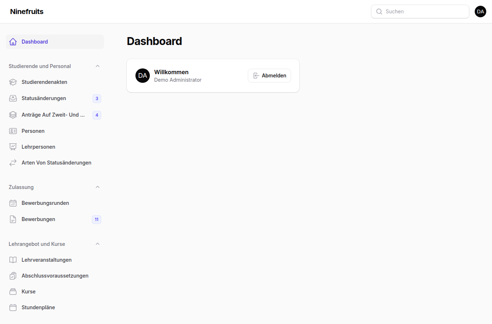
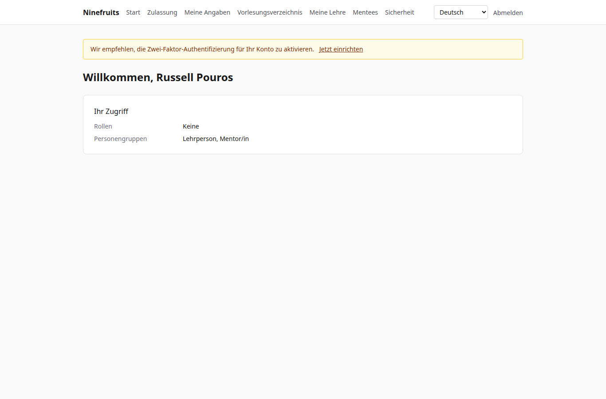
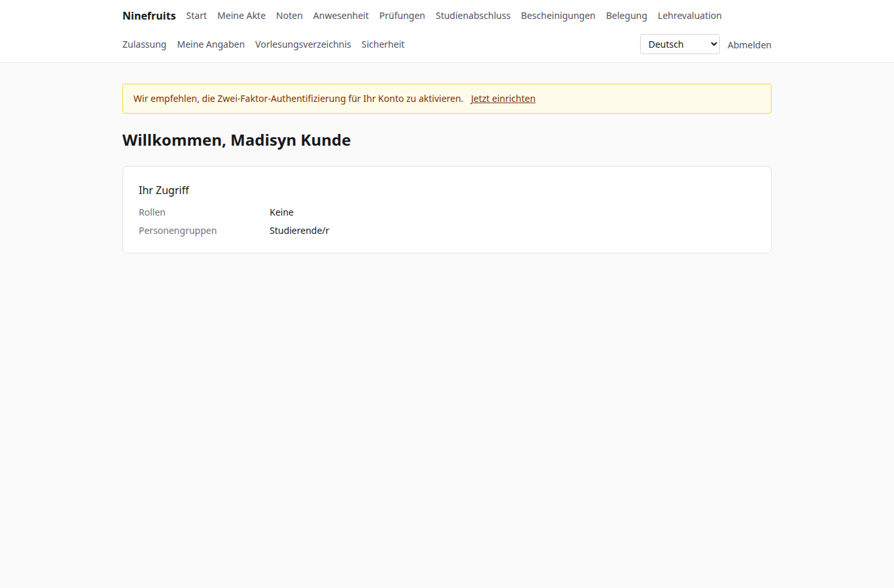

# Ninefruits — Studierendenverwaltungssystem

**Languages / 언어**

| Sprache | README | Handbuch |
|---|---|---|
| 한국어 | [README.md](README.md) | [docs/manual/ko/](docs/manual/ko/README.md) |
| English | [README.en.md](README.en.md) | [docs/manual/en/](docs/manual/en/README.md) |
| 简体中文 | [README.zh_CN.md](README.zh_CN.md) | [docs/manual/zh_CN/](docs/manual/zh_CN/README.md) |
| ລາວ | [README.lo.md](README.lo.md) | [docs/manual/lo/](docs/manual/lo/README.md) |
| Deutsch | [README.de.md](README.de.md) (diese Datei) | [docs/manual/de/](docs/manual/de/README.md) |
| Filipino | [README.fil.md](README.fil.md) | [docs/manual/fil/](docs/manual/fil/README.md) |
| Français | [README.fr.md](README.fr.md) | [docs/manual/fr/](docs/manual/fr/README.md) |
| 日本語 | [README.ja.md](README.ja.md) | [docs/manual/ja/](docs/manual/ja/README.md) |
| Монгол | [README.mn.md](README.mn.md) | [docs/manual/mn/](docs/manual/mn/README.md) |
| Bahasa Melayu | [README.ms.md](README.ms.md) | [docs/manual/ms/](docs/manual/ms/README.md) |
| नेपाली | [README.ne.md](README.ne.md) | [docs/manual/ne/](docs/manual/ne/README.md) |
| Русский | [README.ru.md](README.ru.md) | [docs/manual/ru/](docs/manual/ru/README.md) |
| ไทย | [README.th.md](README.th.md) | [docs/manual/th/](docs/manual/th/README.md) |
| Türkçe | [README.tr.md](README.tr.md) | [docs/manual/tr/](docs/manual/tr/README.md) |
| Oʻzbek | [README.uz.md](README.uz.md) | [docs/manual/uz/](docs/manual/uz/README.md) |
| Tiếng Việt | [README.vi.md](README.vi.md) | [docs/manual/vi/](docs/manual/vi/README.md) |

Wie Sie eine weitere Sprache hinzufügen, steht unter [Adding a language](docs/development/adding-a-language.md).

Ninefruits ist ein Studierendenverwaltungssystem, das jede Universität installieren kann. Es deckt den Kern der akademischen Verwaltung ab — Zulassung, Studierendenakten, Lehrangebot und Kurse, Belegung, Noten, Lehrevaluation, Bescheinigungen, Sprach- und Abschlussprüfungen, Anwesenheit, Prüfung der Abschlussvoraussetzungen, Berichte und eine Grundlage für die LMS-Anbindung — mit Oberflächen und Dokumenten in den oben aufgeführten 16 Sprachen.

## Auf einen Blick

Die Startseite von drei Rollen (Demodaten).

| Administration (Verwaltungsoberfläche) | Lehrperson (Portal) | Studierende (Portal) |
|---|---|---|
|  |  |  |

- **Verwaltungsoberfläche** `/admin`: Die Mitarbeitenden bearbeiten Akten, Studienangelegenheiten, Zulassung, Bescheinigungen, Prüfungen, Studienabschluss und Berichte. Berechtigungen ergeben sich aus Rollenvorlagen (Studierendensekretariat, Lehrplanung, Bescheinigungsstelle, Institutssekretariat, Zulassungsstelle, Systemadministration), deren Geltungsbereich auf Organisationseinheiten oder Studiengänge beschränkt ist.
- **Portal** `/portal`: Studierende belegen Kurse und sehen Noten, Anwesenheit, Prüfungen, Abschlussvoraussetzungen und Bescheinigungen; Lehrpersonen verwalten die Teilnehmerlisten, die Anwesenheit, die Noteneingabe und die Evaluationsergebnisse ihrer Kurse; Bewerbende reichen ihre Bewerbung ein. Ein Konto kann mehreren Personengruppen angehören.

## Funktionen

| Bereich | Inhalt |
|---|---|
| Benutzer und Sicherheit | Gemeinsame Anmeldung, Zwei-Faktor-Authentifizierung (App, E-Mail), Rollen mit Geltungsbereich auf Organisationseinheit/Studiengang, Protokollierung von Daten und fachlichen Vorgängen, Row Level Security, verschlüsselte personenbezogene Daten |
| Personen und Akten | Trennung von Person und Akte, Regeln für Matrikelnummern, Statusänderungen (Beurlaubung, Rückkehr, Exmatrikulation auf Antrag, Exmatrikulation von Amts wegen, Wiederaufnahme, Studienabschluss) mit Genehmigung, Mentor/innen, Zweitfächer und Nebenfächer |
| Zulassung | Bewerbungsrunden, Online-Bewerbungen mit Unterlagen, Begutachtung und Entscheidung, Anlage von Studierendenakten für zugelassene Bewerbende |
| Lehrangebot | Versionen von Lehrveranstaltungen, Voraussetzungen und äquivalente Lehrveranstaltungen, Abschlussvoraussetzungen je Studienordnungsjahr, Kurse, Stundenpläne, Kurspläne |
| Belegung | Regelwerke, Leistungspunkte-Obergrenzen, Kapazitäten und Wartelisten, Sperren und Regelausnahmen, ausgelegt für die Belegungsspitze |
| Noten | Absolute und relative Bewertung, Notenobergrenzen, Einreichung und Freigabe, Genehmigung von Notenänderungen, Notendurchschnitt und Wiederholungen, Semesterabschluss (Studienwarnungen, Auszeichnungen), Notenspiegel |
| Lehrevaluation | Anonyme Antworten, Evaluationsbögen und Fragen, Mindestanzahl an Antworten, Veröffentlichung, Sperre der Notenansicht bis zur Teilnahme |
| Bescheinigungen | Bescheinigungsarten und Vorlagen je Sprache, Seriennummern, gespeicherte PDFs, öffentliche Prüfseite mit QR-Code |
| Prüfungen | Prüfungsarten mit Bereichen und Bestehensregeln, Anmeldung zu Prüfungsterminen, Ergebniseingabe, CSV, Veröffentlichung, Korrekturen, externe Ergebnisse |
| Anwesenheit | Kurstermine aus den wöchentlichen Kurszeiten, Erfassung der Anwesenheit, Anwesenheitsliste als PDF, Teilnehmerliste als CSV |
| Studienabschluss | Prüfung der Abschlussvoraussetzungen, gespeicherte Prüfungen, Erlass von Anforderungen (Vier-Augen-Prinzip), Studienabschluss mit Urkundennummern |
| Berichte | Sieben Standardberichte mit CSV, `reporting`-Views für BI |
| Grundlage der LMS-Anbindung | Plattformen, Kursverknüpfungen, Synchronisationsprotokolle, ereignisgesteuerte Synchronisation, nächtlicher Abgleich, LMS-Punkte als Notenentwurf |

## Technologie

PHP 8.5, Laravel 13, Filament 5 (Verwaltungsoberfläche), Livewire 4 (Portal), PostgreSQL 18 (RLS, Protokoll), Redis und Horizon (Queues), Gotenberg (PDF), Fortify (Anmeldung, 2FA). Entwicklung und Demo laufen auf Docker (Laravel Sail).

## Installation (Demoseite)

Auf dem Host wird nur Docker benötigt; PHP und Composer laufen in Containern.

```bash
# 1. Dependencies
docker run --rm -u "$(id -u):$(id -g)" -v "$PWD":/app -w /app composer:latest \
    composer install --ignore-platform-req='ext-*'

# 2. Environment file
cp .env.example .env
printf '\nWWWUSER=%s\nWWWGROUP=%s\n' "$(id -u)" "$(id -g)" >> .env

# 3. Containers (database roles are created on first start)
./vendor/bin/sail up -d

# 4. Keys
./vendor/bin/sail artisan key:generate
./vendor/bin/sail artisan pii:generate-key   # put the two printed values in .env

# 5. Install: migrations, essential data, institution settings, first administrator, grade scale
./vendor/bin/sail artisan setup:install --profile=korean-university --grade-scale=4.5

# 6. Demo data and demo accounts per role
./vendor/bin/sail artisan setup:demo --size=small --seed=42

# 7. Assets
./vendor/bin/sail npm install && ./vendor/bin/sail npm run build
```

- Portal: http://localhost/portal · Verwaltungsoberfläche: http://localhost/admin (dieselbe Anmeldung)
- Mail (Mailpit): http://localhost:8025 · Queues (Horizon): http://localhost/horizon

### Demokonten

Alle Passwörter lauten `demo-password` (`config/setup.php`). Die Zwei-Faktor-Authentifizierung ist ausgeschaltet.

| Konto | Rolle / Personengruppe | Startseite |
|---|---|---|
| system-administrator@demo.test | Systemadministration (alle Berechtigungen) | /admin |
| registrar@demo.test | Studierendensekretariat (Akten, Belegung, Notenfreigabe, Bescheinigungen, Prüfungen, Studienabschluss, Berichte) | /admin |
| academic-affairs@demo.test | Lehrplanung (Lehrveranstaltungen, Kurse, Stundenpläne, Bewertungsrichtlinien, Evaluation, Kurstermine) | /admin |
| certificate-officer@demo.test | Bescheinigungsstelle | /admin |
| department-assistant@demo.test | Institutssekretariat (Ansichten im Geltungsbereich der Organisationseinheit, Mentor/innen, Berichte) | /admin |
| admissions-officer@demo.test | Zulassungsstelle | /admin |
| instructor@demo.test | Lehrperson und Mentor/in (Kurse, Anwesenheit, Noteneingabe, Mentees) | /portal |
| student@demo.test | Eingeschriebene/r Studierende/r | /portal |
| alumni@demo.test | Absolvent/in | /portal |
| readmitted@demo.test | Erneut aufgenommene/r Absolvent/in (zwei Akten) | /portal |
| applicant@demo.test | Bewerber/in | /portal |
| admitted@demo.test | Zugelassene/r Bewerber/in | /portal |

Die Demo ist eine fiktive Universität (Profil einer koreanischen Universität) mit Studierenden, Lehrpersonen, Lehrveranstaltungen, Kursen, Belegungen, Noten, Evaluationen, Bescheinigungen, Prüfungen, Anwesenheit, Prüfungen der Abschlussvoraussetzungen und LMS-Verknüpfungen. Spielen Sie sie nie in der Produktion ein (`setup:demo` verweigert dies).

## Dokumentation

- [Administratorhandbuch](docs/manual/de/README.md) (koreanisches Original: [docs/manual/ko/](docs/manual/ko/README.md))
- Betrieb: [Installation](docs/manual/de/operations/installation.md), [Befehle](docs/manual/de/operations/commands.md), [zeitgesteuerte Jobs](docs/manual/de/operations/scheduled-jobs.md), [Sicherung und Wiederherstellung](docs/manual/de/operations/backup-restore.md), [Sicherheitsschlüssel](docs/manual/de/operations/security-keys.md), [Fehlerbehebung](docs/manual/de/operations/troubleshooting.md)
- [Leitfaden zur LMS-Anbindung](docs/lms-integration-guide.md)
- [Entwicklungskonventionen](docs/development/)
- Portierungsverlauf und Designentscheidungen (Referenz): [porting/](porting/README.md)

## Produktionsdatenbank

Ein Superuser führt dies einmalig aus.

```bash
psql -v migrator_password=... -v runtime_password=... -v reporting_password=... \
     -f database/sql/roles/create_roles.sql
psql -d <database> -f database/sql/roles/prepare_database.sql
```

Die Anwendung verbindet sich als `app_runtime` (Row Level Security gilt), Migrationen als `app_migrator`, BI-Werkzeuge als `app_reporting` (Reporting-Views). Siehe das [Installationshandbuch](docs/manual/de/operations/installation.md).

## Alltägliche Befehle

| Befehl | Wirkung |
|---|---|
| `sail composer check` | Pint, Larastan, Prüfung der Namenskonventionen, fehlende Übersetzungen, Tests (wie in der CI) |
| `sail pest` | Tests |
| `sail artisan migrate` | Migrationen (verwendet automatisch die Verbindung `app_migrator`) |
| `sail artisan setup:install`, `setup:demo` | Installation/Update, Demodaten |
| `sail artisan system:health-check` | Einstellungen, Schlüssel, Datenbankrollen, Queue, Redis, Gotenberg, Speicher, Scheduler |
| `sail artisan security:sync-permissions` | Berechtigungskatalog aus dem Code mit der Datenbank synchronisieren |
| `sail artisan i18n:missing` | Fehlende Übersetzungen (`i18n:export`/`i18n:import` für die Zusammenarbeit mit Übersetzenden) |

Die vollständige Liste steht in der [Befehlsreferenz](docs/manual/de/operations/commands.md).

## Lizenz

[MIT-Lizenz](LICENSE). Freie Nutzung, Änderung und Weitergabe; Urheberrechtsvermerk und Lizenztext müssen erhalten bleiben.

---

**Danksagung**

Unser Dank gilt YUSTIC, dem akademischen Verwaltungssystem der Yanbian University of Science and Technology, das dieses System erst möglich gemacht hat. YUSTIC war das Werk eines kleinen Entwicklerteams, das über viele Jahre gemeinsam geträumt, geschwitzt und gebaut hat. Mit diesem System möchten wir zum Ausdruck bringen, wie sehr wir die Kolleginnen und Kollegen, mit denen wir gearbeitet haben, vermissen, respektieren und ihnen danken.
