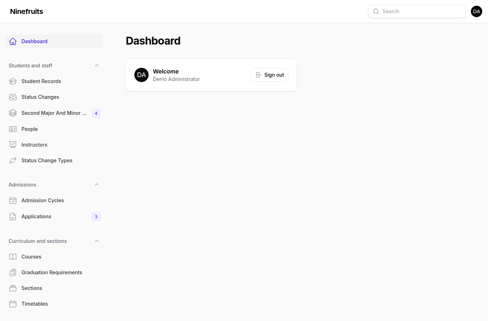
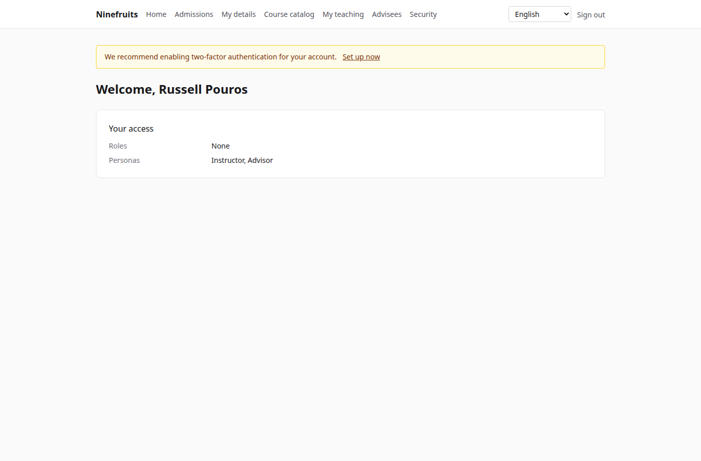
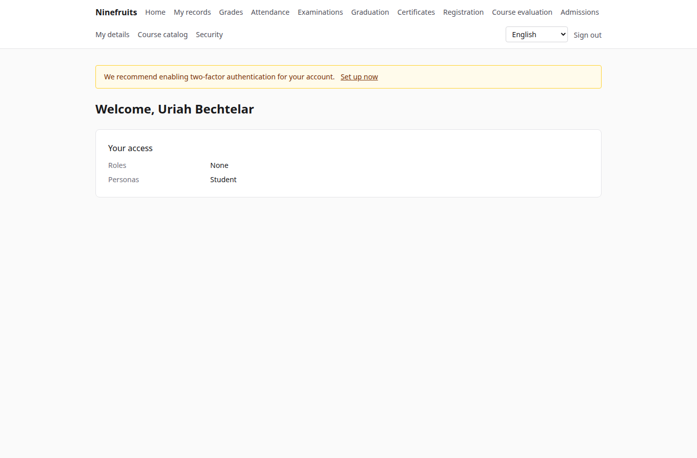

# Ninefruits — Student Information System

**언어 / Languages / 语言 / ພາສາ**

| Language | README | Manual |
|---|---|---|
| 한국어 | [README.md](README.md) | [docs/manual/ko/](docs/manual/ko/README.md) |
| English | [README.en.md](README.en.md) (this file) | [docs/manual/en/](docs/manual/en/README.md) |
| 简体中文 | [README.zh_CN.md](README.zh_CN.md) | [docs/manual/zh_CN/](docs/manual/zh_CN/README.md) |
| ລາວ | [README.lo.md](README.lo.md) | [docs/manual/lo/](docs/manual/lo/README.md) |

To add another language, see [Adding a language](docs/development/adding-a-language.md).

Ninefruits is a student information system that any university can install. It covers the core of academic administration — admissions, student records, curriculum and sections, registration, grades, course evaluation, certificates, language and comprehensive examinations, attendance, degree audits, reports and an LMS integration base — with screens and documents in Korean, English, Simplified Chinese and Lao.

## At a glance

The first screen of three roles (demo data).

| Administrator (admin panel) | Instructor (portal) | Student (portal) |
|---|---|---|
|  |  |  |

- **Admin panel** `/admin`: staff handle records, academic affairs, admissions, certificates, examinations, graduation and reports. Permissions come from role templates (registrar, academic affairs, certificate officer, department assistant, admissions officer, system administrator) scoped to units or programs.
- **Portal** `/portal`: students register, see grades, attendance, examinations, graduation requirements and certificates; instructors manage their sections' rosters, attendance, grade entry and evaluation results; applicants apply. One account can hold several personas.

## Features

| Area | Contents |
|---|---|
| Users and security | Shared sign-in, two-factor authentication (app, email), roles with unit/program scope, data and business audit, row level security, encrypted personal data |
| People and records | Person/record separation, student number rules, status changes (leave, return, withdrawal, dismissal, readmission, graduation) with approval, advisors, second majors and minors |
| Admissions | Cycles, online applications with documents, review and decisions, record creation for admitted applicants |
| Curriculum | Course versions, prerequisites and equivalents, graduation requirements per catalog year, sections, timetables, syllabi |
| Registration | Rule sets, credit limits, capacity and waitlists, holds and overrides, designed for the registration peak |
| Grades | Absolute and relative evaluation, grade caps, submission and finalization, change approval, GPA and retakes, term close (warnings, honors), transcripts |
| Course evaluation | Anonymous responses, forms and questions, minimum responses, publication, grade view block until completed |
| Certificates | Kinds and templates per language, serial numbers, stored PDFs, public verification page with QR |
| Examinations | Kinds with areas and pass rules, session registration, result entry, CSV, publication, corrections, external results |
| Attendance | Class meetings from the weekly times, attendance entry, attendance sheet PDF, roster CSV |
| Graduation | Degree audits, stored audits, requirement waivers (two-person rule), graduation with degree numbers |
| Reports | Seven standard reports with CSV, `reporting` views for BI |
| LMS integration base | Platforms, course links, sync logs, event-driven sync, nightly reconcile, LMS scores as a grade draft |

## Stack

PHP 8.5, Laravel 13, Filament 5 (admin panel), Livewire 4 (portal), PostgreSQL 18 (RLS, audit), Redis and Horizon (queues), Gotenberg (PDF), Fortify (sign-in, 2FA). Development and demo run on Docker (Laravel Sail).

## Install (demo site)

Only Docker is needed on the host; PHP and Composer run in containers.

```bash
# 1. Dependencies
docker run --rm -u "$(id -u):$(id -g)" -v "$PWD":/app -w /app composer:latest \
    composer install --ignore-platform-req='ext-*'

# 2. Environment file
cp .env.example .env
printf '\nWWWUSER=%s\nWWWGROUP=%s\n' "$(id -u)" "$(id -g)" >> .env

# 3. Containers (database roles are created on first start)
./vendor/bin/sail up -d

# 4. Keys
./vendor/bin/sail artisan key:generate
./vendor/bin/sail artisan pii:generate-key   # put the two printed values in .env

# 5. Install: migrations, essential data, institution settings, first administrator, grade scale
./vendor/bin/sail artisan setup:install --profile=korean-university --grade-scale=4.5

# 6. Demo data and demo accounts per role
./vendor/bin/sail artisan setup:demo --size=small --seed=42

# 7. Assets
./vendor/bin/sail npm install && ./vendor/bin/sail npm run build
```

- Portal: http://localhost/portal · Admin panel: http://localhost/admin (same sign-in)
- Mail (Mailpit): http://localhost:8025 · Queues (Horizon): http://localhost/horizon

### Demo accounts

Every password is `demo-password` (`config/setup.php`). Two-factor authentication is off.

| Account | Role / persona | First screen |
|---|---|---|
| system-administrator@demo.test | System administrator (every permission) | /admin |
| registrar@demo.test | Registrar (records, registration, grade finalization, certificates, examinations, graduation, reports) | /admin |
| academic-affairs@demo.test | Academic affairs (courses, sections, timetables, grading policy, evaluation, class meetings) | /admin |
| certificate-officer@demo.test | Certificate officer | /admin |
| department-assistant@demo.test | Department assistant (unit-scoped views, advisors, reports) | /admin |
| admissions-officer@demo.test | Admissions officer | /admin |
| instructor@demo.test | Instructor and advisor (sections, attendance, grade entry, advisees) | /portal |
| student@demo.test | Current student | /portal |
| alumni@demo.test | Graduate | /portal |
| readmitted@demo.test | Graduate admitted again (two records) | /portal |
| applicant@demo.test | Applicant | /portal |
| admitted@demo.test | Admitted applicant | /portal |

The demo is one fictional university (Korean university profile) with students, instructors, courses, sections, enrollments, grades, evaluations, certificates, examinations, attendance, degree audits and LMS links. Never seed it in production (`setup:demo` refuses).

## Documentation

- [Administrator manual](docs/manual/en/README.md) (Korean original: [docs/manual/ko/](docs/manual/ko/README.md))
- Operations: [installation](docs/manual/ko/operations/installation.md), [commands](docs/manual/ko/operations/commands.md), [scheduled jobs](docs/manual/ko/operations/scheduled-jobs.md), [backup and restore](docs/manual/ko/operations/backup-restore.md), [security keys](docs/manual/ko/operations/security-keys.md), [troubleshooting](docs/manual/ko/operations/troubleshooting.md)
- [LMS integration guide](docs/lms-integration-guide.md)
- [Development conventions](docs/development/)
- Porting history and design decisions (reference): [porting/](porting/README.md)

## Production database

A superuser runs this once.

```bash
psql -v migrator_password=... -v runtime_password=... -v reporting_password=... \
     -f database/sql/roles/create_roles.sql
psql -d <database> -f database/sql/roles/prepare_database.sql
```

The application connects as `app_runtime` (row level security applies), migrations as `app_migrator`, BI tools as `app_reporting` (reporting views). See the [installation manual](docs/manual/ko/operations/installation.md).

## Everyday commands

| Command | What it does |
|---|---|
| `sail composer check` | Pint, Larastan, naming check, missing translations, tests (same as CI) |
| `sail pest` | Tests |
| `sail artisan migrate` | Migrations (uses the `app_migrator` connection automatically) |
| `sail artisan setup:install`, `setup:demo` | Install/update, demo data |
| `sail artisan system:health-check` | Settings, keys, database roles, queue, Redis, Gotenberg, storage, scheduler |
| `sail artisan security:sync-permissions` | Sync the permission catalog from code to the database |
| `sail artisan i18n:missing` | Missing translations (`i18n:export`/`i18n:import` to work with translators) |

The full list is in the [command reference](docs/manual/ko/operations/commands.md).

## License

[MIT License](LICENSE). Use, modify and distribute freely; keep the copyright notice and the license text.

---

**Acknowledgement**

Our thanks go to YUSTIC, the academic administration system of Yanbian University of Science and Technology, which made this system possible. YUSTIC was the work of a small team of developers who dreamed, sweated and built together over many years. This system is our way of saying how much we miss, respect and thank the colleagues we worked with.
