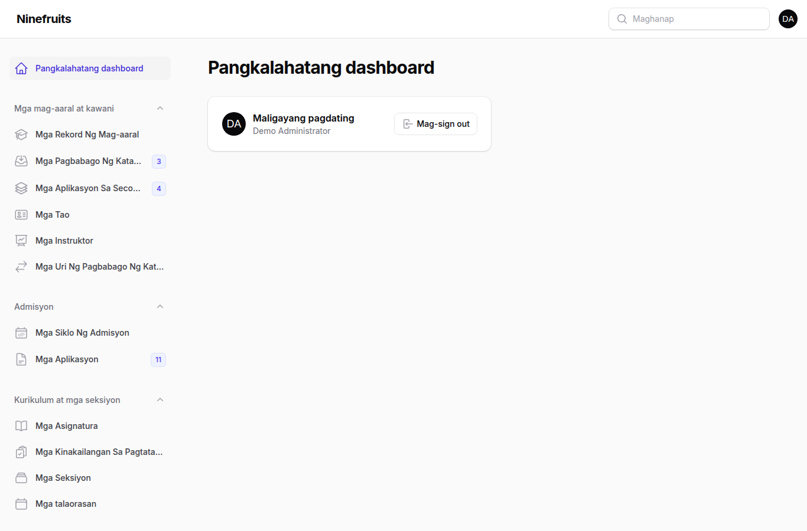
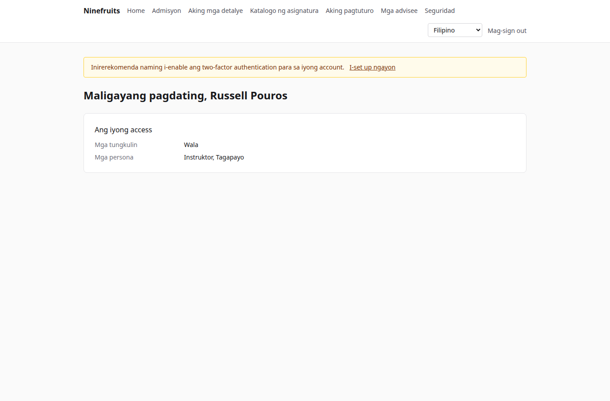
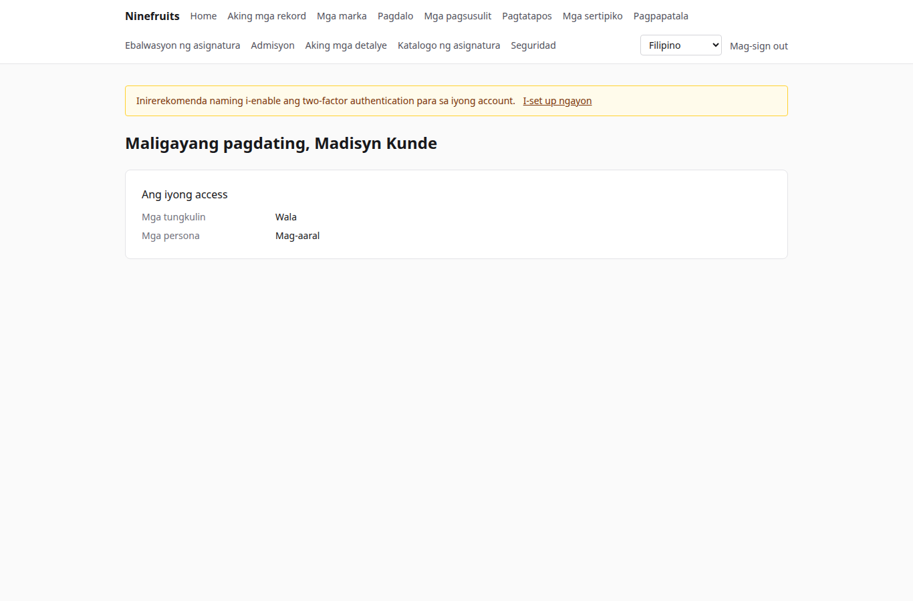

# Ninefruits — Student Information System

**Mga wika / 언어**

| Wika | README | Manwal |
|---|---|---|
| 한국어 | [README.md](README.md) | [docs/manual/ko/](docs/manual/ko/README.md) |
| English | [README.en.md](README.en.md) | [docs/manual/en/](docs/manual/en/README.md) |
| 简体中文 | [README.zh_CN.md](README.zh_CN.md) | [docs/manual/zh_CN/](docs/manual/zh_CN/README.md) |
| ລາວ | [README.lo.md](README.lo.md) | [docs/manual/lo/](docs/manual/lo/README.md) |
| Deutsch | [README.de.md](README.de.md) | [docs/manual/de/](docs/manual/de/README.md) |
| Filipino | [README.fil.md](README.fil.md) (ang file na ito) | [docs/manual/fil/](docs/manual/fil/README.md) |
| Français | [README.fr.md](README.fr.md) | [docs/manual/fr/](docs/manual/fr/README.md) |
| 日本語 | [README.ja.md](README.ja.md) | [docs/manual/ja/](docs/manual/ja/README.md) |
| Монгол | [README.mn.md](README.mn.md) | [docs/manual/mn/](docs/manual/mn/README.md) |
| Bahasa Melayu | [README.ms.md](README.ms.md) | [docs/manual/ms/](docs/manual/ms/README.md) |
| नेपाली | [README.ne.md](README.ne.md) | [docs/manual/ne/](docs/manual/ne/README.md) |
| Русский | [README.ru.md](README.ru.md) | [docs/manual/ru/](docs/manual/ru/README.md) |
| ไทย | [README.th.md](README.th.md) | [docs/manual/th/](docs/manual/th/README.md) |
| Türkçe | [README.tr.md](README.tr.md) | [docs/manual/tr/](docs/manual/tr/README.md) |
| Oʻzbek | [README.uz.md](README.uz.md) | [docs/manual/uz/](docs/manual/uz/README.md) |
| Tiếng Việt | [README.vi.md](README.vi.md) | [docs/manual/vi/](docs/manual/vi/README.md) |

Upang magdagdag ng isa pang wika, tingnan ang [Adding a language](docs/development/adding-a-language.md).

Ang Ninefruits ay isang student information system na maaaring i-install ng anumang unibersidad. Saklaw nito ang ubod ng akademikong administrasyon — admisyon, mga rekord ng mag-aaral, kurikulum at mga seksiyon, pagpapatala, mga marka, ebalwasyon ng asignatura, mga sertipiko, mga pagsusulit sa wika at comprehensive examination, pagdalo, mga degree audit, mga ulat at batayan para sa integrasyon ng LMS — na may mga screen at dokumento sa 16 na wikang nakalista sa itaas.

## Sa isang sulyap

Ang unang screen ng tatlong tungkulin (demo data).

| Administrator (panel ng administrasyon) | Instruktor (portal) | Mag-aaral (portal) |
|---|---|---|
|  |  |  |

- **Panel ng administrasyon** `/admin`: hinahawakan ng mga kawani ang mga rekord, akademikong gawain, admisyon, mga sertipiko, mga pagsusulit, pagtatapos at mga ulat. Nagmumula ang mga pahintulot sa mga template ng tungkulin (Registrar, Academic Affairs, Tagapangasiwa ng Sertipiko, Katuwang ng Departamento, Admissions Officer, Administrator ng Sistema) na may saklaw na mga yunit o programa.
- **Portal** `/portal`: nagpapatala ang mga mag-aaral, tumitingin ng mga marka, pagdalo, mga pagsusulit, mga kinakailangan sa pagtatapos at mga sertipiko; pinamamahalaan ng mga instruktor ang mga roster, pagdalo, pagpasok ng marka at mga resulta ng ebalwasyon ng kanilang mga seksiyon; nag-a-apply ang mga aplikante. Maaaring magkaroon ng ilang persona ang iisang account.

## Mga tampok

| Larangan | Nilalaman |
|---|---|
| Mga user at seguridad | Iisang pag-sign in, two-factor authentication (app, email), mga tungkuling may saklaw na yunit/programa, audit ng datos at ng operasyon, row level security, naka-encrypt na personal na datos |
| Mga tao at rekord | Paghihiwalay ng tao at rekord, mga panuntunan sa student number, mga pagbabago ng katayuan (leave of absence, pagbalik mula sa leave, pag-withdraw, pagkatanggal, muling pagtanggap, pagtatapos) na may pag-apruba, mga tagapayo, second major at minor |
| Admisyon | Mga siklo, online na aplikasyon na may mga dokumento, pagsusuri at pagpapasya, paggawa ng rekord para sa mga natanggap na aplikante |
| Kurikulum | Mga bersiyon ng asignatura, prerequisite at katumbas na asignatura, mga kinakailangan sa pagtatapos bawat taon ng kurikulum, mga seksiyon, iskedyul ng klase, syllabus |
| Pagpapatala | Mga set ng panuntunan, limitasyon ng units, kapasidad at waitlist, hold at override, idinisenyo para sa rurok ng pagpapatala |
| Mga marka | Absolute at relative na pagmamarka, mga limitasyon ng marka, pagsusumite at paggawang pinal, pag-apruba ng pagbabago, GPA at retake, pagsasara ng termino (academic warning, karangalan), Transcript of Records |
| Ebalwasyon ng asignatura | Anonimong tugon, mga form at tanong, pinakamababang bilang ng tugon, paglalathala, pagharang sa pagtingin ng marka hangga't hindi nakukumpleto |
| Mga sertipiko | Mga uri at template bawat wika, mga serial number, naka-imbak na PDF, pampublikong pahina ng beripikasyon na may QR |
| Mga pagsusulit | Mga uri na may mga bahagi at panuntunan sa pagpasa, pagpaparehistro sa sesyon, pagpasok ng resulta, CSV, paglalathala, pagwawasto, panlabas na resulta |
| Pagdalo | Mga pagkikita ng klase mula sa lingguhang oras ng klase, pagpasok ng pagdalo, PDF ng attendance sheet, CSV ng roster |
| Pagtatapos | Mga degree audit, naka-imbak na audit, waiver ng kinakailangan (panuntunang dalawang tao), pagtatapos na may mga numero ng digri |
| Mga ulat | Pitong karaniwang ulat na may CSV, mga view na `reporting` para sa BI |
| Batayan ng integrasyon ng LMS | Mga platform, link ng asignatura, sync log, sync na pinapagana ng event, gabi-gabing reconcile, mga iskor sa LMS bilang draft ng marka |

## Stack

PHP 8.5, Laravel 13, Filament 5 (panel ng administrasyon), Livewire 4 (portal), PostgreSQL 18 (RLS, audit), Redis at Horizon (mga queue), Gotenberg (PDF), Fortify (pag-sign in, 2FA). Tumatakbo ang development at demo sa Docker (Laravel Sail).

## Pag-install (demo site)

Docker lamang ang kailangan sa host; tumatakbo ang PHP at Composer sa mga container.

```bash
# 1. Dependencies
docker run --rm -u "$(id -u):$(id -g)" -v "$PWD":/app -w /app composer:latest \
    composer install --ignore-platform-req='ext-*'

# 2. Environment file
cp .env.example .env
printf '\nWWWUSER=%s\nWWWGROUP=%s\n' "$(id -u)" "$(id -g)" >> .env

# 3. Containers (database roles are created on first start)
./vendor/bin/sail up -d

# 4. Keys
./vendor/bin/sail artisan key:generate
./vendor/bin/sail artisan pii:generate-key   # put the two printed values in .env

# 5. Install: migrations, essential data, institution settings, first administrator, grade scale
./vendor/bin/sail artisan setup:install --profile=korean-university --grade-scale=4.5

# 6. Demo data and demo accounts per role
./vendor/bin/sail artisan setup:demo --size=small --seed=42

# 7. Assets
./vendor/bin/sail npm install && ./vendor/bin/sail npm run build
```

- Portal: http://localhost/portal · Panel ng administrasyon: http://localhost/admin (parehong pag-sign in)
- Mail (Mailpit): http://localhost:8025 · Mga queue (Horizon): http://localhost/horizon

### Mga demo account

Ang bawat password ay `demo-password` (`config/setup.php`). Naka-off ang two-factor authentication.

| Account | Tungkulin / persona | Unang screen |
|---|---|---|
| system-administrator@demo.test | Administrator ng Sistema (lahat ng pahintulot) | /admin |
| registrar@demo.test | Registrar (mga rekord, pagpapatala, paggawang pinal ng marka, mga sertipiko, mga pagsusulit, pagtatapos, mga ulat) | /admin |
| academic-affairs@demo.test | Academic Affairs (mga asignatura, seksiyon, iskedyul ng klase, patakaran sa pagmamarka, ebalwasyon, mga pagkikita ng klase) | /admin |
| certificate-officer@demo.test | Tagapangasiwa ng Sertipiko | /admin |
| department-assistant@demo.test | Katuwang ng Departamento (mga view na may saklaw na yunit, mga tagapayo, mga ulat) | /admin |
| admissions-officer@demo.test | Admissions Officer | /admin |
| instructor@demo.test | Instruktor at tagapayo (mga seksiyon, pagdalo, pagpasok ng marka, mga advisee) | /portal |
| student@demo.test | Kasalukuyang mag-aaral | /portal |
| alumni@demo.test | Nagtapos | /portal |
| readmitted@demo.test | Nagtapos na muling tinanggap (dalawang rekord) | /portal |
| applicant@demo.test | Aplikante | /portal |
| admitted@demo.test | Natanggap na aplikante | /portal |

Ang demo ay isang kathang-isip na unibersidad (profile ng unibersidad sa Korea) na may mga mag-aaral, instruktor, asignatura, seksiyon, pagpapatala, marka, ebalwasyon, sertipiko, pagsusulit, pagdalo, degree audit at mga link sa LMS. Huwag itong i-seed kailanman sa production (tumatanggi ang `setup:demo`).

## Dokumentasyon

- [Manwal ng administrator](docs/manual/fil/README.md) (orihinal na Korean: [docs/manual/ko/](docs/manual/ko/README.md))
- Operasyon: [pag-install](docs/manual/fil/operations/installation.md), [mga command](docs/manual/fil/operations/commands.md), [mga naka-iskedyul na job](docs/manual/fil/operations/scheduled-jobs.md), [backup at restore](docs/manual/fil/operations/backup-restore.md), [mga security key](docs/manual/fil/operations/security-keys.md), [pag-troubleshoot](docs/manual/fil/operations/troubleshooting.md)
- [Gabay sa integrasyon ng LMS](docs/lms-integration-guide.md)
- [Mga kumbensiyon sa development](docs/development/)
- Kasaysayan ng porting at mga desisyon sa disenyo (sanggunian): [porting/](porting/README.md)

## Production database

Patakbuhin ito nang isang beses ng isang superuser.

```bash
psql -v migrator_password=... -v runtime_password=... -v reporting_password=... \
     -f database/sql/roles/create_roles.sql
psql -d <database> -f database/sql/roles/prepare_database.sql
```

Kumokonekta ang application bilang `app_runtime` (nalalapat ang row level security), ang mga migration bilang `app_migrator`, ang mga BI tool bilang `app_reporting` (mga reporting view). Tingnan ang [manwal ng pag-install](docs/manual/fil/operations/installation.md).

## Mga pang-araw-araw na command

| Command | Ano ang ginagawa nito |
|---|---|
| `sail composer check` | Pint, Larastan, pagsuri ng pagpapangalan, mga nawawalang salin, mga test (katulad ng CI) |
| `sail pest` | Mga test |
| `sail artisan migrate` | Mga migration (awtomatikong gumagamit ng koneksiyong `app_migrator`) |
| `sail artisan setup:install`, `setup:demo` | Pag-install/update, demo data |
| `sail artisan system:health-check` | Mga setting, key, role ng database, queue, Redis, Gotenberg, storage, scheduler |
| `sail artisan security:sync-permissions` | I-sync ang katalogo ng pahintulot mula sa code papunta sa database |
| `sail artisan i18n:missing` | Mga nawawalang salin (`i18n:export`/`i18n:import` para makipagtulungan sa mga tagasalin) |

Ang buong listahan ay nasa [sanggunian ng mga command](docs/manual/fil/operations/commands.md).

## Lisensiya

[MIT License](LICENSE). Malayang gamitin, baguhin at ipamahagi; panatilihin ang paunawa sa copyright at ang teksto ng lisensiya.

---

**Pasasalamat**

Taos-puso kaming nagpapasalamat sa YUSTIC, ang sistema ng akademikong administrasyon ng Yanbian University of Science and Technology, na naging daan upang mabuo ang sistemang ito. Ang YUSTIC ay bunga ng isang maliit na pangkat ng mga developer na sama-samang nangarap, nagpagal at bumuo sa loob ng maraming taon. Ang sistemang ito ang aming paraan upang ipahayag kung gaano namin nami-miss, iginagalang at pinasasalamatan ang mga kasamahang aming nakatrabaho.
