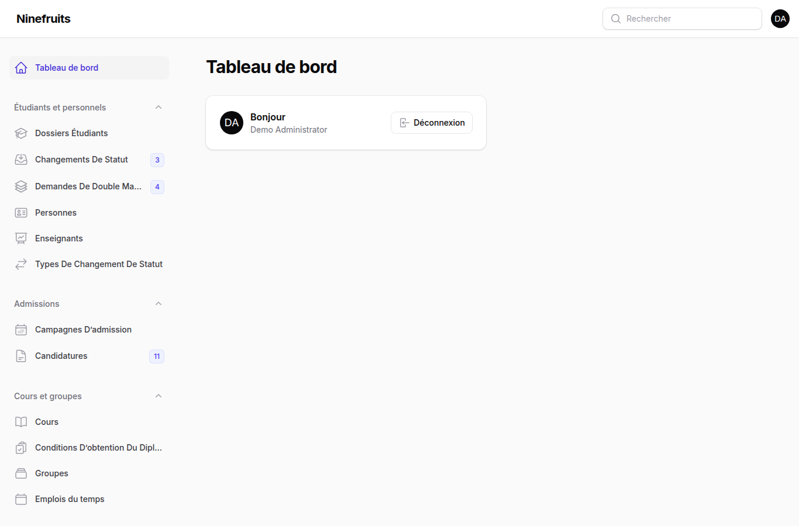
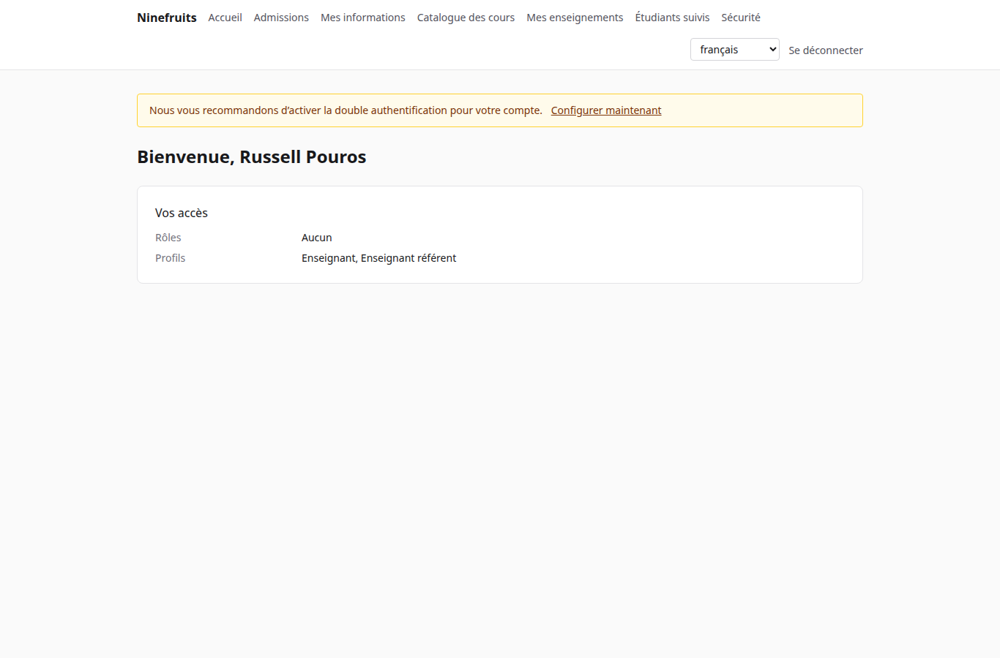
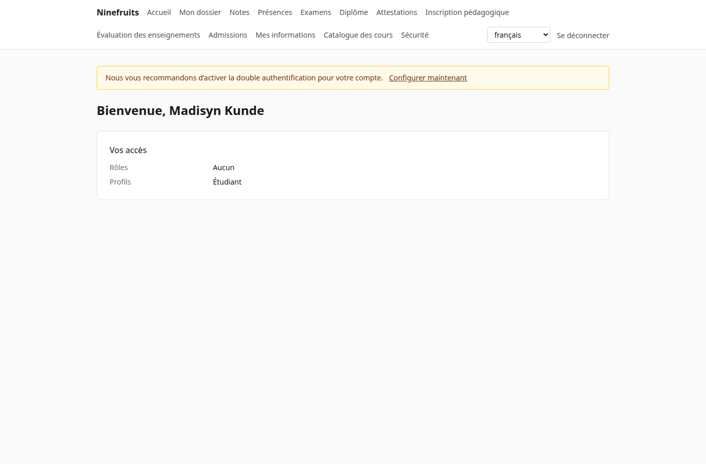

# Ninefruits — Système d’information étudiant

**Languages / 언어**

| Langue | README | Manuel |
|---|---|---|
| 한국어 | [README.md](README.md) | [docs/manual/ko/](docs/manual/ko/README.md) |
| English | [README.en.md](README.en.md) | [docs/manual/en/](docs/manual/en/README.md) |
| 简体中文 | [README.zh_CN.md](README.zh_CN.md) | [docs/manual/zh_CN/](docs/manual/zh_CN/README.md) |
| ລາວ | [README.lo.md](README.lo.md) | [docs/manual/lo/](docs/manual/lo/README.md) |
| Deutsch | [README.de.md](README.de.md) | [docs/manual/de/](docs/manual/de/README.md) |
| Filipino | [README.fil.md](README.fil.md) | [docs/manual/fil/](docs/manual/fil/README.md) |
| Français | [README.fr.md](README.fr.md) (ce fichier) | [docs/manual/fr/](docs/manual/fr/README.md) |
| 日本語 | [README.ja.md](README.ja.md) | [docs/manual/ja/](docs/manual/ja/README.md) |
| Монгол | [README.mn.md](README.mn.md) | [docs/manual/mn/](docs/manual/mn/README.md) |
| Bahasa Melayu | [README.ms.md](README.ms.md) | [docs/manual/ms/](docs/manual/ms/README.md) |
| नेपाली | [README.ne.md](README.ne.md) | [docs/manual/ne/](docs/manual/ne/README.md) |
| Русский | [README.ru.md](README.ru.md) | [docs/manual/ru/](docs/manual/ru/README.md) |
| ไทย | [README.th.md](README.th.md) | [docs/manual/th/](docs/manual/th/README.md) |
| Türkçe | [README.tr.md](README.tr.md) | [docs/manual/tr/](docs/manual/tr/README.md) |
| Oʻzbek | [README.uz.md](README.uz.md) | [docs/manual/uz/](docs/manual/uz/README.md) |
| Tiếng Việt | [README.vi.md](README.vi.md) | [docs/manual/vi/](docs/manual/vi/README.md) |

Pour ajouter une autre langue, voir [Adding a language](docs/development/adding-a-language.md).

Ninefruits est un système d’information étudiant que toute université peut installer. Il couvre le cœur de la gestion académique — admissions, dossiers étudiants, cours et groupes, inscription pédagogique, notes, évaluation des enseignements, attestations, examens de langue et examens généraux, assiduité, vérification du diplôme, rapports et socle d’intégration LMS — avec des écrans et des documents dans les 16 langues indiquées ci-dessus.

## En bref

Le premier écran de trois rôles (données de démonstration).

| Administrateur (panneau d’administration) | Enseignant (portail) | Étudiant (portail) |
|---|---|---|
|  |  |  |

- **Panneau d’administration** `/admin` : le personnel gère les dossiers, les affaires pédagogiques, les admissions, les attestations, les examens, la diplomation et les rapports. Les autorisations proviennent de modèles de rôles (Scolarité, Affaires pédagogiques, Responsable des attestations, Gestionnaire de département, Chargé des admissions, Administrateur système) dont le périmètre porte sur des unités organisationnelles ou des formations.
- **Portail** `/portal` : les étudiants s’inscrivent, consultent leurs notes, leur assiduité, leurs examens, leurs conditions d’obtention du diplôme et leurs attestations ; les enseignants gèrent les listes d’étudiants de leurs groupes, l’assiduité, la saisie des notes et les résultats d’évaluation ; les candidats déposent leur candidature. Un même compte peut réunir plusieurs profils.

## Fonctionnalités

| Domaine | Contenu |
|---|---|
| Utilisateurs et sécurité | Connexion commune, double authentification (application, e-mail), rôles avec périmètre par unité/formation, audit des données et des opérations métier, sécurité au niveau des lignes, données personnelles chiffrées |
| Personnes et dossiers | Séparation personne/dossier, règles de numérotation des étudiants, changements de statut (congé, reprise d’études, abandon, exclusion, réadmission, diplomation) avec approbation, enseignants référents, doubles majeures et mineures |
| Admissions | Campagnes, candidatures en ligne avec pièces jointes, examen et décisions, création des dossiers des candidats admis |
| Cours | Versions de cours, prérequis et cours équivalents, conditions d’obtention du diplôme par année de catalogue, groupes, emplois du temps, syllabus |
| Inscription pédagogique | Jeux de règles, plafonds de crédits, capacité et listes d’attente, blocages et dérogations, conçue pour le pic d’inscription |
| Notes | Évaluation absolue et relative, plafonds de notes, soumission et validation, approbation des modifications, moyenne et reprises, clôture du semestre (avertissements, tableau d’honneur), relevés de notes |
| Évaluation des enseignements | Réponses anonymes, questionnaires et questions, nombre minimal de réponses, publication, consultation des notes bloquée tant que l’évaluation n’est pas faite |
| Attestations | Types et modèles par langue, numéros de série, PDF archivés, page publique de vérification avec QR code |
| Examens | Types avec épreuves et règles de réussite, inscription aux sessions, saisie des résultats, CSV, publication, corrections, résultats externes |
| Assiduité | Séances générées à partir des horaires hebdomadaires, saisie des présences, feuille de présence en PDF, liste d’étudiants en CSV |
| Diplomation | Vérifications du diplôme, vérifications archivées, dispenses de condition (règle des deux personnes), diplomation avec numéros de diplôme |
| Rapports | Sept rapports standard avec CSV, vues `reporting` pour la BI |
| Socle d’intégration LMS | Plateformes, liens de cours, journaux de synchronisation, synchronisation déclenchée par événements, rapprochement nocturne, scores LMS comme brouillon de notes |

## Pile technique

PHP 8.5, Laravel 13, Filament 5 (panneau d’administration), Livewire 4 (portail), PostgreSQL 18 (RLS, audit), Redis et Horizon (files d’attente), Gotenberg (PDF), Fortify (connexion, 2FA). Le développement et la démonstration tournent sous Docker (Laravel Sail).

## Installation (site de démonstration)

Seul Docker est nécessaire sur l’hôte ; PHP et Composer s’exécutent dans des conteneurs.

```bash
# 1. Dependencies
docker run --rm -u "$(id -u):$(id -g)" -v "$PWD":/app -w /app composer:latest \
    composer install --ignore-platform-req='ext-*'

# 2. Environment file
cp .env.example .env
printf '\nWWWUSER=%s\nWWWGROUP=%s\n' "$(id -u)" "$(id -g)" >> .env

# 3. Containers (database roles are created on first start)
./vendor/bin/sail up -d

# 4. Keys
./vendor/bin/sail artisan key:generate
./vendor/bin/sail artisan pii:generate-key   # put the two printed values in .env

# 5. Install: migrations, essential data, institution settings, first administrator, grade scale
./vendor/bin/sail artisan setup:install --profile=korean-university --grade-scale=4.5

# 6. Demo data and demo accounts per role
./vendor/bin/sail artisan setup:demo --size=small --seed=42

# 7. Assets
./vendor/bin/sail npm install && ./vendor/bin/sail npm run build
```

- Portail : http://localhost/portal · Panneau d’administration : http://localhost/admin (même connexion)
- Messagerie (Mailpit) : http://localhost:8025 · Files d’attente (Horizon) : http://localhost/horizon

### Comptes de démonstration

Tous les mots de passe sont `demo-password` (`config/setup.php`). La double authentification est désactivée.

| Compte | Rôle / profil | Premier écran |
|---|---|---|
| system-administrator@demo.test | Administrateur système (toutes les autorisations) | /admin |
| registrar@demo.test | Scolarité (dossiers, inscription pédagogique, validation des notes, attestations, examens, diplomation, rapports) | /admin |
| academic-affairs@demo.test | Affaires pédagogiques (cours, groupes, emplois du temps, politique de notation, évaluation, séances) | /admin |
| certificate-officer@demo.test | Responsable des attestations | /admin |
| department-assistant@demo.test | Gestionnaire de département (consultations limitées à l’unité, enseignants référents, rapports) | /admin |
| admissions-officer@demo.test | Chargé des admissions | /admin |
| instructor@demo.test | Enseignant et enseignant référent (groupes, assiduité, saisie des notes, étudiants suivis) | /portal |
| student@demo.test | Étudiant inscrit | /portal |
| alumni@demo.test | Diplômé | /portal |
| readmitted@demo.test | Diplômé admis de nouveau (deux dossiers) | /portal |
| applicant@demo.test | Candidat | /portal |
| admitted@demo.test | Candidat admis | /portal |

La démonstration représente une université fictive (profil d’université coréenne) avec des étudiants, des enseignants, des cours, des groupes, des inscriptions, des notes, des évaluations, des attestations, des examens, l’assiduité, des vérifications du diplôme et des liens LMS. Ne l’injectez jamais en production (`setup:demo` refuse de s’exécuter).

## Documentation

- [Manuel d’administration](docs/manual/fr/README.md) (original coréen : [docs/manual/ko/](docs/manual/ko/README.md))
- Exploitation : [installation](docs/manual/fr/operations/installation.md), [commandes](docs/manual/fr/operations/commands.md), [tâches planifiées](docs/manual/fr/operations/scheduled-jobs.md), [sauvegarde et restauration](docs/manual/fr/operations/backup-restore.md), [clés de sécurité](docs/manual/fr/operations/security-keys.md), [dépannage](docs/manual/fr/operations/troubleshooting.md)
- [Guide d’intégration LMS](docs/lms-integration-guide.md)
- [Conventions de développement](docs/development/)
- Historique du portage et décisions de conception (référence) : [porting/](porting/README.md)

## Base de données de production

Un superutilisateur exécute ceci une seule fois.

```bash
psql -v migrator_password=... -v runtime_password=... -v reporting_password=... \
     -f database/sql/roles/create_roles.sql
psql -d <database> -f database/sql/roles/prepare_database.sql
```

L’application se connecte en tant que `app_runtime` (la sécurité au niveau des lignes s’applique), les migrations en tant que `app_migrator`, les outils de BI en tant que `app_reporting` (vues de reporting). Voir le [manuel d’installation](docs/manual/fr/operations/installation.md).

## Commandes courantes

| Commande | Rôle |
|---|---|
| `sail composer check` | Pint, Larastan, contrôle du nommage, traductions manquantes, tests (comme en CI) |
| `sail pest` | Tests |
| `sail artisan migrate` | Migrations (utilise automatiquement la connexion `app_migrator`) |
| `sail artisan setup:install`, `setup:demo` | Installation/mise à jour, données de démonstration |
| `sail artisan system:health-check` | Paramètres, clés, rôles de base de données, file d’attente, Redis, Gotenberg, stockage, planificateur |
| `sail artisan security:sync-permissions` | Synchronise le catalogue d’autorisations du code vers la base de données |
| `sail artisan i18n:missing` | Traductions manquantes (`i18n:export`/`i18n:import` pour travailler avec les traducteurs) |

La liste complète figure dans la [référence des commandes](docs/manual/fr/operations/commands.md).

## Licence

[Licence MIT](LICENSE). Utilisation, modification et distribution libres ; conservez la mention de droit d’auteur et le texte de la licence.

---

**Remerciements**

Nous remercions YUSTIC, le système de gestion académique de l’Université des sciences et technologies de Yanbian, qui a rendu ce système possible. YUSTIC est l’œuvre d’une petite équipe de développeurs qui ont rêvé, peiné et construit ensemble pendant de nombreuses années. Ce système est notre façon de dire combien nos anciens collègues nous manquent, et tout le respect et la gratitude que nous leur portons.
