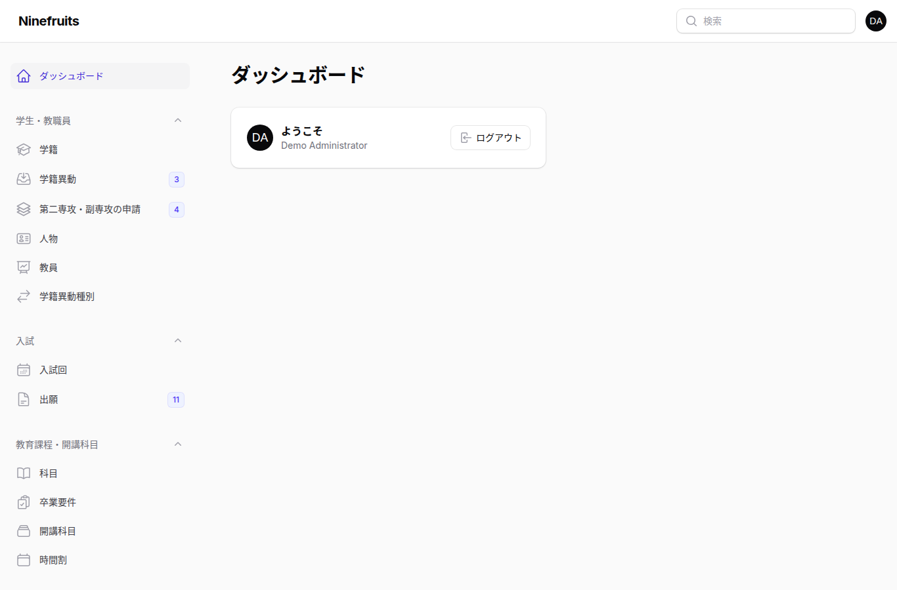
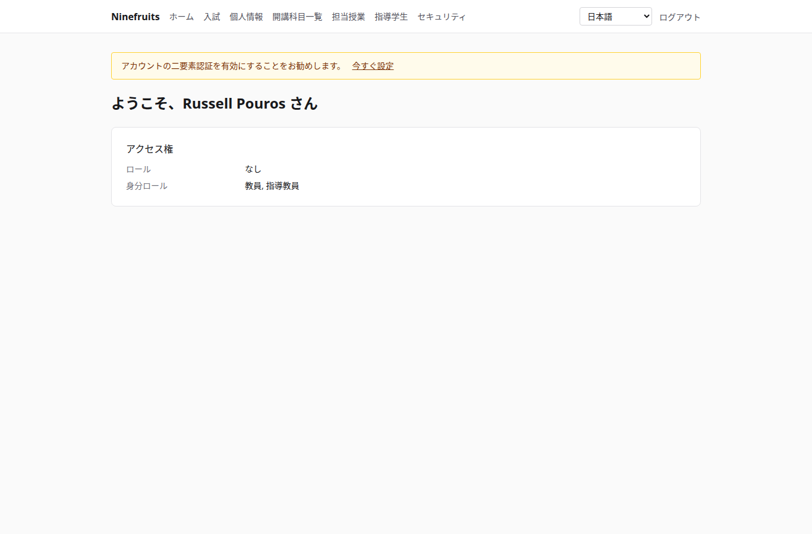
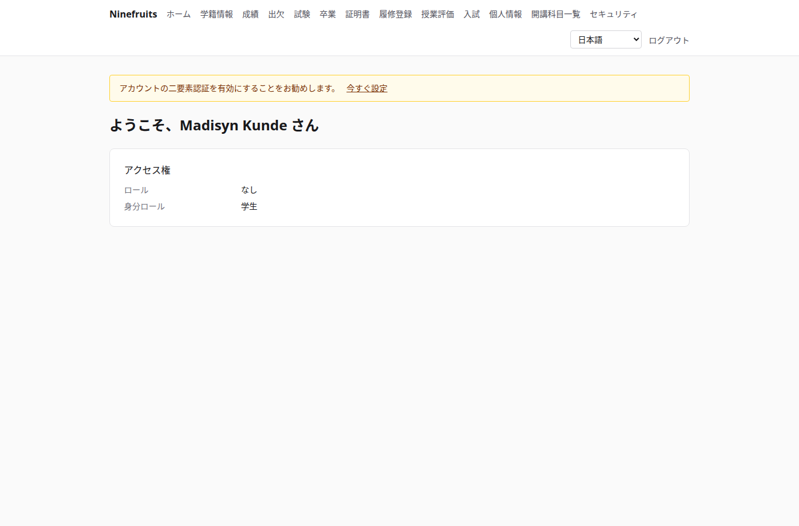

# Ninefruits — 学生情報システム

**Languages / 언어**

| 言語 | README | マニュアル |
|---|---|---|
| 한국어 | [README.md](README.md) | [docs/manual/ko/](docs/manual/ko/README.md) |
| English | [README.en.md](README.en.md) | [docs/manual/en/](docs/manual/en/README.md) |
| 简体中文 | [README.zh_CN.md](README.zh_CN.md) | [docs/manual/zh_CN/](docs/manual/zh_CN/README.md) |
| ລາວ | [README.lo.md](README.lo.md) | [docs/manual/lo/](docs/manual/lo/README.md) |
| Deutsch | [README.de.md](README.de.md) | [docs/manual/de/](docs/manual/de/README.md) |
| Filipino | [README.fil.md](README.fil.md) | [docs/manual/fil/](docs/manual/fil/README.md) |
| Français | [README.fr.md](README.fr.md) | [docs/manual/fr/](docs/manual/fr/README.md) |
| 日本語 | [README.ja.md](README.ja.md) (このファイル) | [docs/manual/ja/](docs/manual/ja/README.md) |
| Монгол | [README.mn.md](README.mn.md) | [docs/manual/mn/](docs/manual/mn/README.md) |
| Bahasa Melayu | [README.ms.md](README.ms.md) | [docs/manual/ms/](docs/manual/ms/README.md) |
| नेपाली | [README.ne.md](README.ne.md) | [docs/manual/ne/](docs/manual/ne/README.md) |
| Русский | [README.ru.md](README.ru.md) | [docs/manual/ru/](docs/manual/ru/README.md) |
| ไทย | [README.th.md](README.th.md) | [docs/manual/th/](docs/manual/th/README.md) |
| Türkçe | [README.tr.md](README.tr.md) | [docs/manual/tr/](docs/manual/tr/README.md) |
| Oʻzbek | [README.uz.md](README.uz.md) | [docs/manual/uz/](docs/manual/uz/README.md) |
| Tiếng Việt | [README.vi.md](README.vi.md) | [docs/manual/vi/](docs/manual/vi/README.md) |

言語を追加するには、[言語の追加](docs/development/adding-a-language.md)を参照してください。

Ninefruits は、どの大学でもインストールできる学生情報システムです。入試、学籍、教育課程と開講科目、履修登録、成績、授業評価、証明書、語学・総合試験、出欠、卒業判定、レポート、LMS 連携基盤といった教務の中核を扱い、画面と文書は上記の 16 言語に対応しています。

## 概要

3 つのロールの最初の画面(デモデータ)。

| 管理者(管理画面) | 教員(ポータル) | 学生(ポータル) |
|---|---|---|
|  |  |  |

- **管理画面** `/admin`: 職員が学籍、教務、入試、証明書、試験、卒業、レポートを扱います。権限は、組織単位やプログラムを範囲とするロールテンプレート(学籍担当、教務担当、証明書担当、学科助手、入試担当、システム管理者)から付与されます。
- **ポータル** `/portal`: 学生は履修登録を行い、成績、出欠、試験、卒業要件、証明書を確認します。教員は担当開講科目の履修者名簿、出欠、成績入力、評価結果を管理します。志願者は出願します。1 つのアカウントで複数の身分ロールを持てます。

## 機能

| 領域 | 内容 |
|---|---|
| ユーザーとセキュリティ | 共通ログイン、二要素認証(アプリ、メール)、組織単位/プログラムを範囲とするロール、データと業務の監査、行レベルセキュリティ、個人情報の暗号化 |
| 人物と学籍 | 人物と学籍の分離、学籍番号のルール、承認を伴う学籍異動(休学、復学、退学、除籍、再入学、卒業)、指導教員、第二専攻と副専攻 |
| 入試 | 入試回、書類付きのオンライン出願、審査と合否判定、合格者の学籍作成 |
| 教育課程 | 科目バージョン、先修科目と代替科目、教育課程年度ごとの卒業要件、開講科目、時間割、シラバス |
| 履修登録 | ルールセット、履修単位上限、定員とキャンセル待ち、制限措置とルール例外、履修登録のピークを想定した設計 |
| 成績 | 絶対評価と相対評価、成績分布上限、提出と確定、訂正の承認、GPA と再履修、成績締め(学業警告、成績優秀者)、成績証明書 |
| 授業評価 | 匿名回答、評価票と設問、最小回答数、公開、評価完了までの成績閲覧制限 |
| 証明書 | 言語ごとの種別とテンプレート、発行番号、保存された PDF、QR 付きの公開検証ページ |
| 試験 | 領域と合格ルールを持つ種別、試験実施回への申込、結果入力、CSV、公開、訂正、外部試験の結果 |
| 出欠 | 週ごとの授業時間からの授業回、出欠入力、出席簿 PDF、履修者名簿 CSV |
| 卒業 | 卒業判定、保存された判定、要件免除(2 名による承認)、学位記番号を伴う卒業 |
| レポート | CSV 付きの 7 つの標準レポート、BI 向けの `reporting` ビュー |
| LMS 連携基盤 | プラットフォーム、コース連携、同期ログ、イベント駆動の同期、夜間の照合、LMS の点数を成績の下書きとして取り込み |

## 技術スタック

PHP 8.5、Laravel 13、Filament 5(管理画面)、Livewire 4(ポータル)、PostgreSQL 18(RLS、監査)、Redis と Horizon(キュー)、Gotenberg(PDF)、Fortify(ログイン、二要素認証)。開発とデモは Docker(Laravel Sail)で動作します。

## インストール(デモサイト)

ホストに必要なのは Docker だけです。PHP と Composer はコンテナ内で動作します。

```bash
# 1. Dependencies
docker run --rm -u "$(id -u):$(id -g)" -v "$PWD":/app -w /app composer:latest \
    composer install --ignore-platform-req='ext-*'

# 2. Environment file
cp .env.example .env
printf '\nWWWUSER=%s\nWWWGROUP=%s\n' "$(id -u)" "$(id -g)" >> .env

# 3. Containers (database roles are created on first start)
./vendor/bin/sail up -d

# 4. Keys
./vendor/bin/sail artisan key:generate
./vendor/bin/sail artisan pii:generate-key   # put the two printed values in .env

# 5. Install: migrations, essential data, institution settings, first administrator, grade scale
./vendor/bin/sail artisan setup:install --profile=korean-university --grade-scale=4.5

# 6. Demo data and demo accounts per role
./vendor/bin/sail artisan setup:demo --size=small --seed=42

# 7. Assets
./vendor/bin/sail npm install && ./vendor/bin/sail npm run build
```

- ポータル: http://localhost/portal · 管理画面: http://localhost/admin(同じログイン)
- メール(Mailpit): http://localhost:8025 · キュー(Horizon): http://localhost/horizon

### デモアカウント

パスワードはすべて `demo-password` です(`config/setup.php`)。二要素認証はオフです。

| アカウント | ロール / 身分ロール | 最初の画面 |
|---|---|---|
| system-administrator@demo.test | システム管理者(すべての権限) | /admin |
| registrar@demo.test | 学籍担当(学籍、履修登録、成績の確定、証明書、試験、卒業、レポート) | /admin |
| academic-affairs@demo.test | 教務担当(科目、開講科目、時間割、成績ポリシー、授業評価、授業回) | /admin |
| certificate-officer@demo.test | 証明書担当 | /admin |
| department-assistant@demo.test | 学科助手(組織単位を範囲とする閲覧、指導教員、レポート) | /admin |
| admissions-officer@demo.test | 入試担当 | /admin |
| instructor@demo.test | 教員兼指導教員(開講科目、出欠、成績入力、指導学生) | /portal |
| student@demo.test | 在学生 | /portal |
| alumni@demo.test | 卒業生 | /portal |
| readmitted@demo.test | 卒業後に再入学した学生(学籍 2 件) | /portal |
| applicant@demo.test | 志願者 | /portal |
| admitted@demo.test | 合格した志願者 | /portal |

デモは架空の大学 1 校(韓国の大学プロファイル)で、学生、教員、科目、開講科目、履修、成績、授業評価、証明書、試験、出欠、卒業判定、LMS 連携を含みます。本番環境では決してシードしないでください(`setup:demo` は実行を拒否します)。

## ドキュメント

- [管理者マニュアル](docs/manual/ja/README.md)(韓国語の原文: [docs/manual/ko/](docs/manual/ko/README.md))
- 運用: [インストール](docs/manual/ja/operations/installation.md)、[コマンド](docs/manual/ja/operations/commands.md)、[スケジュールジョブ](docs/manual/ja/operations/scheduled-jobs.md)、[バックアップと復元](docs/manual/ja/operations/backup-restore.md)、[セキュリティキー](docs/manual/ja/operations/security-keys.md)、[トラブルシューティング](docs/manual/ja/operations/troubleshooting.md)
- [LMS 連携ガイド](docs/lms-integration-guide.md)
- [開発規約](docs/development/)
- 移植の経緯と設計判断(参考): [porting/](porting/README.md)

## 本番データベース

スーパーユーザーが 1 回だけ実行します。

```bash
psql -v migrator_password=... -v runtime_password=... -v reporting_password=... \
     -f database/sql/roles/create_roles.sql
psql -d <database> -f database/sql/roles/prepare_database.sql
```

アプリケーションは `app_runtime`(行レベルセキュリティが適用されます)、マイグレーションは `app_migrator`、BI ツールは `app_reporting`(レポート用ビュー)で接続します。[インストールマニュアル](docs/manual/ja/operations/installation.md)を参照してください。

## よく使うコマンド

| コマンド | 内容 |
|---|---|
| `sail composer check` | Pint、Larastan、命名チェック、翻訳漏れ、テスト(CI と同じ) |
| `sail pest` | テスト |
| `sail artisan migrate` | マイグレーション(自動的に `app_migrator` の接続を使用) |
| `sail artisan setup:install`, `setup:demo` | インストール/更新、デモデータ |
| `sail artisan system:health-check` | 設定、キー、データベースのロール、キュー、Redis、Gotenberg、ストレージ、スケジューラー |
| `sail artisan security:sync-permissions` | コードの権限カタログをデータベースに同期 |
| `sail artisan i18n:missing` | 翻訳漏れ(翻訳者との作業には `i18n:export`/`i18n:import`) |

全一覧は[コマンドリファレンス](docs/manual/ja/operations/commands.md)にあります。

## ライセンス

[MIT License](LICENSE)。自由に使用、改変、配布できます。著作権表示とライセンス本文は残してください。

---

**謝辞**

このシステムを可能にしてくれた、延辺科学技術大学の教務システム YUSTIC に感謝します。YUSTIC は、長年にわたって共に夢を見、汗を流し、作り上げてきた少数の開発者チームの成果でした。このシステムは、共に働いた同僚たちへの懐かしさと敬意、そして感謝を伝える私たちなりの方法です。
