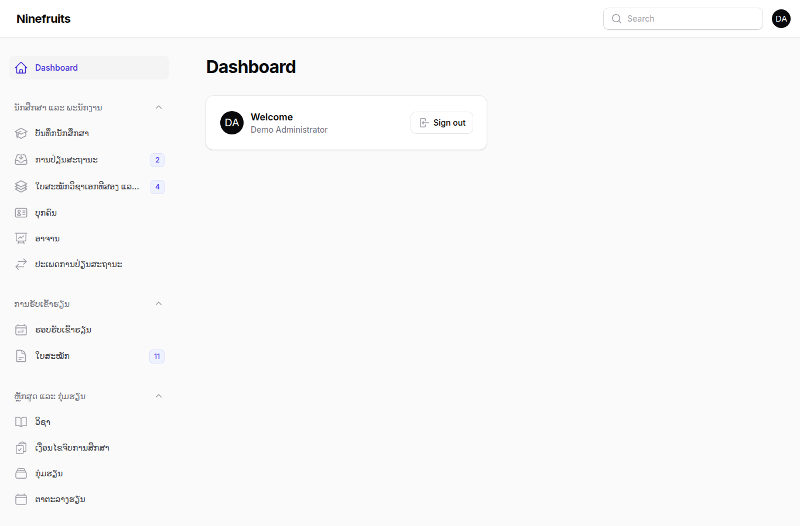
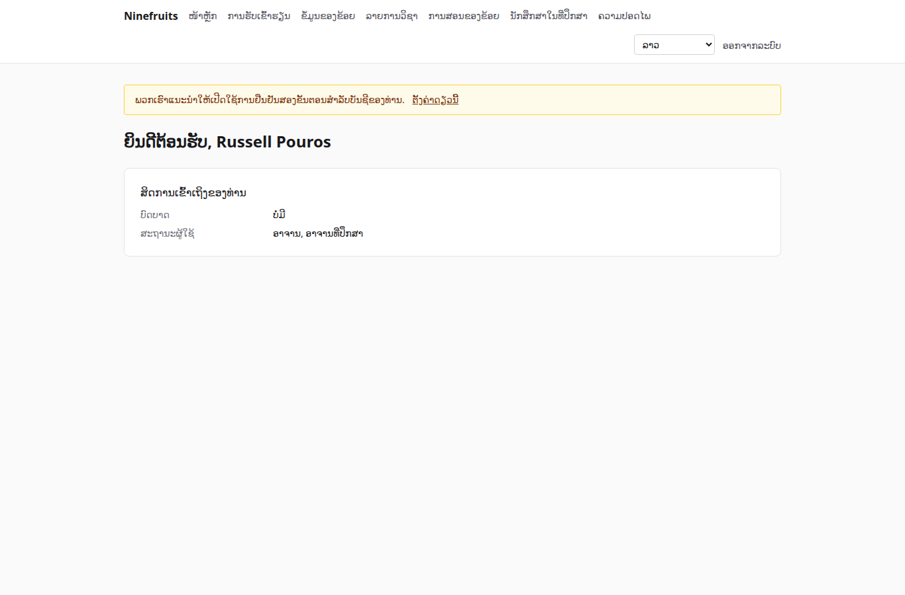
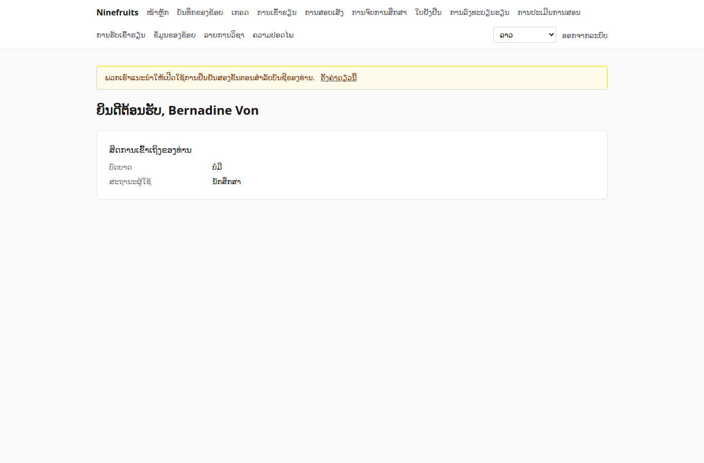

# Ninefruits — ລະບົບບໍລິຫານການສຶກສາຂອງມະຫາວິທະຍາໄລ

**언어 / Languages / 语言 / ພາສາ**

| ພາສາ | README | ຄູ່ມື |
|---|---|---|
| 한국어 | [README.md](README.md) | [docs/manual/ko/](docs/manual/ko/README.md) |
| English | [README.en.md](README.en.md) | [docs/manual/en/](docs/manual/en/README.md) |
| 简体中文 | [README.zh_CN.md](README.zh_CN.md) | [docs/manual/zh_CN/](docs/manual/zh_CN/README.md) |
| ລາວ | [README.lo.md](README.lo.md) (ເອກະສານນີ້) | [docs/manual/lo/](docs/manual/lo/README.md) |

ຖ້າຕ້ອງການເພີ່ມພາສາອື່ນ ໃຫ້ເບິ່ງ [ຄູ່ມືການເພີ່ມພາສາ](docs/development/adding-a-language.md) (English, [한국어](docs/development/adding-a-language.ko.md)).

Ninefruits ແມ່ນລະບົບບໍລິຫານການສຶກສາ (Student Information System) ທີ່ສາມາດຕິດຕັ້ງ ແລະ ໃຊ້ໄດ້ໃນຫຼາຍມະຫາວິທະຍາໄລ. ມັນຄວບຄຸມແກ່ນຂອງວຽກງານບໍລິຫານການສຶກສາ ຕັ້ງແຕ່ການສະໝັກເຂົ້າຮຽນ, ບັນທຶກນັກສຶກສາ, ຫຼັກສູດ ແລະ ກຸ່ມຮຽນ, ການລົງທະບຽນຮຽນ, ເກຣດ, ການປະເມີນການສອນ, ໃບຢັ້ງຢືນ, ການສອບເສັງພາສາ ແລະ ການສອບເສັງລວມ, ການເຂົ້າຮຽນ, ການພິຈາລະນາຈົບການສຶກສາ, ບົດລາຍງານ ຈົນເຖິງພື້ນຖານການເຊື່ອມຕໍ່ LMS ແລະ ໜ້າຈໍກັບເອກະສານຮອງຮັບພາສາເກົາຫຼີ, ອັງກິດ, ຈີນ ແລະ ລາວ.

## ເບິ່ງໂດຍຫຍໍ້

ໜ້າຈໍທຳອິດຫຼັງເຂົ້າສູ່ລະບົບດ້ວຍສາມບົດບາດ (ຂໍ້ມູນເດໂມ).

| ຜູ້ບໍລິຫານສູງສຸດ (ໜ້າບໍລິຫານ) | ອາຈານ (ພອດທໍ) | ນັກສຶກສາ (ພອດທໍ) |
|---|---|---|
|  |  |  |

- **ໜ້າບໍລິຫານ** `/admin`: ພະນັກງານດຳເນີນວຽກບັນທຶກນັກສຶກສາ, ວິຊາການ, ການຮັບເຂົ້າຮຽນ, ໃບຢັ້ງຢືນ, ການສອບເສັງ, ການຈົບການສຶກສາ ແລະ ບົດລາຍງານ. ສິດກຳນົດດ້ວຍແມ່ແບບບົດບາດ (ຜູ້ຮັບຜິດຊອບບັນທຶກນັກສຶກສາ, ຜູ້ຮັບຜິດຊອບວິຊາການ, ຜູ້ຮັບຜິດຊອບໃບຢັ້ງຢືນ, ຜູ້ຊ່ວຍພາກວິຊາ, ຜູ້ຮັບຜິດຊອບການຮັບເຂົ້າຮຽນ, ຜູ້ບໍລິຫານລະບົບ) ແລະ ຂອບເຂດໜ່ວຍງານ ຫຼື ຫຼັກສູດ.
- **ພອດທໍ** `/portal`: ນັກສຶກສາເບິ່ງການລົງທະບຽນຮຽນ, ເກຣດ, ການເຂົ້າຮຽນ, ການລົງທະບຽນສອບ, ເງື່ອນໄຂການຈົບການສຶກສາ ແລະ ໃບຢັ້ງຢືນ; ອາຈານເບິ່ງລາຍຊື່, ການເຂົ້າຮຽນ, ການປ້ອນເກຣດ ແລະ ຜົນການປະເມີນການສອນຂອງກຸ່ມຮຽນທີ່ຮັບຜິດຊອບ; ຜູ້ສະໝັກເບິ່ງການສະໝັກເຂົ້າຮຽນ. ບັນຊີດຽວສາມາດມີຫຼາຍສະຖານະພາບ (ເຊັ່ນ ເປັນທັງນັກສຶກສາ ແລະ ຜູ້ຊ່ວຍ).

## ໜ້າທີ່ຫຼັກ

| ຂົງເຂດ | ເນື້ອໃນ |
|---|---|
| ຜູ້ໃຊ້ ແລະ ຄວາມປອດໄພ | ການເຂົ້າສູ່ລະບົບຮ່ວມ, ການຢືນຢັນສອງຂັ້ນຕອນ (ແອັບ, ອີເມວ), ບົດບາດ ສິດ ແລະ ຂອບເຂດໜ່ວຍງານ, ການກວດສອບຂໍ້ມູນ ແລະ ທຸລະກິດ, ຄວາມປອດໄພລະດັບແຖວ (RLS), ການເຂົ້າລະຫັດຂໍ້ມູນສ່ວນບຸກຄົນ |
| ບຸກຄົນ ແລະ ບັນທຶກນັກສຶກສາ | ແຍກບຸກຄົນກັບບັນທຶກນັກສຶກສາ, ກົດລະຫັດນັກສຶກສາ, ການຮ້ອງຂໍ ແລະ ອະນຸມັດການປ່ຽນສະຖານະ (ພັກການຮຽນ, ກັບຄືນ, ລາອອກ, ໃຫ້ອອກ, ເຂົ້າຮຽນໃໝ່, ຈົບການສຶກສາ), ອາຈານທີ່ປຶກສາ, ວິຊາເອກທີສອງ ແລະ ວິຊາໂທ |
| ການຮັບເຂົ້າຮຽນ | ຮອບຮັບສະໝັກ, ໃບສະໝັກອອນລາຍ ແລະ ເອກະສານ, ການພິຈາລະນາ ແລະ ປະກາດຜົນ, ການສ້າງບັນທຶກນັກສຶກສາຂອງຜູ້ຖືກຮັບ |
| ຫຼັກສູດ | ເວີຊັນວິຊາ, ວິຊາບັງຄັບກ່ອນ ແລະ ວິຊາທົດແທນ, ເງື່ອນໄຂການຈົບການສຶກສາຕາມປີຫຼັກສູດ, ກຸ່ມຮຽນ ຕາຕະລາງຮຽນ ແລະ ແຜນການສອນ |
| ການລົງທະບຽນຮຽນ | ຊຸດກົດລະບຽບ, ເພດານໜ່ວຍກິດ, ຈຳນວນຮັບ ແລະ ລາຍຊື່ລໍຖ້າ, ການຈຳກັດ ແລະ ຂໍ້ຍົກເວັ້ນ, ການອອກແບບຮອງຮັບຊ່ວງສູງສຸດ |
| ເກຣດ | ການປະເມີນແບບອີງເກນ ແລະ ອີງກຸ່ມ, ເພດານອັດຕາສ່ວນເກຣດ, ການສົ່ງ ແລະ ຢືນຢັນ, ການອະນຸມັດການແກ້ໄຂ, GPA ແລະ ການຮຽນຊ້ຳ, ການປິດພາກຮຽນ (ເຕືອນທາງວິຊາການ, ນັກສຶກສາດີເດັ່ນ), ໃບຄະແນນ |
| ການປະເມີນການສອນ | ການຕອບແບບບໍ່ລະບຸຊື່, ແບບຟອມ ແລະ ຄຳຖາມ, ເກນຄຳຕອບຂັ້ນຕ່ຳ, ການເປີດເຜີຍຜົນ, ການຈຳກັດການເບິ່ງເກຣດຖ້າຍັງບໍ່ປະເມີນ |
| ໃບຢັ້ງຢືນ | ແບບຟອມຕາມປະເພດ ແລະ ພາສາ, ເລກທີອອກ, ການເກັບ PDF, ໜ້າສາທາລະນະກວດຄວາມແທ້ (QR) |
| ການສອບເສັງພາສາ/ລວມ | ປະເພດ ຂົງເຂດ ແລະ ເກນຜ່ານ, ການລົງທະບຽນສອບຕໍ່ຮອບ, ການປ້ອນຜົນ CSV ແລະ ການເປີດເຜີຍ, ການຮ້ອງຂໍແກ້ໄຂ, ຜົນຈາກພາຍນອກ |
| ການເຂົ້າຮຽນ | ຄາບຮຽນຕາມເວລາສອນ, ການປ້ອນການເຂົ້າຮຽນ, PDF ບັນຊີການເຂົ້າຮຽນ, CSV ລາຍຊື່ |
| ການຈົບການສຶກສາ | ການຕັດສິນເງື່ອນໄຂ, ການບັນທຶກການກວດ, ການຍົກເວັ້ນເງື່ອນໄຂ (ອະນຸມັດ 2 ຄົນ), ການດຳເນີນການຈົບການສຶກສາ ແລະ ເລກທີປະລິນຍາ |
| ບົດລາຍງານ | ບົດລາຍງານມາດຕະຖານ 7 ປະເພດ ແລະ CSV, view `reporting` ສຳລັບ BI |
| ພື້ນຖານການເຊື່ອມຕໍ່ LMS | ແພລັດຟອມ, ການເຊື່ອມຕໍ່ຫ້ອງຮຽນ ແລະ ບັນທຶກການຊິງ, ການຊິງຕາມເຫດການ, ການກວດທຽບຕອນກາງຄືນ, ຮ່າງຄະແນນຈາກ LMS |

## ເທັກໂນໂລຊີ

PHP 8.5, Laravel 13, Filament 5 (ໜ້າບໍລິຫານ), Livewire 4 (ພອດທໍ), PostgreSQL 18 (RLS, ການກວດສອບ), Redis ແລະ Horizon (ຄິວ), Gotenberg (PDF), Fortify (ການເຂົ້າສູ່ລະບົບ ແລະ ການຢືນຢັນສອງຂັ້ນຕອນ). ສະພາບແວດລ້ອມພັດທະນາ ແລະ ເດໂມແລ່ນດ້ວຍ Docker (Laravel Sail).

## ການຕິດຕັ້ງ (ເວັບໄຊເດໂມ)

ເຄື່ອງ host ຕ້ອງການພຽງ Docker. PHP ແລະ Composer ແລ່ນຢູ່ໃນ container.

```bash
# 1. ຕິດຕັ້ງ dependency
docker run --rm -u "$(id -u):$(id -g)" -v "$PWD":/app -w /app composer:latest \
    composer install --ignore-platform-req='ext-*'

# 2. ໄຟລ໌ສະພາບແວດລ້ອມ
cp .env.example .env
printf '\nWWWUSER=%s\nWWWGROUP=%s\n' "$(id -u)" "$(id -g)" >> .env

# 3. ເລີ່ມ container (ສ້າງບົດບາດ DB ເມື່ອເລີ່ມຄັ້ງທຳອິດ)
./vendor/bin/sail up -d

# 4. ສ້າງກະແຈ
./vendor/bin/sail artisan key:generate
./vendor/bin/sail artisan pii:generate-key   # ໃສ່ສອງຄ່າທີ່ສະແດງລົງໃນ .env

# 5. ຕິດຕັ້ງ: migration, ຂໍ້ມູນຈຳເປັນ, ການຕັ້ງຄ່າສະຖາບັນ, ຜູ້ບໍລິຫານຄົນທຳອິດ, ມາດຕາເກຣດ
./vendor/bin/sail artisan setup:install --profile=korean-university --grade-scale=4.5

# 6. ຂໍ້ມູນເດໂມ ແລະ ບັນຊີເດໂມຕໍ່ບົດບາດ
./vendor/bin/sail artisan setup:demo --size=small --seed=42

# 7. ຊັບສິນໜ້າຈໍ
./vendor/bin/sail npm install && ./vendor/bin/sail npm run build
```

- ພອດທໍ: http://localhost/portal · ໜ້າບໍລິຫານ: http://localhost/admin (ເຂົ້າສູ່ລະບົບດຽວກັນ)
- ກວດເມວ (Mailpit): http://localhost:8025 · ຕິດຕາມຄິວ (Horizon): http://localhost/horizon

### ບັນຊີເດໂມ

ລະຫັດຜ່ານທັງໝົດແມ່ນ `demo-password` (`config/setup.php`). ການຢືນຢັນສອງຂັ້ນຕອນຖືກປິດໄວ້.

| ບັນຊີ | ບົດບາດ / ສະຖານະພາບ | ໜ້າຈໍທຳອິດ |
|---|---|---|
| system-administrator@demo.test | ຜູ້ບໍລິຫານລະບົບ (ທຸກສິດ) | /admin |
| registrar@demo.test | ຜູ້ຮັບຜິດຊອບບັນທຶກນັກສຶກສາ (ບັນທຶກນັກສຶກສາ, ການປັບການລົງທະບຽນຮຽນ, ການຢືນຢັນເກຣດ, ໃບຢັ້ງຢືນ, ການສອບເສັງ, ການຈົບການສຶກສາ, ບົດລາຍງານ) | /admin |
| academic-affairs@demo.test | ຜູ້ຮັບຜິດຊອບວິຊາການ (ວິຊາ ກຸ່ມຮຽນ ແລະ ຕາຕະລາງຮຽນ, ນະໂຍບາຍເກຣດ, ການປະເມີນການສອນ, ຄາບຮຽນ) | /admin |
| certificate-officer@demo.test | ຜູ້ຮັບຜິດຊອບໃບຢັ້ງຢືນ | /admin |
| department-assistant@demo.test | ຜູ້ຊ່ວຍພາກວິຊາ (ການເບິ່ງໃນຂອບເຂດພາກວິຊາ, ອາຈານທີ່ປຶກສາ, ບົດລາຍງານ) | /admin |
| admissions-officer@demo.test | ຜູ້ຮັບຜິດຊອບການຮັບເຂົ້າຮຽນ | /admin |
| instructor@demo.test | ອາຈານ ແລະ ອາຈານທີ່ປຶກສາ (ກຸ່ມຮຽນທີ່ຮັບຜິດຊອບ, ການເຂົ້າຮຽນ, ການປ້ອນເກຣດ, ນັກສຶກສາທີ່ປຶກສາ) | /portal |
| student@demo.test | ນັກສຶກສາປັດຈຸບັນ | /portal |
| alumni@demo.test | ຜູ້ຈົບການສຶກສາ | /portal |
| readmitted@demo.test | ຜູ້ຈົບການສຶກສາທີ່ເຂົ້າຮຽນໃໝ່ (ບັນທຶກນັກສຶກສາ 2 ລາຍການ) | /portal |
| applicant@demo.test | ຜູ້ສະໝັກເຂົ້າຮຽນ | /portal |
| admitted@demo.test | ຜູ້ຖືກຮັບເຂົ້າຮຽນ | /portal |

ຂໍ້ມູນເດໂມແມ່ນມະຫາວິທະຍາໄລສົມມຸດ 1 ແຫ່ງ (ໂປຣໄຟລ໌ມະຫາວິທະຍາໄລເກົາຫຼີ) ປະກອບດ້ວຍນັກສຶກສາ, ອາຈານ, ວິຊາ, ກຸ່ມຮຽນ, ການລົງທະບຽນຮຽນ, ເກຣດ, ການປະເມີນການສອນ, ໃບຢັ້ງຢືນ, ການສອບເສັງ, ການເຂົ້າຮຽນ, ການກວດເງື່ອນໄຂການຈົບການສຶກສາ ແລະ ການເຊື່ອມຕໍ່ LMS. ຢ່າໃສ່ໃນສະພາບແວດລ້ອມນຳໃຊ້ຈິງເດັດຂາດ (`setup:demo` ຈະປະຕິເສດໃນສະພາບແວດລ້ອມນຳໃຊ້ຈິງ).

## ເອກະສານ

- [ຄູ່ມືຜູ້ບໍລິຫານ](docs/manual/lo/README.md): 28 ບົດ ແຕ່ລຳດັບການຕັ້ງຄ່າເບື້ອງຕົ້ນຈົນເຖິງວິທີໃຊ້ແຕ່ລະຂົງເຂດ
- [ຄູ່ມືການດຳເນີນງານ](docs/manual/lo/operations/): [ການຕິດຕັ້ງ](docs/manual/lo/operations/installation.md), [ຄຳສັ່ງດຳເນີນງານ](docs/manual/lo/operations/commands.md), [ວຽກຕາມກຳນົດເວລາ](docs/manual/lo/operations/scheduled-jobs.md), [ການສຳຮອງ ແລະ ກູ້ຄືນຂໍ້ມູນ](docs/manual/lo/operations/backup-restore.md), [ກະແຈຄວາມປອດໄພ](docs/manual/lo/operations/security-keys.md), [ການແກ້ໄຂບັນຫາ](docs/manual/lo/operations/troubleshooting.md)
- [ຄູ່ມືການເຊື່ອມຕໍ່ LMS](docs/lms-integration-guide.md)
- [ກົດການພັດທະນາ](docs/development/): ກົດການຕັ້ງຊື່, ລາຍການກວດສອບສຳລັບການ review
- ປະຫວັດການຍ້າຍລະບົບ ແລະ ການຕັດສິນໃຈດ້ານການອອກແບບ (ອ້າງອີງ): [porting/](porting/README.md)

## ການກຽມ DB ສຳລັບການນຳໃຊ້ຈິງ

superuser ແລ່ນຄັ້ງດຽວ.

```bash
psql -v migrator_password=... -v runtime_password=... -v reporting_password=... \
     -f database/sql/roles/create_roles.sql
psql -d <database> -f database/sql/roles/prepare_database.sql
```

ແອັບພລິເຄຊັນເຊື່ອມຕໍ່ດ້ວຍ `DB_USERNAME=app_runtime` (ນຳໃຊ້ RLS), migration ດ້ວຍ `DB_MIGRATOR_USERNAME=app_migrator` ແລະ ເຄື່ອງມື BI ດ້ວຍ `app_reporting` (ອ່ານ view reporting). ເບິ່ງຂັ້ນຕອນລະອຽດທີ່ [ຄູ່ມືການຕິດຕັ້ງ](docs/manual/lo/operations/installation.md).

## ຄຳສັ່ງທີ່ໃຊ້ເລື້ອຍ

| ຄຳສັ່ງ | ເນື້ອໃນ |
|---|---|
| `sail composer check` | Pint, Larastan, ການກວດການຕັ້ງຊື່, ການກວດຄຳແປທີ່ຂາດ, ການທົດສອບ (ຄືກັນກັບ CI) |
| `sail pest` | ການທົດສອບ |
| `sail artisan migrate` | migration (ໃຊ້ການເຊື່ອມຕໍ່ `app_migrator` ອັດຕະໂນມັດ) |
| `sail artisan setup:install`, `setup:demo` | ຕິດຕັ້ງ/ອັບເດດ, ຂໍ້ມູນເດໂມ |
| `sail artisan system:health-check` | ກວດການຕັ້ງຄ່າ, ກະແຈ, ບົດບາດ DB, ຄິວ, Redis, Gotenberg, ບ່ອນເກັບຂໍ້ມູນ ແລະ ຕົວກຳນົດເວລາ |
| `sail artisan security:sync-permissions` | ນຳລາຍການສິດຈາກໂຄດເຂົ້າ DB |
| `sail artisan i18n:missing` | ກວດຄຳແປທີ່ຂາດ (ແລກປ່ຽນກັບນັກແປດ້ວຍ `i18n:export`/`i18n:import`) |

ລາຍການທັງໝົດຢູ່ທີ່ [ເອກະສານອ້າງອີງຄຳສັ່ງດຳເນີນງານ](docs/manual/lo/operations/commands.md).

## ໃບອະນຸຍາດ

[ໃບອະນຸຍາດ MIT](LICENSE). ສາມາດນຳໃຊ້, ດັດແກ້ ແລະ ແຈກຢາຍໄດ້ຢ່າງເສລີ ໂດຍຮັກສາຂໍ້ຄວາມລິຂະສິດ ແລະ ຂໍ້ຄວາມໃບອະນຸຍາດໄວ້.

---

**ຄຳຂອບໃຈ**

ຂໍສະແດງຄວາມຂອບໃຈຕໍ່ YUSTIC (ລະບົບເຄືອຂ່າຍບໍລິຫານການສຶກສາຂອງມະຫາວິທະຍາໄລວິທະຍາສາດ ແລະ ເທັກໂນໂລຊີ Yanbian) ທີ່ເຮັດໃຫ້ລະບົບນີ້ເປັນໄປໄດ້. YUSTIC ແມ່ນຜົນງານທີ່ທີມພັດທະນາຈຳນວນບໍ່ຫຼາຍຄົນໄດ້ຮ່ວມກັນຫຼັ່ງເຫື່ອ, ຝັນ ແລະ ທຸ່ມເທສ້າງຂຶ້ນມາຕະຫຼອດຫຼາຍປີ. ການພັດທະນາລະບົບນີ້ແມ່ນການສະແດງຄວາມຄິດຮອດ, ຄວາມເຄົາລົບ ແລະ ຄວາມຂອບໃຈຕໍ່ເພື່ອນຮ່ວມງານທີ່ເຄີຍຮ່ວມເຮັດວຽກນຳກັນ.
