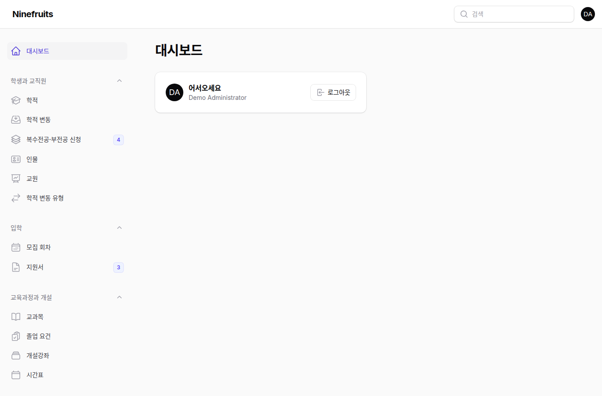
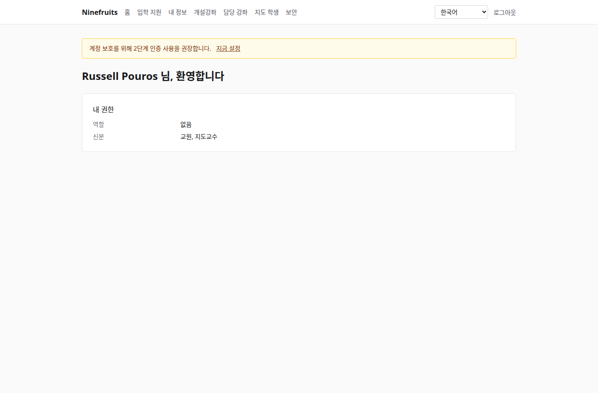
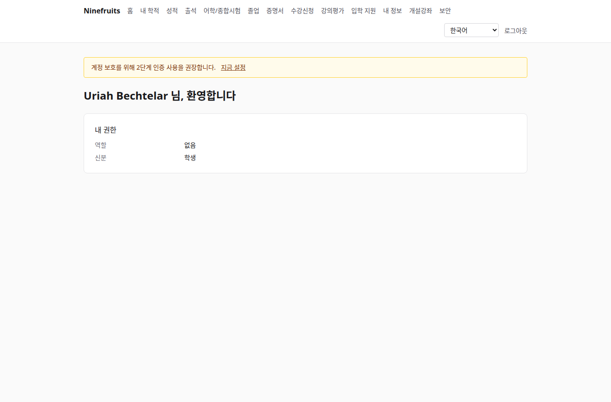

# Ninefruits — 대학 학사 행정 시스템

**언어 / Languages / 语言**

| 언어 | README | 매뉴얼 |
|---|---|---|
| 한국어 | [README.md](README.md) (이 문서) | [docs/manual/ko/](docs/manual/ko/README.md) |
| English | [README.en.md](README.en.md) | [docs/manual/en/](docs/manual/en/README.md) |
| 简体中文 | [README.zh_CN.md](README.zh_CN.md) | [docs/manual/zh_CN/](docs/manual/zh_CN/README.md) |

Ninefruits는 여러 대학에 설치해 쓸 수 있는 학사 행정 시스템(Student Information System)입니다. 입학 지원부터 학적, 교육과정과 개설강좌, 수강신청, 성적, 강의평가, 증명서, 어학·종합시험, 출석, 졸업 사정, 보고서, LMS 연동 기반까지 학사 업무의 핵심을 다루며, 화면과 문서는 한국어·영어·중국어를 지원합니다.

## 한눈에 보기

세 가지 역할로 로그인한 첫 화면입니다(데모 데이터).

| 최고관리자 (관리 화면) | 교수 (포털) | 학생 (포털) |
|---|---|---|
|  |  |  |

- **관리 화면** `/admin`: 교직원이 학적·교무·입학·증명서·시험·졸업·보고서를 처리합니다. 권한은 역할 템플릿(학적 담당, 교무 담당, 증명서 담당, 학과 조교, 입학 담당, 시스템 관리자)과 조직·과정 범위로 정합니다.
- **포털** `/portal`: 학생은 수강신청, 성적, 출석, 시험 접수, 졸업 요건, 증명서를, 교수는 담당 강좌의 명단·출석·성적 입력·강의평가 결과를, 지원자는 입학 지원을 봅니다. 한 계정이 여러 신분(학생이자 조교 등)을 가질 수 있습니다.

## 주요 기능

| 영역 | 내용 |
|---|---|
| 사용자와 보안 | 공용 로그인, 2단계 인증(앱·이메일), 역할·권한·조직 범위, 데이터·업무 감사, 행 수준 보안(RLS), 개인정보 암호화 |
| 인물과 학적 | 인물·학적 분리, 학번 규칙, 학적 변동(휴학·복학·자퇴·제적·재입학·졸업) 신청과 승인, 지도교수, 복수전공·부전공 |
| 입학 | 모집 회차, 온라인 지원서와 서류, 심사와 결과 발표, 합격자 학적 생성 |
| 교육과정 | 교과목 버전, 선수·대체과목, 교육과정 연도별 졸업 요건, 개설강좌·시간표·강의계획서 |
| 수강신청 | 규칙 세트, 학점 상한, 정원·대기자, 수강 제한과 예외, 피크 대비 설계 |
| 성적 | 절대·상대평가, 등급 비율 상한, 제출·확정, 정정 승인, 평점·재수강, 학기 마감(학사경고·성적우수), 성적표 |
| 강의평가 | 익명 응답, 양식·문항, 최소 응답 기준, 결과 공개, 미완료 시 성적 조회 제한 |
| 증명서 | 종류·언어별 서식, 발급번호, PDF 보관, 진위 확인(QR) 공개 페이지 |
| 어학/종합시험 | 시험 종류·영역·합격 기준, 회차 접수, 결과 입력·CSV·공개, 정정 요청, 외부 성적 |
| 출석 | 강의 시간 기준 수업 회차, 출석 입력, 출석부 PDF, 명단 CSV |
| 졸업 | 요건 판정, 점검 저장, 요건 면제(2인 승인), 졸업 처리와 학위번호 |
| 보고서 | 표준 보고서 7종과 CSV, BI용 `reporting` 뷰 |
| LMS 연동 기반 | 플랫폼·강좌 연결·동기화 기록, 이벤트 기반 동기화, 야간 대조, LMS 점수 초안 |

## 기술 스택

PHP 8.5, Laravel 13, Filament 5(관리 화면), Livewire 4(포털), PostgreSQL 18(RLS, 감사), Redis·Horizon(큐), Gotenberg(PDF), Fortify(로그인·2단계 인증). 개발·데모 환경은 Docker(Laravel Sail).

## 설치 (데모 사이트)

호스트에는 Docker만 있으면 됩니다. PHP와 Composer는 컨테이너 안에서 실행합니다.

```bash
# 1. 의존성 설치
docker run --rm -u "$(id -u):$(id -g)" -v "$PWD":/app -w /app composer:latest \
    composer install --ignore-platform-req='ext-*'

# 2. 환경 파일
cp .env.example .env
printf '\nWWWUSER=%s\nWWWGROUP=%s\n' "$(id -u)" "$(id -g)" >> .env

# 3. 컨테이너 기동 (최초 기동 시 DB 역할 생성)
./vendor/bin/sail up -d

# 4. 키 생성
./vendor/bin/sail artisan key:generate
./vendor/bin/sail artisan pii:generate-key   # 출력된 두 값을 .env에 넣는다

# 5. 설치: 마이그레이션, 필수 데이터, 기관 설정, 첫 관리자, 성적 척도
./vendor/bin/sail artisan setup:install --profile=korean-university --grade-scale=4.5

# 6. 데모 데이터와 역할별 데모 계정
./vendor/bin/sail artisan setup:demo --size=small --seed=42

# 7. 화면 자산
./vendor/bin/sail npm install && ./vendor/bin/sail npm run build
```

- 포털: http://localhost/portal · 관리 화면: http://localhost/admin (같은 로그인)
- 메일 확인(Mailpit): http://localhost:8025 · 큐 모니터(Horizon): http://localhost/horizon

### 데모 계정

비밀번호는 모두 `demo-password`입니다(`config/setup.php`). 2단계 인증은 꺼져 있습니다.

| 계정 | 역할 / 신분 | 첫 화면 |
|---|---|---|
| system-administrator@demo.test | 시스템 관리자(모든 권한) | /admin |
| registrar@demo.test | 학적 담당(학적, 수강 조정, 성적 확정, 증명서, 시험, 졸업, 보고서) | /admin |
| academic-affairs@demo.test | 교무 담당(교과목·개설·시간표, 성적 정책, 강의평가, 출석 회차) | /admin |
| certificate-officer@demo.test | 증명서 담당 | /admin |
| department-assistant@demo.test | 학과 조교(학과 범위 조회, 지도교수, 보고서) | /admin |
| admissions-officer@demo.test | 입학 담당 | /admin |
| instructor@demo.test | 교원·지도교수(담당 강좌, 출석, 성적 입력, 지도 학생) | /portal |
| student@demo.test | 재학생 | /portal |
| alumni@demo.test | 졸업생 | /portal |
| readmitted@demo.test | 재입학한 졸업생(학적 2개) | /portal |
| applicant@demo.test | 입학 지원자 | /portal |
| admitted@demo.test | 합격자 | /portal |

데모 데이터는 가상 대학 1곳(한국 대학 프로파일)으로, 학생·교원·교과목·개설강좌·수강·성적·강의평가·증명서·시험·출석·졸업 점검·LMS 연결이 들어 있습니다. 운영 환경에는 절대 넣지 마세요(`setup:demo`는 운영에서 거부됩니다).

## 문서

- [관리자 매뉴얼](docs/manual/ko/README.md): 처음 설정 순서부터 영역별 사용법까지 28장
- [운영 매뉴얼](docs/manual/ko/operations/): [설치](docs/manual/ko/operations/installation.md), [운영 명령](docs/manual/ko/operations/commands.md), [예약 작업](docs/manual/ko/operations/scheduled-jobs.md), [백업·복구](docs/manual/ko/operations/backup-restore.md), [보안 키](docs/manual/ko/operations/security-keys.md), [문제 해결](docs/manual/ko/operations/troubleshooting.md)
- [LMS 연동 가이드](docs/lms-integration-guide.md)
- [개발 규칙](docs/development/): 명명 규칙, 리뷰 체크리스트
- 이식 이력과 설계 결정(참고): [porting/](porting/README.md)

## 운영 DB 준비

슈퍼유저가 한 번 실행합니다.

```bash
psql -v migrator_password=... -v runtime_password=... -v reporting_password=... \
     -f database/sql/roles/create_roles.sql
psql -d <database> -f database/sql/roles/prepare_database.sql
```

애플리케이션은 `DB_USERNAME=app_runtime`(RLS 적용), 마이그레이션은 `DB_MIGRATOR_USERNAME=app_migrator`, BI 도구는 `app_reporting`(reporting 뷰 읽기)으로 접속합니다. 자세한 절차는 [설치 매뉴얼](docs/manual/ko/operations/installation.md)을 보세요.

## 자주 쓰는 명령

| 명령 | 내용 |
|---|---|
| `sail composer check` | Pint, Larastan, 명명 검사, 번역 누락 검사, 테스트 (CI와 같음) |
| `sail pest` | 테스트 |
| `sail artisan migrate` | 마이그레이션(자동으로 `app_migrator` 연결 사용) |
| `sail artisan setup:install`, `setup:demo` | 설치/업데이트, 데모 데이터 |
| `sail artisan system:health-check` | 설정·키·DB 역할·큐·Redis·Gotenberg·저장소·스케줄러 점검 |
| `sail artisan security:sync-permissions` | 코드의 권한 카탈로그를 DB에 반영 |
| `sail artisan i18n:missing` | 번역 누락 확인(`i18n:export`/`i18n:import`로 번역가와 주고받기) |

전체 목록은 [운영 명령 레퍼런스](docs/manual/ko/operations/commands.md)에 있습니다.

## 라이선스

(라이선스를 정해 여기에 적습니다.)

---

**감사의 말**

이 시스템을 가능하게 한 YUSTIC(연변과기대 학사행정망 시스템)에 감사를 드립니다. YUSTIC은 수 명의 개발팀이 수 년 동안 함께 땀흘리며 꿈을 꾸고 수고로 이루어 낸 결과물입니다. 함께 했던 동료들에게 그리움과 존경과 감사의 말을 이 시스템개발로 대신합니다.
