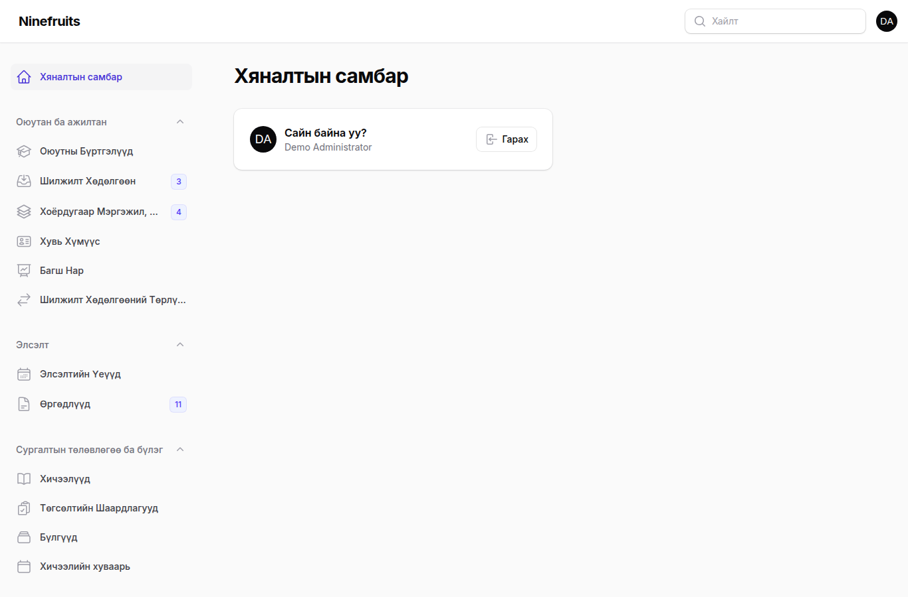
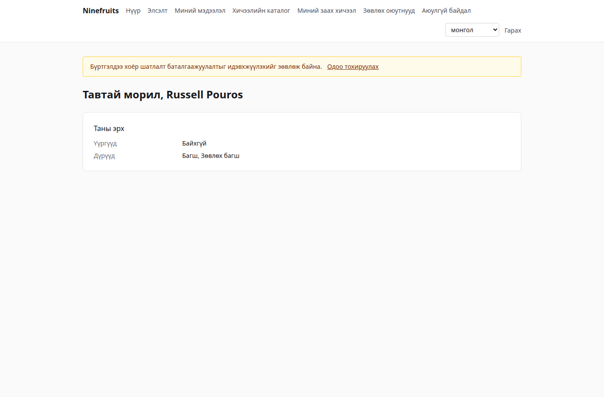
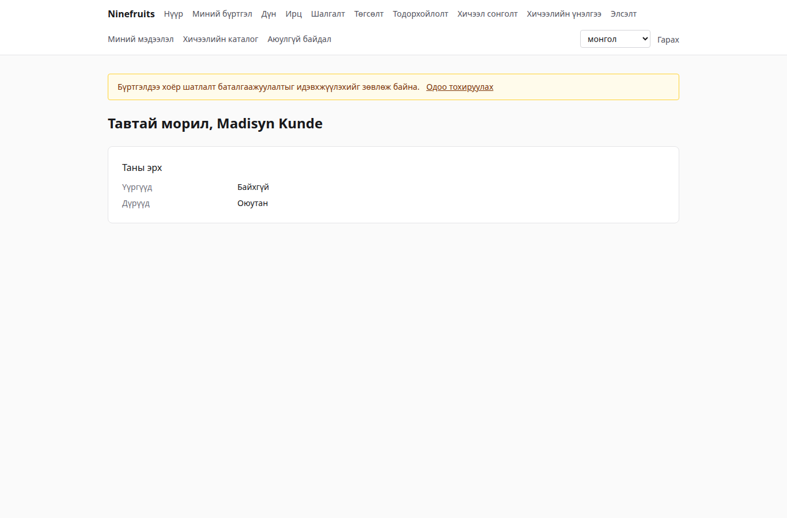

# Ninefruits — Оюутны мэдээллийн систем

**Languages / 언어**

| Хэл | README | Гарын авлага |
|---|---|---|
| 한국어 | [README.md](README.md) | [docs/manual/ko/](docs/manual/ko/README.md) |
| English | [README.en.md](README.en.md) | [docs/manual/en/](docs/manual/en/README.md) |
| 简体中文 | [README.zh_CN.md](README.zh_CN.md) | [docs/manual/zh_CN/](docs/manual/zh_CN/README.md) |
| ລາວ | [README.lo.md](README.lo.md) | [docs/manual/lo/](docs/manual/lo/README.md) |
| Deutsch | [README.de.md](README.de.md) | [docs/manual/de/](docs/manual/de/README.md) |
| Filipino | [README.fil.md](README.fil.md) | [docs/manual/fil/](docs/manual/fil/README.md) |
| Français | [README.fr.md](README.fr.md) | [docs/manual/fr/](docs/manual/fr/README.md) |
| 日本語 | [README.ja.md](README.ja.md) | [docs/manual/ja/](docs/manual/ja/README.md) |
| Монгол | [README.mn.md](README.mn.md) (энэ файл) | [docs/manual/mn/](docs/manual/mn/README.md) |
| Bahasa Melayu | [README.ms.md](README.ms.md) | [docs/manual/ms/](docs/manual/ms/README.md) |
| नेपाली | [README.ne.md](README.ne.md) | [docs/manual/ne/](docs/manual/ne/README.md) |
| Русский | [README.ru.md](README.ru.md) | [docs/manual/ru/](docs/manual/ru/README.md) |
| ไทย | [README.th.md](README.th.md) | [docs/manual/th/](docs/manual/th/README.md) |
| Türkçe | [README.tr.md](README.tr.md) | [docs/manual/tr/](docs/manual/tr/README.md) |
| Oʻzbek | [README.uz.md](README.uz.md) | [docs/manual/uz/](docs/manual/uz/README.md) |
| Tiếng Việt | [README.vi.md](README.vi.md) | [docs/manual/vi/](docs/manual/vi/README.md) |

Өөр хэл нэмэхийн тулд [Хэл нэмэх](docs/development/adding-a-language.md)-ийг үзнэ үү.

Ninefruits нь аль ч их сургууль суулгаж болох оюутны мэдээллийн систем юм. Сургалтын удирдлагын үндсэн хэсгүүд болох элсэлт, оюутны бүртгэл, сургалтын төлөвлөгөө ба бүлэг, хичээл сонголт, дүн, хичээлийн үнэлгээ, тодорхойлолт, хэлний болон иж бүрэн шалгалт, ирц, төгсөлтийн шалгалт, тайлан болон LMS холболтын суурийг хамардаг бөгөөд дэлгэц, баримт бичиг нь дээр жагсаасан 16 хэл дээр бэлэн.

## Товч танилцуулга

Гурван үүргийн эхний дэлгэц (демо өгөгдөл).

| Админ (удирдлагын самбар) | Багш (портал) | Оюутан (портал) |
|---|---|---|
|  |  |  |

- **Удирдлагын самбар** `/admin`: ажилтнууд бүртгэл, сургалтын үйл ажиллагаа, элсэлт, тодорхойлолт, шалгалт, төгсөлт болон тайланг хариуцна. Эрхүүд нь бүтцийн нэгж эсвэл хөтөлбөрөөр хамрах хүрээ тогтоосон үүргийн загвараас (оюутны бүртгэл хариуцсан ажилтан, сургалтын албаны ажилтан, тодорхойлолт хариуцсан ажилтан, тэнхимийн туслах ажилтан, элсэлт хариуцсан ажилтан, системийн админ) ирдэг.
- **Портал** `/portal`: оюутнууд хичээл сонгож, дүн, ирц, шалгалт, төгсөлтийн шаардлага, тодорхойлолтоо харна; багш нар өөрийн бүлгийн нэрсийн жагсаалт, ирц, дүн оруулалт, үнэлгээний үр дүнг удирдана; өргөдөл гаргагчид өргөдөл гаргана. Нэг бүртгэл хэд хэдэн дүртэй байж болно.

## Боломжууд

| Чиглэл | Агуулга |
|---|---|
| Хэрэглэгч ба аюулгүй байдал | Нийтлэг нэвтрэлт, хоёр шатлалт баталгаажуулалт (апп, и-мэйл), бүтцийн нэгж/хөтөлбөрийн хамрах хүрээтэй үүрэг, өгөгдлийн болон бизнесийн аудит, мөрийн түвшний хамгаалалт, шифрлэгдсэн хувийн мэдээлэл |
| Хувь хүн ба бүртгэл | Хувь хүн/бүртгэлийг тусгаарлах, оюутны кодын дүрэм, батлалттай шилжилт хөдөлгөөн (чөлөө, чөлөөнөөс эргэн орох, сургуулиас гарах, сургуулиас хасах, дахин элсэх, төгсөлт), зөвлөх багш, хоёрдугаар мэргэжил ба дэд мэргэжил |
| Элсэлт | Элсэлтийн үе, баримттай онлайн өргөдөл, хяналт ба шийдвэр, тэнцсэн өргөдөл гаргагчдад оюутны бүртгэл үүсгэх |
| Сургалтын төлөвлөгөө | Хичээлийн хувилбар, өмнөх холбоо хичээл ба дүйцэх хичээл, сургалтын төлөвлөгөөний жил тус бүрийн төгсөлтийн шаардлага, бүлэг, хичээлийн хуваарь, силлабус |
| Хичээл сонголт | Дүрмийн багц, кредитийн хязгаар, багтаамж ба хүлээлгийн жагсаалт, хориг ба онцгой зөвшөөрөл, хичээл сонголтын оргил үед зориулсан дизайн |
| Дүн | Үнэмлэхүй ба харьцангуй үнэлгээ, дүнгийн дээд хязгаар, илгээх ба баталгаажуулах, өөрчлөлтийн батлалт, голч дүн ба давтан судлах, улирал хаах (сануулга, онц сурлага), дүнгийн хуудас |
| Хичээлийн үнэлгээ | Нэргүй хариулт, маягт ба асуулт, хариултын хамгийн бага тоо, нийтлэх, үнэлгээ өгөх хүртэл дүн харахыг хаах |
| Тодорхойлолт | Хэл тус бүрийн төрөл ба загвар, серийн дугаар, хадгалсан PDF, QR-тай нийтийн баталгаажуулах хуудас |
| Шалгалт | Чиглэл ба тэнцэх дүрэмтэй төрлүүд, шалгалтын хуваарьт бүртгүүлэх, дүн оруулах, CSV, нийтлэх, засвар, гадны дүн |
| Ирц | Долоо хоногийн хичээллэх цагаас хичээлийн цаг үүсгэх, ирц оруулах, ирцийн хуудасны PDF, нэрсийн жагсаалтын CSV |
| Төгсөлт | Төгсөлтийн шалгалт, хадгалсан шалгалт, шаардлагаас чөлөөлөх (хоёр хүний дүрэм), дипломын дугаартай төгсөлт |
| Тайлан | CSV-тэй долоон стандарт тайлан, BI-д зориулсан `reporting` view-үүд |
| LMS холболтын суурь | Платформ, хичээлийн холбоос, синхрончлолын бүртгэл, үйл явдалд суурилсан синхрончлол, шөнийн тулгалт, LMS-ийн оноог дүнгийн ноорог болгох |

## Технологи

PHP 8.5, Laravel 13, Filament 5 (удирдлагын самбар), Livewire 4 (портал), PostgreSQL 18 (RLS, аудит), Redis ба Horizon (дараалал), Gotenberg (PDF), Fortify (нэвтрэлт, 2FA). Хөгжүүлэлт ба демо нь Docker (Laravel Sail) дээр ажиллана.

## Суулгах (демо сайт)

Хост дээр зөвхөн Docker хэрэгтэй; PHP болон Composer контейнерт ажиллана.

```bash
# 1. Dependencies
docker run --rm -u "$(id -u):$(id -g)" -v "$PWD":/app -w /app composer:latest \
    composer install --ignore-platform-req='ext-*'

# 2. Environment file
cp .env.example .env
printf '\nWWWUSER=%s\nWWWGROUP=%s\n' "$(id -u)" "$(id -g)" >> .env

# 3. Containers (database roles are created on first start)
./vendor/bin/sail up -d

# 4. Keys
./vendor/bin/sail artisan key:generate
./vendor/bin/sail artisan pii:generate-key   # put the two printed values in .env

# 5. Install: migrations, essential data, institution settings, first administrator, grade scale
./vendor/bin/sail artisan setup:install --profile=korean-university --grade-scale=4.5

# 6. Demo data and demo accounts per role
./vendor/bin/sail artisan setup:demo --size=small --seed=42

# 7. Assets
./vendor/bin/sail npm install && ./vendor/bin/sail npm run build
```

- Портал: http://localhost/portal · Удирдлагын самбар: http://localhost/admin (ижил нэвтрэлт)
- Мэйл (Mailpit): http://localhost:8025 · Дараалал (Horizon): http://localhost/horizon

### Демо бүртгэлүүд

Бүх нууц үг `demo-password` (`config/setup.php`). Хоёр шатлалт баталгаажуулалт унтраалттай.

| Бүртгэл | Үүрэг / дүр | Эхний дэлгэц |
|---|---|---|
| system-administrator@demo.test | Системийн админ (бүх эрх) | /admin |
| registrar@demo.test | Оюутны бүртгэл хариуцсан ажилтан (бүртгэл, хичээл сонголт, дүн баталгаажуулах, тодорхойлолт, шалгалт, төгсөлт, тайлан) | /admin |
| academic-affairs@demo.test | Сургалтын албаны ажилтан (хичээл, бүлэг, хичээлийн хуваарь, дүнгийн бодлого, үнэлгээ, хичээлийн цаг) | /admin |
| certificate-officer@demo.test | Тодорхойлолт хариуцсан ажилтан | /admin |
| department-assistant@demo.test | Тэнхимийн туслах ажилтан (бүтцийн нэгжийн хүрээн дэх харагдац, зөвлөх багш, тайлан) | /admin |
| admissions-officer@demo.test | Элсэлт хариуцсан ажилтан | /admin |
| instructor@demo.test | Багш ба зөвлөх багш (бүлэг, ирц, дүн оруулах, зөвлөх оюутнууд) | /portal |
| student@demo.test | Одоо суралцаж буй оюутан | /portal |
| alumni@demo.test | Төгсөгч | /portal |
| readmitted@demo.test | Дахин элссэн төгсөгч (хоёр бүртгэлтэй) | /portal |
| applicant@demo.test | Өргөдөл гаргагч | /portal |
| admitted@demo.test | Тэнцсэн өргөдөл гаргагч | /portal |

Демо нь нэг зохиомол их сургууль (Солонгосын их сургуулийн профайл) бөгөөд оюутан, багш, хичээл, бүлэг, хичээлийн бүртгэл, дүн, үнэлгээ, тодорхойлолт, шалгалт, ирц, төгсөлтийн шалгалт болон LMS холбоосыг агуулна. Production-д хэзээ ч бүү оруул (`setup:demo` татгалзана).

## Баримт бичиг

- [Админы гарын авлага](docs/manual/mn/README.md) (солонгос эх: [docs/manual/ko/](docs/manual/ko/README.md))
- Ашиглалт: [суулгалт](docs/manual/mn/operations/installation.md), [командууд](docs/manual/mn/operations/commands.md), [төлөвлөгдсөн ажил](docs/manual/mn/operations/scheduled-jobs.md), [нөөцлөлт ба сэргээлт](docs/manual/mn/operations/backup-restore.md), [аюулгүй байдлын түлхүүр](docs/manual/mn/operations/security-keys.md), [алдааг олж засварлах](docs/manual/mn/operations/troubleshooting.md)
- [LMS холболтын гарын авлага](docs/lms-integration-guide.md)
- [Хөгжүүлэлтийн дүрэм](docs/development/)
- Шилжүүлгийн түүх ба дизайны шийдвэрүүд (лавлагаа): [porting/](porting/README.md)

## Production өгөгдлийн сан

Superuser үүнийг нэг удаа ажиллуулна.

```bash
psql -v migrator_password=... -v runtime_password=... -v reporting_password=... \
     -f database/sql/roles/create_roles.sql
psql -d <database> -f database/sql/roles/prepare_database.sql
```

Аппликейшн `app_runtime`-аар (мөрийн түвшний хамгаалалт хэрэгжинэ), миграц `app_migrator`-аар, BI хэрэгслүүд `app_reporting`-аар (reporting view-үүд) холбогдоно. [Суулгалтын гарын авлага](docs/manual/mn/operations/installation.md)-ыг үзнэ үү.

## Өдөр тутмын командууд

| Команд | Юу хийдэг |
|---|---|
| `sail composer check` | Pint, Larastan, нэршлийн шалгалт, дутуу орчуулга, тест (CI-тэй ижил) |
| `sail pest` | Тест |
| `sail artisan migrate` | Миграц (автоматаар `app_migrator` холболтыг ашиглана) |
| `sail artisan setup:install`, `setup:demo` | Суулгах/шинэчлэх, демо өгөгдөл |
| `sail artisan system:health-check` | Тохиргоо, түлхүүр, өгөгдлийн сангийн роль, дараалал, Redis, Gotenberg, хадгалалт, төлөвлөгч |
| `sail artisan security:sync-permissions` | Эрхийн каталогийг кодоос өгөгдлийн сан руу синхрончлох |
| `sail artisan i18n:missing` | Дутуу орчуулга (орчуулагчидтай ажиллахдаа `i18n:export`/`i18n:import`) |

Бүрэн жагсаалт [командын лавлах](docs/manual/mn/operations/commands.md)-д байна.

## Лиценз

[MIT License](LICENSE). Чөлөөтэй ашиглах, өөрчлөх, түгээх боломжтой; зохиогчийн эрхийн мэдэгдэл болон лицензийн текстийг хадгална.

---

**Талархал**

Энэ системийг бий болгох боломж олгосон Яньбяний Шинжлэх Ухаан, Технологийн Их Сургуулийн сургалтын удирдлагын систем YUSTIC-д талархал илэрхийлье. YUSTIC бол олон жилийн турш хамтдаа мөрөөдөж, хөлсөө урсган бүтээсэн цөөн тооны хөгжүүлэгчдийн баг хамт олны бүтээл юм. Энэ систем нь хамтран ажилласан хамт олноо хэчнээн их санаж, хүндэлж, талархаж байгаагаа илэрхийлэх бидний арга юм.
