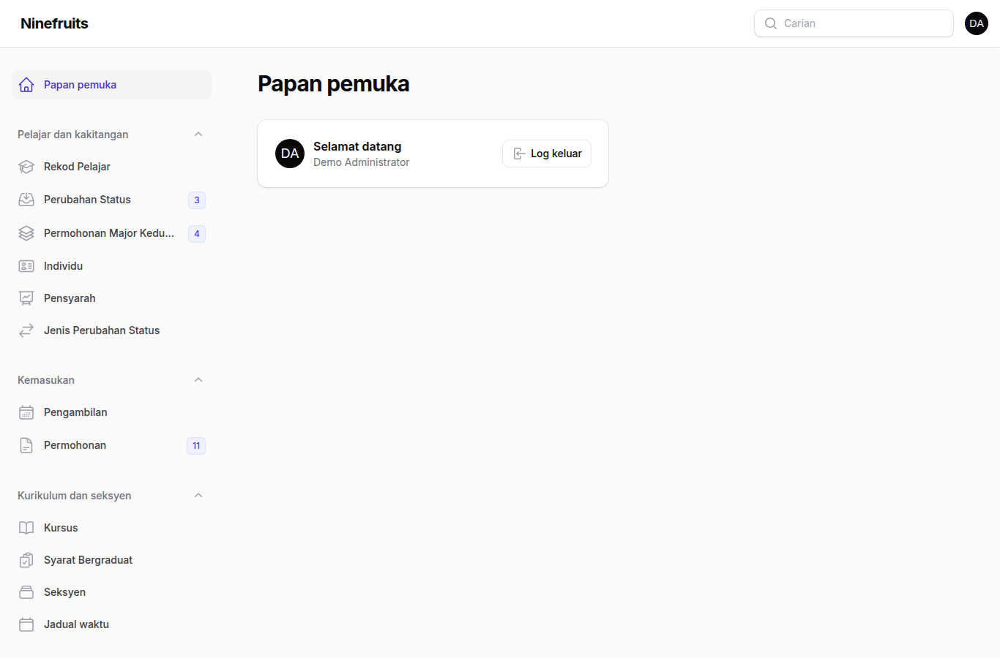
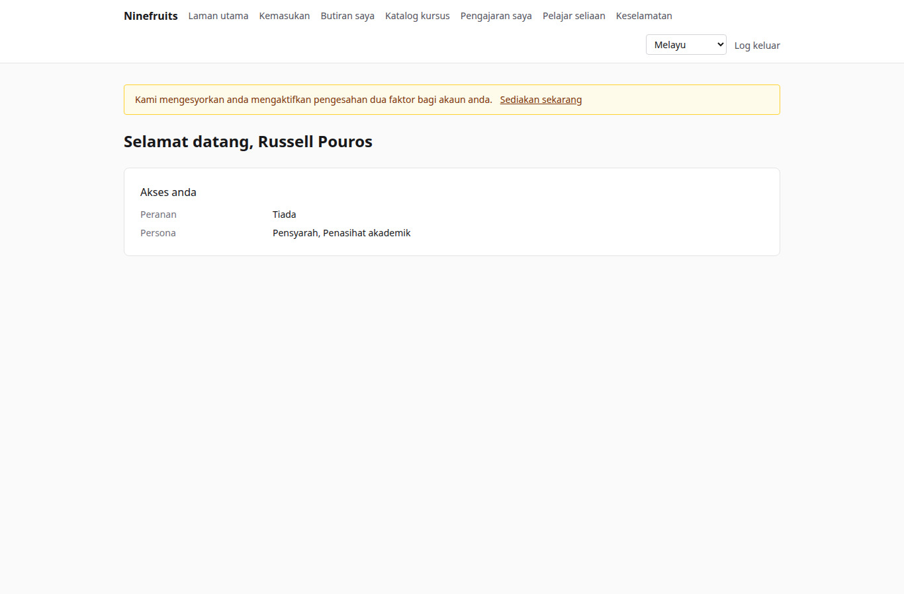
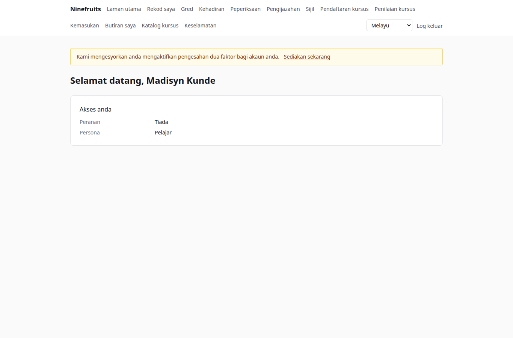

# Ninefruits — Sistem Maklumat Pelajar

**Languages / 언어**

| Bahasa | README | Manual |
|---|---|---|
| 한국어 | [README.md](README.md) | [docs/manual/ko/](docs/manual/ko/README.md) |
| English | [README.en.md](README.en.md) | [docs/manual/en/](docs/manual/en/README.md) |
| 简体中文 | [README.zh_CN.md](README.zh_CN.md) | [docs/manual/zh_CN/](docs/manual/zh_CN/README.md) |
| ລາວ | [README.lo.md](README.lo.md) | [docs/manual/lo/](docs/manual/lo/README.md) |
| Deutsch | [README.de.md](README.de.md) | [docs/manual/de/](docs/manual/de/README.md) |
| Filipino | [README.fil.md](README.fil.md) | [docs/manual/fil/](docs/manual/fil/README.md) |
| Français | [README.fr.md](README.fr.md) | [docs/manual/fr/](docs/manual/fr/README.md) |
| 日本語 | [README.ja.md](README.ja.md) | [docs/manual/ja/](docs/manual/ja/README.md) |
| Монгол | [README.mn.md](README.mn.md) | [docs/manual/mn/](docs/manual/mn/README.md) |
| Bahasa Melayu | [README.ms.md](README.ms.md) (fail ini) | [docs/manual/ms/](docs/manual/ms/README.md) |
| नेपाली | [README.ne.md](README.ne.md) | [docs/manual/ne/](docs/manual/ne/README.md) |
| Русский | [README.ru.md](README.ru.md) | [docs/manual/ru/](docs/manual/ru/README.md) |
| ไทย | [README.th.md](README.th.md) | [docs/manual/th/](docs/manual/th/README.md) |
| Türkçe | [README.tr.md](README.tr.md) | [docs/manual/tr/](docs/manual/tr/README.md) |
| Oʻzbek | [README.uz.md](README.uz.md) | [docs/manual/uz/](docs/manual/uz/README.md) |
| Tiếng Việt | [README.vi.md](README.vi.md) | [docs/manual/vi/](docs/manual/vi/README.md) |

Untuk menambah bahasa lain, lihat [Menambah bahasa](docs/development/adding-a-language.md).

Ninefruits ialah sistem maklumat pelajar yang boleh dipasang oleh mana-mana universiti. Ia meliputi teras pentadbiran akademik — kemasukan, rekod pelajar, kurikulum dan seksyen, pendaftaran kursus, gred, penilaian kursus, sijil, peperiksaan bahasa dan peperiksaan komprehensif, kehadiran, semakan bergraduat, laporan dan asas integrasi LMS — dengan skrin dan dokumen dalam 16 bahasa yang disenaraikan di atas.

## Sekilas pandang

Skrin pertama bagi tiga peranan (data demo).

| Pentadbir (panel pentadbiran) | Pensyarah (portal) | Pelajar (portal) |
|---|---|---|
|  |  |  |

- **Panel pentadbiran** `/admin`: kakitangan mengurus rekod, hal ehwal akademik, kemasukan, sijil, peperiksaan, pengijazahan dan laporan. Kebenaran datang daripada templat peranan (Pegawai Pendaftar, Pegawai Hal Ehwal Akademik, Pegawai Sijil, Pembantu Jabatan, Pegawai Kemasukan, Pentadbir Sistem) yang berskop kepada unit atau program.
- **Portal** `/portal`: pelajar mendaftar kursus, melihat gred, kehadiran, peperiksaan, syarat bergraduat dan sijil; pensyarah mengurus senarai pelajar, kehadiran, kemasukan gred dan keputusan penilaian bagi seksyen mereka; pemohon membuat permohonan. Satu akaun boleh memegang beberapa persona.

## Ciri-ciri

| Bidang | Kandungan |
|---|---|
| Pengguna dan keselamatan | Log masuk bersama, pengesahan dua faktor (aplikasi, e-mel), peranan dengan skop unit/program, audit data dan urusan, keselamatan peringkat baris, data peribadi yang disulitkan |
| Individu dan rekod | Pemisahan individu/rekod, peraturan nombor matrik, perubahan status (penangguhan pengajian, sambung semula pengajian, tarik diri, pemberhentian, kemasukan semula, pengijazahan) dengan kelulusan, penasihat akademik, major kedua dan minor |
| Kemasukan | Pengambilan, permohonan dalam talian dengan dokumen, semakan dan keputusan, penciptaan rekod pelajar bagi pemohon yang diterima masuk |
| Kurikulum | Versi kursus, prasyarat dan kursus setara, syarat bergraduat mengikut tahun kurikulum, seksyen, jadual waktu, rangka kursus |
| Pendaftaran kursus | Set peraturan, had kredit, kapasiti dan senarai menunggu, sekatan dan kelulusan khas, direka untuk puncak pendaftaran kursus |
| Gred | Penilaian mutlak dan relatif, had gred, penghantaran dan pemuktamadan, kelulusan pindaan gred, PNGK dan ulang kursus, tutup semester (amaran, Senarai Dekan), transkrip |
| Penilaian kursus | Respons tanpa nama, borang dan soalan, respons minimum, penerbitan, sekatan paparan gred sehingga selesai |
| Sijil | Jenis dan templat mengikut bahasa, nombor siri, PDF yang disimpan, halaman pengesahan awam dengan QR |
| Peperiksaan | Jenis dengan bidang dan peraturan lulus, pendaftaran sesi, kemasukan keputusan, CSV, penerbitan, pembetulan keputusan, keputusan luar |
| Kehadiran | Sesi kelas daripada waktu kelas mingguan, kemasukan kehadiran, PDF helaian kehadiran, CSV senarai pelajar |
| Pengijazahan | Semakan bergraduat, semakan yang disimpan, pengecualian syarat (peraturan dua orang), pengijazahan dengan nombor ijazah |
| Laporan | Tujuh laporan standard dengan CSV, paparan `reporting` untuk BI |
| Asas integrasi LMS | Platform, pautan kursus, log penyegerakan, penyegerakan dipacu peristiwa, penyelarasan setiap malam, markah LMS sebagai draf gred |

## Tindanan teknologi

PHP 8.5, Laravel 13, Filament 5 (panel pentadbiran), Livewire 4 (portal), PostgreSQL 18 (RLS, audit), Redis dan Horizon (baris gilir), Gotenberg (PDF), Fortify (log masuk, 2FA). Pembangunan dan demo berjalan di atas Docker (Laravel Sail).

## Pemasangan (laman demo)

Hanya Docker diperlukan pada hos; PHP dan Composer berjalan dalam kontena.

```bash
# 1. Dependencies
docker run --rm -u "$(id -u):$(id -g)" -v "$PWD":/app -w /app composer:latest \
    composer install --ignore-platform-req='ext-*'

# 2. Environment file
cp .env.example .env
printf '\nWWWUSER=%s\nWWWGROUP=%s\n' "$(id -u)" "$(id -g)" >> .env

# 3. Containers (database roles are created on first start)
./vendor/bin/sail up -d

# 4. Keys
./vendor/bin/sail artisan key:generate
./vendor/bin/sail artisan pii:generate-key   # put the two printed values in .env

# 5. Install: migrations, essential data, institution settings, first administrator, grade scale
./vendor/bin/sail artisan setup:install --profile=korean-university --grade-scale=4.5

# 6. Demo data and demo accounts per role
./vendor/bin/sail artisan setup:demo --size=small --seed=42

# 7. Assets
./vendor/bin/sail npm install && ./vendor/bin/sail npm run build
```

- Portal: http://localhost/portal · Panel pentadbiran: http://localhost/admin (log masuk yang sama)
- E-mel (Mailpit): http://localhost:8025 · Baris gilir (Horizon): http://localhost/horizon

### Akaun demo

Setiap kata laluan ialah `demo-password` (`config/setup.php`). Pengesahan dua faktor dimatikan.

| Akaun | Peranan / persona | Skrin pertama |
|---|---|---|
| system-administrator@demo.test | Pentadbir Sistem (setiap kebenaran) | /admin |
| registrar@demo.test | Pegawai Pendaftar (rekod, pendaftaran kursus, pemuktamadan gred, sijil, peperiksaan, pengijazahan, laporan) | /admin |
| academic-affairs@demo.test | Pegawai Hal Ehwal Akademik (kursus, seksyen, jadual waktu, dasar penggredan, penilaian, sesi kelas) | /admin |
| certificate-officer@demo.test | Pegawai Sijil | /admin |
| department-assistant@demo.test | Pembantu Jabatan (paparan berskop unit, penasihat akademik, laporan) | /admin |
| admissions-officer@demo.test | Pegawai Kemasukan | /admin |
| instructor@demo.test | Pensyarah dan penasihat akademik (seksyen, kehadiran, kemasukan gred, pelajar seliaan) | /portal |
| student@demo.test | Pelajar semasa | /portal |
| alumni@demo.test | Graduan | /portal |
| readmitted@demo.test | Graduan yang diterima masuk semula (dua rekod) | /portal |
| applicant@demo.test | Pemohon | /portal |
| admitted@demo.test | Pemohon yang diterima masuk | /portal |

Demo ini ialah sebuah universiti rekaan (profil universiti Korea) dengan pelajar, pensyarah, kursus, seksyen, pendaftaran, gred, penilaian, sijil, peperiksaan, kehadiran, semakan bergraduat dan pautan LMS. Jangan sekali-kali memasukkannya dalam produksi (`setup:demo` akan menolak).

## Dokumentasi

- [Manual pentadbir](docs/manual/ms/README.md) (asal dalam bahasa Korea: [docs/manual/ko/](docs/manual/ko/README.md))
- Operasi: [pemasangan](docs/manual/ms/operations/installation.md), [arahan](docs/manual/ms/operations/commands.md), [tugas berjadual](docs/manual/ms/operations/scheduled-jobs.md), [sandaran dan pemulihan](docs/manual/ms/operations/backup-restore.md), [kunci keselamatan](docs/manual/ms/operations/security-keys.md), [penyelesaian masalah](docs/manual/ms/operations/troubleshooting.md)
- [Panduan integrasi LMS](docs/lms-integration-guide.md)
- [Konvensyen pembangunan](docs/development/)
- Sejarah porting dan keputusan reka bentuk (rujukan): [porting/](porting/README.md)

## Pangkalan data produksi

Seorang superuser menjalankan ini sekali.

```bash
psql -v migrator_password=... -v runtime_password=... -v reporting_password=... \
     -f database/sql/roles/create_roles.sql
psql -d <database> -f database/sql/roles/prepare_database.sql
```

Aplikasi bersambung sebagai `app_runtime` (keselamatan peringkat baris digunakan), migrasi sebagai `app_migrator`, alat BI sebagai `app_reporting` (paparan reporting). Lihat [manual pemasangan](docs/manual/ms/operations/installation.md).

## Arahan harian

| Arahan | Fungsi |
|---|---|
| `sail composer check` | Pint, Larastan, semakan penamaan, terjemahan yang tiada, ujian (sama seperti CI) |
| `sail pest` | Ujian |
| `sail artisan migrate` | Migrasi (menggunakan sambungan `app_migrator` secara automatik) |
| `sail artisan setup:install`, `setup:demo` | Pasang/kemas kini, data demo |
| `sail artisan system:health-check` | Tetapan, kunci, peranan pangkalan data, baris gilir, Redis, Gotenberg, storan, penjadual |
| `sail artisan security:sync-permissions` | Menyegerakkan katalog kebenaran daripada kod ke pangkalan data |
| `sail artisan i18n:missing` | Terjemahan yang tiada (`i18n:export`/`i18n:import` untuk bekerja dengan penterjemah) |

Senarai penuh terdapat dalam [rujukan arahan](docs/manual/ms/operations/commands.md).

## Lesen

[Lesen MIT](LICENSE). Bebas digunakan, diubah suai dan diedarkan; kekalkan notis hak cipta dan teks lesen.

---

**Penghargaan**

Terima kasih kami kepada YUSTIC, sistem pentadbiran akademik Yanbian University of Science and Technology, yang telah memungkinkan sistem ini. YUSTIC ialah hasil kerja sekumpulan kecil pembangun yang bermimpi, berpenat lelah dan membina bersama selama bertahun-tahun. Sistem ini ialah cara kami menyatakan betapa kami merindui, menghormati dan berterima kasih kepada rakan sekerja yang pernah bekerja bersama kami.
