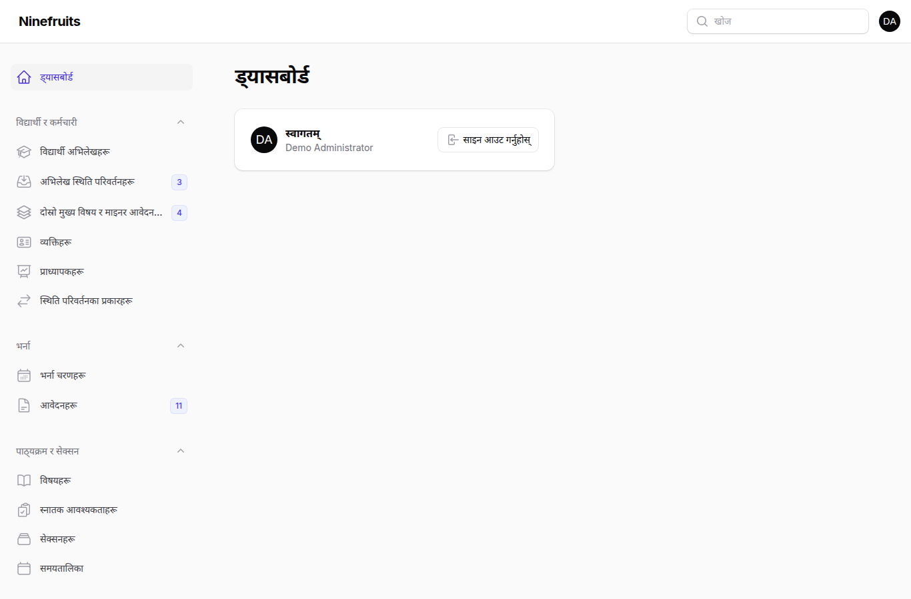
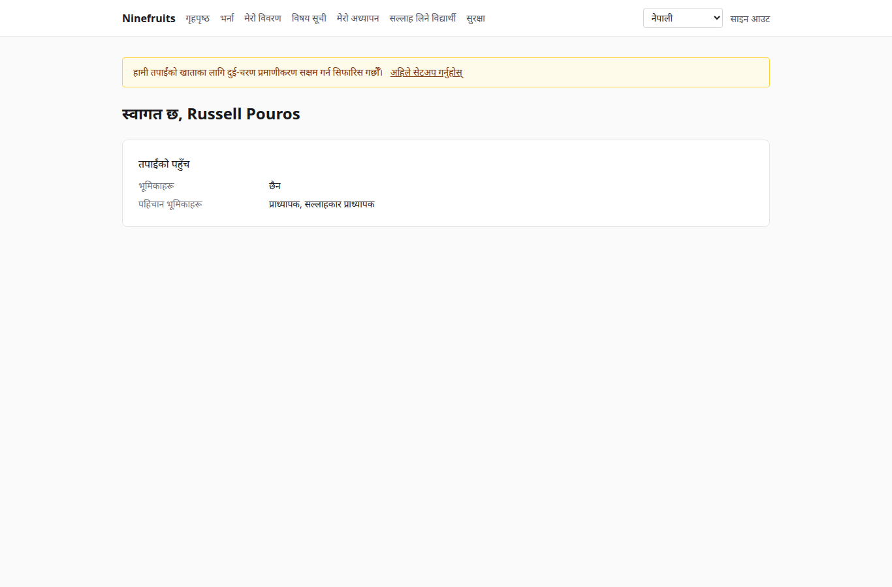
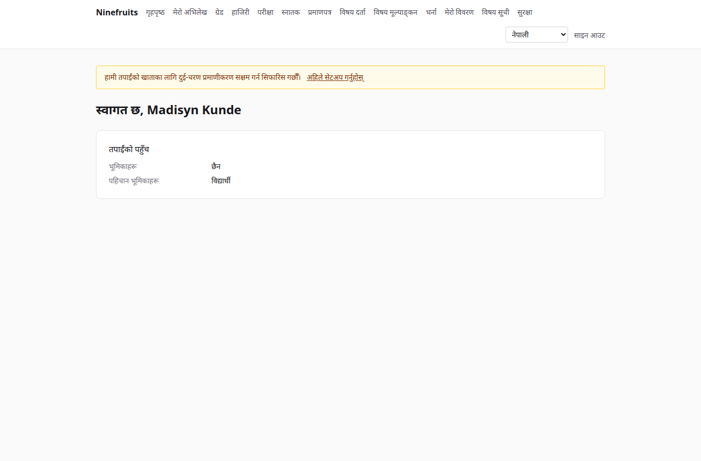

# Ninefruits — विद्यार्थी सूचना प्रणाली

**Languages / 언어**

| भाषा | README | पुस्तिका |
|---|---|---|
| 한국어 | [README.md](README.md) | [docs/manual/ko/](docs/manual/ko/README.md) |
| English | [README.en.md](README.en.md) | [docs/manual/en/](docs/manual/en/README.md) |
| 简体中文 | [README.zh_CN.md](README.zh_CN.md) | [docs/manual/zh_CN/](docs/manual/zh_CN/README.md) |
| ລາວ | [README.lo.md](README.lo.md) | [docs/manual/lo/](docs/manual/lo/README.md) |
| Deutsch | [README.de.md](README.de.md) | [docs/manual/de/](docs/manual/de/README.md) |
| Filipino | [README.fil.md](README.fil.md) | [docs/manual/fil/](docs/manual/fil/README.md) |
| Français | [README.fr.md](README.fr.md) | [docs/manual/fr/](docs/manual/fr/README.md) |
| 日本語 | [README.ja.md](README.ja.md) | [docs/manual/ja/](docs/manual/ja/README.md) |
| Монгол | [README.mn.md](README.mn.md) | [docs/manual/mn/](docs/manual/mn/README.md) |
| Bahasa Melayu | [README.ms.md](README.ms.md) | [docs/manual/ms/](docs/manual/ms/README.md) |
| नेपाली | [README.ne.md](README.ne.md) (यो फाइल) | [docs/manual/ne/](docs/manual/ne/README.md) |
| Русский | [README.ru.md](README.ru.md) | [docs/manual/ru/](docs/manual/ru/README.md) |
| ไทย | [README.th.md](README.th.md) | [docs/manual/th/](docs/manual/th/README.md) |
| Türkçe | [README.tr.md](README.tr.md) | [docs/manual/tr/](docs/manual/tr/README.md) |
| Oʻzbek | [README.uz.md](README.uz.md) | [docs/manual/uz/](docs/manual/uz/README.md) |
| Tiếng Việt | [README.vi.md](README.vi.md) | [docs/manual/vi/](docs/manual/vi/README.md) |

अर्को भाषा थप्न [भाषा थप्ने तरिका](docs/development/adding-a-language.md) हेर्नुहोस्।

Ninefruits कुनै पनि विश्वविद्यालयले स्थापना गर्न सक्ने विद्यार्थी सूचना प्रणाली हो। यसले शैक्षिक प्रशासनका मुख्य पक्षहरू — भर्ना, विद्यार्थी अभिलेख, पाठ्यक्रम र सेक्सन, विषय दर्ता, ग्रेड, विषय मूल्याङ्कन, प्रमाणपत्र, भाषा तथा व्यापक परीक्षा, हाजिरी, स्नातक योग्यता जाँच, प्रतिवेदन र LMS एकीकरणको आधार — समेट्छ, र माथि सूचीबद्ध 16 भाषामा स्क्रिन र कागजातहरू उपलब्ध गराउँछ।

## एक नजरमा

तीन भूमिकाका पहिलो स्क्रिन (डेमो डेटा)।

| प्रशासक (प्रशासन प्यानल) | प्राध्यापक (पोर्टल) | विद्यार्थी (पोर्टल) |
|---|---|---|
|  |  |  |

- **प्रशासन प्यानल** `/admin`: कर्मचारीहरूले अभिलेख, शैक्षिक प्रशासन, भर्ना, प्रमाणपत्र, परीक्षा, स्नातक र प्रतिवेदन सम्हाल्छन्। अनुमतिहरू संगठन एकाइ वा कार्यक्रमको दायरासहितका भूमिका टेम्प्लेटहरू (रजिस्ट्रार, शैक्षिक प्रशासन, प्रमाणपत्र अधिकृत, विभागीय सहायक, भर्ना अधिकृत, प्रणाली प्रशासक) बाट आउँछन्।
- **पोर्टल** `/portal`: विद्यार्थीहरूले विषय दर्ता गर्छन्, ग्रेड, हाजिरी, परीक्षा, स्नातक आवश्यकता र प्रमाणपत्र हेर्छन्; प्राध्यापकहरूले आफ्ना सेक्सनका विद्यार्थी सूची, हाजिरी, ग्रेड प्रविष्टि र मूल्याङ्कन नतिजा व्यवस्थापन गर्छन्; आवेदकहरूले आवेदन दिन्छन्। एउटै खातासँग धेरै पहिचान भूमिका हुन सक्छन्।

## सुविधाहरू

| क्षेत्र | विषयवस्तु |
|---|---|
| प्रयोगकर्ता र सुरक्षा | साझा साइन इन, दुई-चरण प्रमाणीकरण (एप, इमेल), संगठन एकाइ/कार्यक्रम दायरासहितका भूमिकाहरू, डेटा र व्यावसायिक अडिट, row level security, इन्क्रिप्ट गरिएको व्यक्तिगत विवरण |
| व्यक्ति र अभिलेख | व्यक्ति/अभिलेखको विभाजन, विद्यार्थी नम्बरका नियम, स्वीकृतिसहितको अभिलेख स्थिति परिवर्तन (अध्ययन बिदा, अध्ययनमा पुनरागमन, अध्ययन परित्याग, निष्कासन, पुनर्भर्ना, स्नातक), सल्लाहकार प्राध्यापक, दोस्रो मुख्य विषय र माइनर |
| भर्ना | भर्ना चरणहरू, कागजातसहित अनलाइन आवेदन, समीक्षा र निर्णय, भर्ना स्वीकृत आवेदकहरूका लागि अभिलेख सिर्जना |
| पाठ्यक्रम | विषय संस्करणहरू, पूर्वआवश्यक र समकक्ष विषयहरू, पाठ्यक्रम वर्षअनुसार स्नातक आवश्यकता, सेक्सनहरू, समय तालिका, पाठ्यविवरण |
| विषय दर्ता | नियम सेटहरू, क्रेडिट सीमा, क्षमता र प्रतीक्षा सूची, रोक र नियम छुट, दर्ताको उच्च चापका लागि डिजाइन गरिएको |
| ग्रेड | निरपेक्ष र सापेक्ष मूल्याङ्कन, ग्रेड सीमा, पेस गर्ने र अन्तिम गर्ने, परिवर्तन स्वीकृति, GPA र पुनः लिएका विषय, सेमेस्टर बन्द (चेतावनी, सम्मान), ट्रान्सक्रिप्ट |
| विषय मूल्याङ्कन | गुमनाम प्रतिक्रिया, फारम र प्रश्नहरू, न्यूनतम प्रतिक्रिया, प्रकाशन, पूरा नगरेसम्म ग्रेड हेर्न रोक |
| प्रमाणपत्र | भाषाअनुसार प्रकार र टेम्प्लेट, क्रम नम्बर, भण्डारण गरिएका PDF, QR सहितको सार्वजनिक प्रमाणीकरण पृष्ठ |
| परीक्षा | क्षेत्र र उत्तीर्ण नियमसहितका प्रकारहरू, सत्र दर्ता, नतिजा प्रविष्टि, CSV, प्रकाशन, सुधार, बाह्य नतिजा |
| हाजिरी | साप्ताहिक समयबाट कक्षाहरू, हाजिरी प्रविष्टि, हाजिरी पाना PDF, विद्यार्थी सूची CSV |
| स्नातक | स्नातक योग्यता जाँच, सुरक्षित गरिएका जाँच, आवश्यकता छुट (दुई-व्यक्ति नियम), उपाधि नम्बरसहित स्नातक |
| प्रतिवेदन | CSV सहित सात मानक प्रतिवेदन, BI का लागि `reporting` भ्युहरू |
| LMS एकीकरणको आधार | प्लेटफर्महरू, विषय लिङ्कहरू, सिङ्क लग, घटनामा आधारित सिङ्क, रात्रिकालीन मिलान, LMS अङ्कलाई ग्रेड मस्यौदाको रूपमा |

## प्रविधि

PHP 8.5, Laravel 13, Filament 5 (प्रशासन प्यानल), Livewire 4 (पोर्टल), PostgreSQL 18 (RLS, अडिट), Redis र Horizon (क्यु), Gotenberg (PDF), Fortify (साइन इन, 2FA)। विकास र डेमो Docker (Laravel Sail) मा चल्छन्।

## स्थापना (डेमो साइट)

होस्टमा Docker मात्र चाहिन्छ; PHP र Composer कन्टेनरभित्र चल्छन्।

```bash
# 1. Dependencies
docker run --rm -u "$(id -u):$(id -g)" -v "$PWD":/app -w /app composer:latest \
    composer install --ignore-platform-req='ext-*'

# 2. Environment file
cp .env.example .env
printf '\nWWWUSER=%s\nWWWGROUP=%s\n' "$(id -u)" "$(id -g)" >> .env

# 3. Containers (database roles are created on first start)
./vendor/bin/sail up -d

# 4. Keys
./vendor/bin/sail artisan key:generate
./vendor/bin/sail artisan pii:generate-key   # put the two printed values in .env

# 5. Install: migrations, essential data, institution settings, first administrator, grade scale
./vendor/bin/sail artisan setup:install --profile=korean-university --grade-scale=4.5

# 6. Demo data and demo accounts per role
./vendor/bin/sail artisan setup:demo --size=small --seed=42

# 7. Assets
./vendor/bin/sail npm install && ./vendor/bin/sail npm run build
```

- पोर्टल: http://localhost/portal · प्रशासन प्यानल: http://localhost/admin (उही साइन इन)
- मेल (Mailpit): http://localhost:8025 · क्यु (Horizon): http://localhost/horizon

### डेमो खाताहरू

सबै पासवर्ड `demo-password` हुन् (`config/setup.php`)। दुई-चरण प्रमाणीकरण बन्द छ।

| खाता | भूमिका / पहिचान भूमिका | पहिलो स्क्रिन |
|---|---|---|
| system-administrator@demo.test | प्रणाली प्रशासक (सबै अनुमति) | /admin |
| registrar@demo.test | रजिस्ट्रार (अभिलेख, विषय दर्ता, ग्रेड अन्तिम गर्ने, प्रमाणपत्र, परीक्षा, स्नातक, प्रतिवेदन) | /admin |
| academic-affairs@demo.test | शैक्षिक प्रशासन (विषयहरू, सेक्सनहरू, समय तालिका, ग्रेडिङ नीति, मूल्याङ्कन, कक्षाहरू) | /admin |
| certificate-officer@demo.test | प्रमाणपत्र अधिकृत | /admin |
| department-assistant@demo.test | विभागीय सहायक (संगठन एकाइ दायराका दृश्य, सल्लाहकार प्राध्यापक, प्रतिवेदन) | /admin |
| admissions-officer@demo.test | भर्ना अधिकृत | /admin |
| instructor@demo.test | प्राध्यापक र सल्लाहकार प्राध्यापक (सेक्सन, हाजिरी, ग्रेड प्रविष्टि, सल्लाह पाउने विद्यार्थी) | /portal |
| student@demo.test | अध्ययनरत विद्यार्थी | /portal |
| alumni@demo.test | स्नातक भइसकेका | /portal |
| readmitted@demo.test | फेरि भर्ना भएका स्नातक (दुई अभिलेख) | /portal |
| applicant@demo.test | आवेदक | /portal |
| admitted@demo.test | भर्ना स्वीकृत आवेदक | /portal |

डेमो एउटा काल्पनिक विश्वविद्यालय (कोरियाली विश्वविद्यालय प्रोफाइल) हो, जसमा विद्यार्थी, प्राध्यापक, विषय, सेक्सन, विषय दर्ता, ग्रेड, मूल्याङ्कन, प्रमाणपत्र, परीक्षा, हाजिरी, स्नातक योग्यता जाँच र LMS लिङ्कहरू छन्। उत्पादनमा यसलाई कहिल्यै सिड नगर्नुहोस् (`setup:demo` ले अस्वीकार गर्छ)।

## कागजात

- [प्रशासक पुस्तिका](docs/manual/ne/README.md) (कोरियाली मूल: [docs/manual/ko/](docs/manual/ko/README.md))
- सञ्चालन: [स्थापना](docs/manual/ne/operations/installation.md), [कमान्डहरू](docs/manual/ne/operations/commands.md), [निर्धारित कार्यहरू](docs/manual/ne/operations/scheduled-jobs.md), [ब्याकअप र पुनर्स्थापना](docs/manual/ne/operations/backup-restore.md), [सुरक्षा कुञ्जीहरू](docs/manual/ne/operations/security-keys.md), [समस्या समाधान](docs/manual/ne/operations/troubleshooting.md)
- [LMS एकीकरण गाइड](docs/lms-integration-guide.md)
- [विकास नियमहरू](docs/development/)
- पोर्टिङ इतिहास र डिजाइन निर्णयहरू (सन्दर्भ): [porting/](porting/README.md)

## उत्पादन डेटाबेस

सुपरयुजरले यो एक पटक चलाउँछ।

```bash
psql -v migrator_password=... -v runtime_password=... -v reporting_password=... \
     -f database/sql/roles/create_roles.sql
psql -d <database> -f database/sql/roles/prepare_database.sql
```

एप्लिकेसन `app_runtime` को रूपमा जडान हुन्छ (row level security लागू हुन्छ), माइग्रेसन `app_migrator` को रूपमा, र BI उपकरणहरू `app_reporting` (reporting भ्युहरू) को रूपमा। [स्थापना पुस्तिका](docs/manual/ne/operations/installation.md) हेर्नुहोस्।

## दैनिक कमान्डहरू

| कमान्ड | के गर्छ |
|---|---|
| `sail composer check` | Pint, Larastan, नामकरण जाँच, हराएका अनुवाद, परीक्षणहरू (CI जस्तै) |
| `sail pest` | परीक्षणहरू |
| `sail artisan migrate` | माइग्रेसन (स्वतः `app_migrator` जडान प्रयोग गर्छ) |
| `sail artisan setup:install`, `setup:demo` | स्थापना/अद्यावधिक, डेमो डेटा |
| `sail artisan system:health-check` | सेटिङ, कुञ्जी, डेटाबेस भूमिका, क्यु, Redis, Gotenberg, भण्डारण, शेड्युलर |
| `sail artisan security:sync-permissions` | कोडबाट डेटाबेसमा अनुमति सूची सिङ्क गर्छ |
| `sail artisan i18n:missing` | हराएका अनुवाद (अनुवादकहरूसँग काम गर्न `i18n:export`/`i18n:import`) |

पूर्ण सूची [कमान्ड सन्दर्भ](docs/manual/ne/operations/commands.md) मा छ।

## इजाजतपत्र

[MIT License](LICENSE)। स्वतन्त्र रूपमा प्रयोग, परिमार्जन र वितरण गर्नुहोस्; प्रतिलिपि अधिकार सूचना र इजाजतपत्रको पाठ राख्नुहोस्।

---

**आभार**

यो प्रणाली सम्भव बनाउने Yanbian University of Science and Technology को शैक्षिक प्रशासन प्रणाली YUSTIC प्रति हामी आभार व्यक्त गर्छौँ। YUSTIC धेरै वर्षसम्म सँगै सपना देखेका, पसिना बगाएका र निर्माण गरेका विकासकर्ताहरूको सानो टोलीको काम थियो। यो प्रणाली हामीसँग काम गरेका सहकर्मीहरूलाई हामी कति सम्झन्छौँ, सम्मान गर्छौँ र धन्यवाद दिन्छौँ भन्ने व्यक्त गर्ने हाम्रो तरिका हो।
