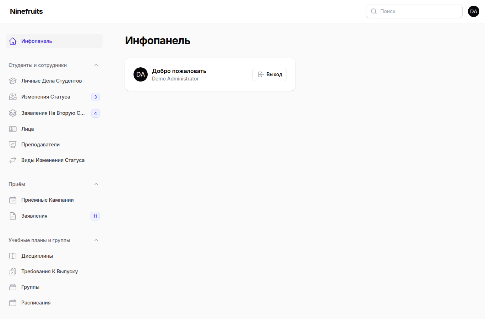
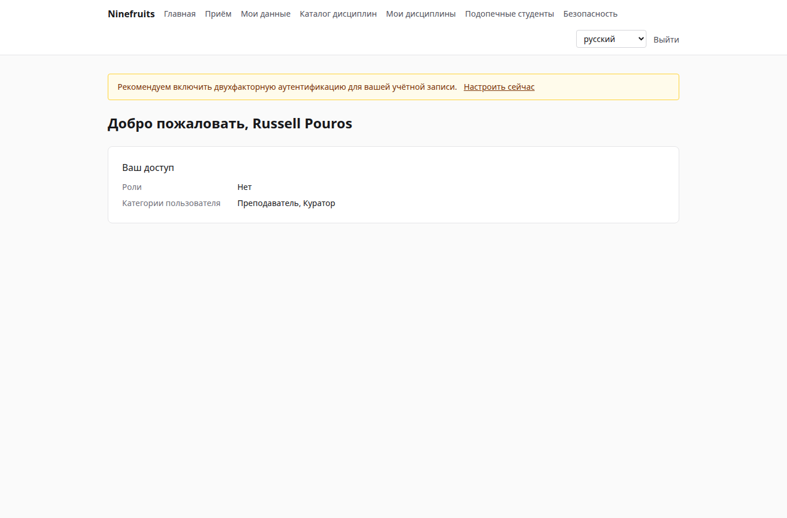
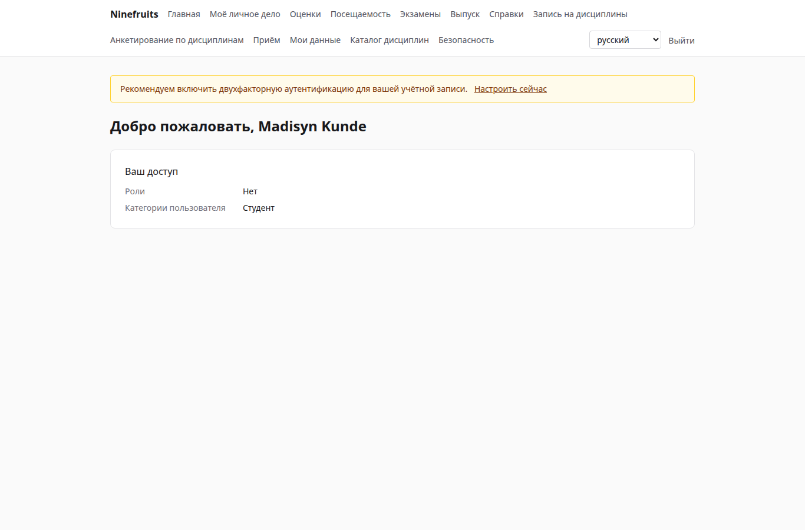

# Ninefruits — система управления учебным процессом

**Языки / 언어**

| Язык | README | Руководство |
|---|---|---|
| 한국어 | [README.md](README.md) | [docs/manual/ko/](docs/manual/ko/README.md) |
| English | [README.en.md](README.en.md) | [docs/manual/en/](docs/manual/en/README.md) |
| 简体中文 | [README.zh_CN.md](README.zh_CN.md) | [docs/manual/zh_CN/](docs/manual/zh_CN/README.md) |
| ລາວ | [README.lo.md](README.lo.md) | [docs/manual/lo/](docs/manual/lo/README.md) |
| Deutsch | [README.de.md](README.de.md) | [docs/manual/de/](docs/manual/de/README.md) |
| Filipino | [README.fil.md](README.fil.md) | [docs/manual/fil/](docs/manual/fil/README.md) |
| Français | [README.fr.md](README.fr.md) | [docs/manual/fr/](docs/manual/fr/README.md) |
| 日本語 | [README.ja.md](README.ja.md) | [docs/manual/ja/](docs/manual/ja/README.md) |
| Монгол | [README.mn.md](README.mn.md) | [docs/manual/mn/](docs/manual/mn/README.md) |
| Bahasa Melayu | [README.ms.md](README.ms.md) | [docs/manual/ms/](docs/manual/ms/README.md) |
| नेपाली | [README.ne.md](README.ne.md) | [docs/manual/ne/](docs/manual/ne/README.md) |
| Русский | [README.ru.md](README.ru.md) (этот файл) | [docs/manual/ru/](docs/manual/ru/README.md) |
| ไทย | [README.th.md](README.th.md) | [docs/manual/th/](docs/manual/th/README.md) |
| Türkçe | [README.tr.md](README.tr.md) | [docs/manual/tr/](docs/manual/tr/README.md) |
| Oʻzbek | [README.uz.md](README.uz.md) | [docs/manual/uz/](docs/manual/uz/README.md) |
| Tiếng Việt | [README.vi.md](README.vi.md) | [docs/manual/vi/](docs/manual/vi/README.md) |

О добавлении нового языка см. [Добавление языка](docs/development/adding-a-language.md).

Ninefruits — система управления учебным процессом, которую может установить любой университет. Она охватывает основу академического администрирования — приём, личные дела студентов, учебные планы и группы, запись на дисциплины, оценки, анкетирование по дисциплинам, справки, языковые и комплексные экзамены, посещаемость, проверку требований к выпуску, отчёты и основу интеграции с LMS — с экранами и документами на 16 перечисленных выше языках.

## Коротко

Первый экран трёх ролей (демонстрационные данные).

| Администратор (панель администрирования) | Преподаватель (портал) | Студент (портал) |
|---|---|---|
|  |  |  |

- **Панель администрирования** `/admin`: сотрудники работают с личными делами, учебной частью, приёмом, справками, экзаменами, выпуском и отчётами. Разрешения задаются шаблонами ролей (сотрудник учебного отдела, сотрудник учебного управления, ответственный за справки, методист кафедры, сотрудник приёмной комиссии, системный администратор) с областью действия по подразделениям или программам.
- **Портал** `/portal`: студенты записываются на дисциплины, смотрят оценки, посещаемость, экзамены, требования к выпуску и справки; преподаватели ведут списки групп, посещаемость, выставление оценок и результаты анкетирования; абитуриенты подают заявления. Одна учётная запись может относиться к нескольким категориям пользователей.

## Возможности

| Область | Содержание |
|---|---|
| Пользователи и безопасность | Общий вход, двухфакторная аутентификация (приложение, эл. почта), роли с областью действия по подразделению/программе, аудит данных и деловых действий, построчная защита (RLS), шифрование персональных данных |
| Лица и личные дела | Разделение лица и личного дела, правила студенческих номеров, изменения статуса (академический отпуск, выход из академического отпуска, отчисление по собственному желанию, отчисление, восстановление, выпуск) с согласованием, кураторы, вторые специальности и minor |
| Приём | Приёмные кампании, онлайн-заявления с документами, рассмотрение и решения, создание личных дел для принятых абитуриентов |
| Учебные планы | Версии дисциплин, пререквизиты и эквивалентные дисциплины, требования к выпуску по году учебного плана, группы, расписания, рабочие программы |
| Запись на дисциплины | Наборы правил, лимиты кредитов, вместимость и листы ожидания, ограничения и исключения из правил, рассчитано на пик записи |
| Оценки | Абсолютное и относительное оценивание, квоты оценок, сдача и утверждение, согласование изменений, средний балл и повторное изучение, закрытие семестра (предупреждения, отличие), академические справки |
| Анкетирование по дисциплинам | Анонимные ответы, анкеты и вопросы, минимальное число ответов, публикация, блокировка просмотра оценок до заполнения |
| Справки | Виды и шаблоны по языкам, регистрационные номера, сохранённые PDF, общедоступная страница проверки с QR-кодом |
| Экзамены | Виды с разделами и правилами зачёта, регистрация на сессии, ввод результатов, CSV, публикация, исправления, внешние результаты |
| Посещаемость | Занятия по еженедельному расписанию, отметка посещаемости, PDF ведомости посещаемости, CSV списка группы |
| Выпуск | Проверки требований к выпуску, сохранённые проверки, освобождения от требований (правило двух лиц), выпуск с номерами дипломов |
| Отчёты | Семь стандартных отчётов с CSV, представления `reporting` для BI |
| Основа интеграции с LMS | Платформы, связи с курсами, журналы синхронизации, синхронизация по событиям, ночная сверка, баллы LMS как черновик оценок |

## Стек

PHP 8.5, Laravel 13, Filament 5 (панель администрирования), Livewire 4 (портал), PostgreSQL 18 (RLS, аудит), Redis и Horizon (очереди), Gotenberg (PDF), Fortify (вход, 2FA). Разработка и демонстрация работают на Docker (Laravel Sail).

## Установка (демонстрационный сайт)

На хосте нужен только Docker; PHP и Composer работают в контейнерах.

```bash
# 1. Dependencies
docker run --rm -u "$(id -u):$(id -g)" -v "$PWD":/app -w /app composer:latest \
    composer install --ignore-platform-req='ext-*'

# 2. Environment file
cp .env.example .env
printf '\nWWWUSER=%s\nWWWGROUP=%s\n' "$(id -u)" "$(id -g)" >> .env

# 3. Containers (database roles are created on first start)
./vendor/bin/sail up -d

# 4. Keys
./vendor/bin/sail artisan key:generate
./vendor/bin/sail artisan pii:generate-key   # put the two printed values in .env

# 5. Install: migrations, essential data, institution settings, first administrator, grade scale
./vendor/bin/sail artisan setup:install --profile=korean-university --grade-scale=4.5

# 6. Demo data and demo accounts per role
./vendor/bin/sail artisan setup:demo --size=small --seed=42

# 7. Assets
./vendor/bin/sail npm install && ./vendor/bin/sail npm run build
```

- Портал: http://localhost/portal · Панель администрирования: http://localhost/admin (единый вход)
- Почта (Mailpit): http://localhost:8025 · Очереди (Horizon): http://localhost/horizon

### Демонстрационные учётные записи

У всех учётных записей пароль `demo-password` (`config/setup.php`). Двухфакторная аутентификация отключена.

| Учётная запись | Роль / категория пользователя | Первый экран |
|---|---|---|
| system-administrator@demo.test | Системный администратор (все разрешения) | /admin |
| registrar@demo.test | Сотрудник учебного отдела (личные дела, запись на дисциплины, утверждение оценок, справки, экзамены, выпуск, отчёты) | /admin |
| academic-affairs@demo.test | Сотрудник учебного управления (дисциплины, группы, расписания, политика оценивания, анкетирование, занятия) | /admin |
| certificate-officer@demo.test | Ответственный за справки | /admin |
| department-assistant@demo.test | Методист кафедры (просмотр в пределах подразделения, кураторы, отчёты) | /admin |
| admissions-officer@demo.test | Сотрудник приёмной комиссии | /admin |
| instructor@demo.test | Преподаватель и куратор (группы, посещаемость, выставление оценок, подопечные студенты) | /portal |
| student@demo.test | Обучающийся студент | /portal |
| alumni@demo.test | Выпускник | /portal |
| readmitted@demo.test | Выпускник, поступивший повторно (два личных дела) | /portal |
| applicant@demo.test | Абитуриент | /portal |
| admitted@demo.test | Принятый абитуриент | /portal |

Демонстрационные данные — это один вымышленный университет (профиль корейского университета) со студентами, преподавателями, дисциплинами, группами, записями на дисциплины, оценками, анкетированием, справками, экзаменами, посещаемостью, проверками требований к выпуску и связями с LMS. Никогда не загружайте их в эксплуатационную среду (`setup:demo` откажется выполняться).

## Документация

- [Руководство администратора](docs/manual/ru/README.md) (корейский оригинал: [docs/manual/ko/](docs/manual/ko/README.md))
- Эксплуатация: [установка](docs/manual/ru/operations/installation.md), [команды](docs/manual/ru/operations/commands.md), [задания по расписанию](docs/manual/ru/operations/scheduled-jobs.md), [резервное копирование и восстановление](docs/manual/ru/operations/backup-restore.md), [ключи безопасности](docs/manual/ru/operations/security-keys.md), [устранение неполадок](docs/manual/ru/operations/troubleshooting.md)
- [Руководство по интеграции с LMS](docs/lms-integration-guide.md)
- [Соглашения о разработке](docs/development/)
- История переноса и проектные решения (для справки): [porting/](porting/README.md)

## База данных для эксплуатации

Суперпользователь выполняет это один раз.

```bash
psql -v migrator_password=... -v runtime_password=... -v reporting_password=... \
     -f database/sql/roles/create_roles.sql
psql -d <database> -f database/sql/roles/prepare_database.sql
```

Приложение подключается как `app_runtime` (действует построчная защита), миграции — как `app_migrator`, BI-инструменты — как `app_reporting` (представления для отчётов). См. [руководство по установке](docs/manual/ru/operations/installation.md).

## Повседневные команды

| Команда | Что делает |
|---|---|
| `sail composer check` | Pint, Larastan, проверка именования, отсутствующие переводы, тесты (как в CI) |
| `sail pest` | Тесты |
| `sail artisan migrate` | Миграции (автоматически используют подключение `app_migrator`) |
| `sail artisan setup:install`, `setup:demo` | Установка/обновление, демонстрационные данные |
| `sail artisan system:health-check` | Настройки, ключи, роли базы данных, очередь, Redis, Gotenberg, хранилище, планировщик |
| `sail artisan security:sync-permissions` | Синхронизация каталога разрешений из кода в базу данных |
| `sail artisan i18n:missing` | Отсутствующие переводы (`i18n:export`/`i18n:import` для работы с переводчиками) |

Полный список — в [справочнике команд](docs/manual/ru/operations/commands.md).

## Лицензия

[Лицензия MIT](LICENSE). Свободно используйте, изменяйте и распространяйте; сохраняйте уведомление об авторских правах и текст лицензии.

---

**Благодарность**

Мы благодарим YUSTIC — систему академического администрирования Яньбяньского университета науки и технологий, благодаря которой стала возможной эта система. YUSTIC была создана небольшой командой разработчиков, которые много лет вместе мечтали, трудились и строили. Эта система — наш способ сказать, как сильно мы скучаем по коллегам, с которыми работали, как уважаем их и как им благодарны.
