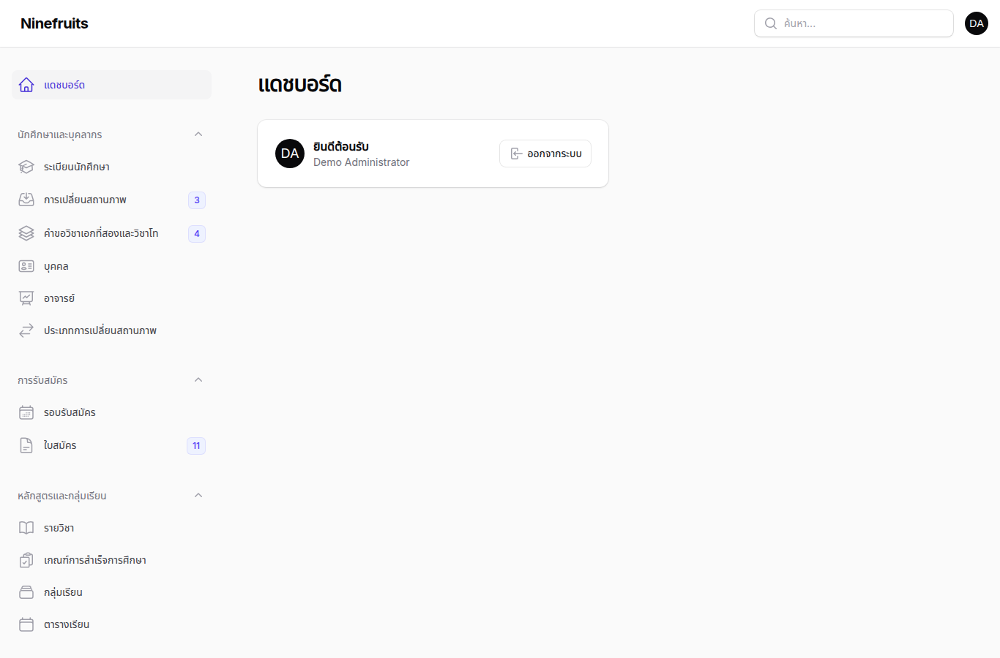
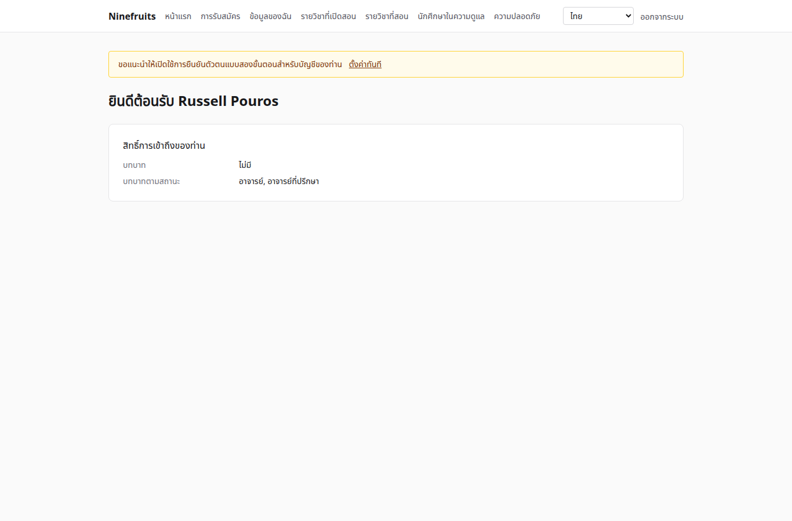
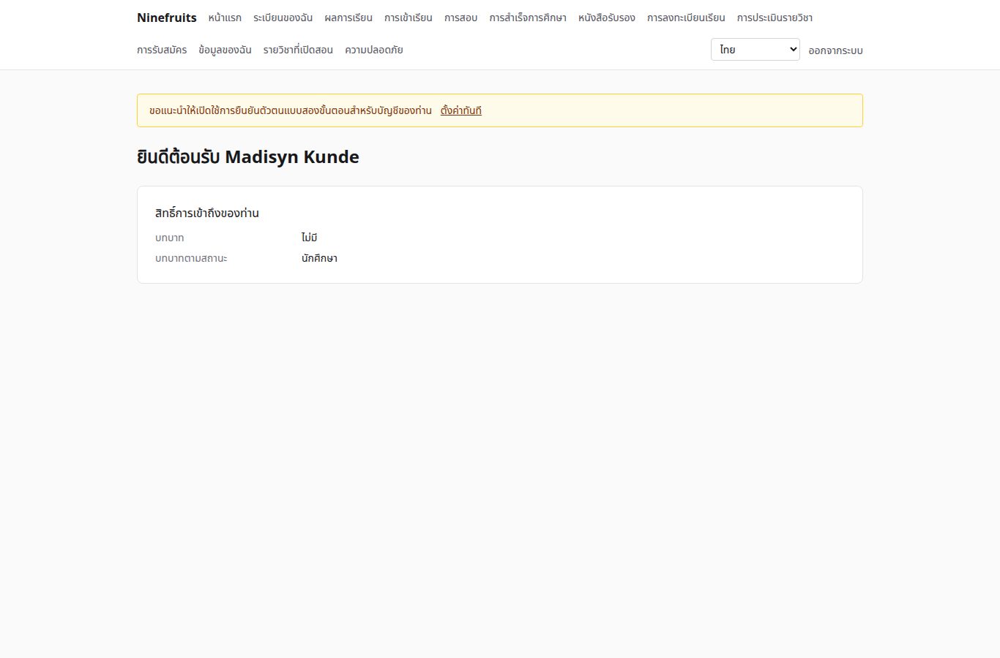

# Ninefruits — ระบบสารสนเทศนักศึกษา

**Languages / 언어**

| ภาษา | README | คู่มือ |
|---|---|---|
| 한국어 | [README.md](README.md) | [docs/manual/ko/](docs/manual/ko/README.md) |
| English | [README.en.md](README.en.md) | [docs/manual/en/](docs/manual/en/README.md) |
| 简体中文 | [README.zh_CN.md](README.zh_CN.md) | [docs/manual/zh_CN/](docs/manual/zh_CN/README.md) |
| ລາວ | [README.lo.md](README.lo.md) | [docs/manual/lo/](docs/manual/lo/README.md) |
| Deutsch | [README.de.md](README.de.md) | [docs/manual/de/](docs/manual/de/README.md) |
| Filipino | [README.fil.md](README.fil.md) | [docs/manual/fil/](docs/manual/fil/README.md) |
| Français | [README.fr.md](README.fr.md) | [docs/manual/fr/](docs/manual/fr/README.md) |
| 日本語 | [README.ja.md](README.ja.md) | [docs/manual/ja/](docs/manual/ja/README.md) |
| Монгол | [README.mn.md](README.mn.md) | [docs/manual/mn/](docs/manual/mn/README.md) |
| Bahasa Melayu | [README.ms.md](README.ms.md) | [docs/manual/ms/](docs/manual/ms/README.md) |
| नेपाली | [README.ne.md](README.ne.md) | [docs/manual/ne/](docs/manual/ne/README.md) |
| Русский | [README.ru.md](README.ru.md) | [docs/manual/ru/](docs/manual/ru/README.md) |
| ไทย | [README.th.md](README.th.md) (ไฟล์นี้) | [docs/manual/th/](docs/manual/th/README.md) |
| Türkçe | [README.tr.md](README.tr.md) | [docs/manual/tr/](docs/manual/tr/README.md) |
| Oʻzbek | [README.uz.md](README.uz.md) | [docs/manual/uz/](docs/manual/uz/README.md) |
| Tiếng Việt | [README.vi.md](README.vi.md) | [docs/manual/vi/](docs/manual/vi/README.md) |

หากต้องการเพิ่มภาษาอื่น ดูที่ [การเพิ่มภาษา](docs/development/adding-a-language.md)

Ninefruits คือระบบสารสนเทศนักศึกษาที่มหาวิทยาลัยใดก็ติดตั้งใช้งานได้ ครอบคลุมงานหลักของการบริหารงานวิชาการ ได้แก่ การรับสมัคร ระเบียนนักศึกษา หลักสูตรและกลุ่มเรียน การลงทะเบียนเรียน ผลการเรียน การประเมินรายวิชา หนังสือรับรอง การสอบวัดความรู้ภาษาและการสอบประมวลความรู้ การเข้าเรียน การตรวจสอบการสำเร็จการศึกษา รายงาน และพื้นฐานสำหรับการเชื่อมต่อ LMS โดยมีหน้าจอและเอกสารใน 16 ภาษาตามรายการด้านบน

## ภาพรวม

หน้าจอแรกของสามบทบาท (ข้อมูลสาธิต)

| ผู้ดูแลระบบ (แผงผู้ดูแลระบบ) | อาจารย์ (พอร์ทัล) | นักศึกษา (พอร์ทัล) |
|---|---|---|
|  |  |  |

- **แผงผู้ดูแลระบบ** `/admin`: เจ้าหน้าที่ดูแลระเบียน งานวิชาการ การรับสมัคร หนังสือรับรอง การสอบ การสำเร็จการศึกษา และรายงาน สิทธิ์มาจากแม่แบบบทบาท (เจ้าหน้าที่ทะเบียน เจ้าหน้าที่ฝ่ายวิชาการ เจ้าหน้าที่ออกหนังสือรับรอง เจ้าหน้าที่ภาควิชา เจ้าหน้าที่รับสมัคร ผู้ดูแลระบบ) ซึ่งกำหนดขอบเขตตามหน่วยงานหรือหลักสูตร
- **พอร์ทัล** `/portal`: นักศึกษาลงทะเบียนเรียน ดูผลการเรียน การเข้าเรียน การสอบ เกณฑ์การสำเร็จการศึกษา และหนังสือรับรอง อาจารย์จัดการรายชื่อนักศึกษา การเข้าเรียน การกรอกเกรด และผลการประเมินของกลุ่มเรียนของตน ผู้สมัครยื่นใบสมัคร บัญชีเดียวมีบทบาทตามสถานะได้หลายบทบาท

## ความสามารถ

| ด้าน | เนื้อหา |
|---|---|
| ผู้ใช้และความปลอดภัย | การเข้าสู่ระบบร่วมกัน การยืนยันตัวตนแบบสองขั้นตอน (แอป อีเมล) บทบาทที่มีขอบเขตตามหน่วยงาน/หลักสูตร การตรวจสอบข้อมูลและการดำเนินงาน การรักษาความปลอดภัยระดับแถว ข้อมูลส่วนบุคคลที่เข้ารหัส |
| บุคคลและระเบียน | การแยกบุคคลกับระเบียน กฎการกำหนดรหัสนักศึกษา การเปลี่ยนสถานภาพ (ลาพักการศึกษา กลับเข้าศึกษา ลาออก พ้นสภาพ คืนสภาพนักศึกษา สำเร็จการศึกษา) พร้อมการอนุมัติ อาจารย์ที่ปรึกษา วิชาเอกที่สองและวิชาโท |
| การรับสมัคร | รอบรับสมัคร ใบสมัครออนไลน์พร้อมเอกสาร การพิจารณาและการตัดสิน การสร้างระเบียนนักศึกษาให้ผู้ได้รับคัดเลือก |
| หลักสูตร | ฉบับรายวิชา วิชาบังคับก่อนและรายวิชาเทียบเท่า เกณฑ์การสำเร็จการศึกษาตามปีหลักสูตร กลุ่มเรียน ตารางเรียน ประมวลรายวิชา |
| การลงทะเบียนเรียน | ชุดกฎ หน่วยกิตสูงสุด ความจุและรายชื่อสำรอง การระงับและการอนุญาตพิเศษ ออกแบบมาสำหรับช่วงลงทะเบียนเรียนหนาแน่น |
| ผลการเรียน | การวัดผลแบบอิงเกณฑ์และแบบอิงกลุ่ม สัดส่วนสูงสุดของเกรด การส่งและการยืนยันเกรด การอนุมัติการแก้ไขเกรด เกรดเฉลี่ยและการเรียนซ้ำ การปิดภาคการศึกษา (รอพินิจ เกียรตินิยม) ใบแสดงผลการเรียน |
| การประเมินรายวิชา | การตอบแบบไม่ระบุตัวตน แบบประเมินและคำถาม จำนวนผู้ตอบขั้นต่ำ การประกาศผล การปิดกั้นการดูเกรดจนกว่าจะประเมินเสร็จ |
| หนังสือรับรอง | ประเภทและแม่แบบตามภาษา เลขที่เอกสาร ไฟล์ PDF ที่จัดเก็บไว้ หน้าตรวจสอบสาธารณะพร้อม QR |
| การสอบ | ประเภทการสอบพร้อมส่วนการสอบและกฎการผ่าน การสมัครสอบตามรอบสอบ การกรอกผลสอบ CSV การประกาศผล การแก้ไขผลสอบ ผลสอบจากภายนอก |
| การเข้าเรียน | ครั้งเรียนจากเวลาเรียนรายสัปดาห์ การบันทึกการเข้าเรียน ใบรายชื่อเช็กชื่อแบบ PDF รายชื่อนักศึกษาแบบ CSV |
| การสำเร็จการศึกษา | การตรวจสอบการสำเร็จการศึกษา ผลการตรวจสอบที่จัดเก็บไว้ การยกเว้นเกณฑ์ (หลักการสองบุคคล) การสำเร็จการศึกษาพร้อมเลขที่ปริญญาบัตร |
| รายงาน | รายงานมาตรฐานเจ็ดรายการพร้อม CSV, วิว `reporting` สำหรับ BI |
| พื้นฐานการเชื่อมต่อ LMS | แพลตฟอร์ม การเชื่อมโยงรายวิชา บันทึกการซิงค์ การซิงค์ตามเหตุการณ์ การกระทบยอดทุกคืน คะแนนจาก LMS เป็นฉบับร่างเกรด |

## เทคโนโลยีที่ใช้

PHP 8.5, Laravel 13, Filament 5 (แผงผู้ดูแลระบบ), Livewire 4 (พอร์ทัล), PostgreSQL 18 (RLS, การตรวจสอบ), Redis และ Horizon (คิว), Gotenberg (PDF), Fortify (การเข้าสู่ระบบ, 2FA) การพัฒนาและการสาธิตทำงานบน Docker (Laravel Sail)

## การติดตั้ง (เว็บไซต์สาธิต)

เครื่องโฮสต์ต้องมีเพียง Docker เท่านั้น PHP และ Composer ทำงานในคอนเทนเนอร์

```bash
# 1. Dependencies
docker run --rm -u "$(id -u):$(id -g)" -v "$PWD":/app -w /app composer:latest \
    composer install --ignore-platform-req='ext-*'

# 2. Environment file
cp .env.example .env
printf '\nWWWUSER=%s\nWWWGROUP=%s\n' "$(id -u)" "$(id -g)" >> .env

# 3. Containers (database roles are created on first start)
./vendor/bin/sail up -d

# 4. Keys
./vendor/bin/sail artisan key:generate
./vendor/bin/sail artisan pii:generate-key   # put the two printed values in .env

# 5. Install: migrations, essential data, institution settings, first administrator, grade scale
./vendor/bin/sail artisan setup:install --profile=korean-university --grade-scale=4.5

# 6. Demo data and demo accounts per role
./vendor/bin/sail artisan setup:demo --size=small --seed=42

# 7. Assets
./vendor/bin/sail npm install && ./vendor/bin/sail npm run build
```

- พอร์ทัล: http://localhost/portal · แผงผู้ดูแลระบบ: http://localhost/admin (เข้าสู่ระบบด้วยบัญชีเดียวกัน)
- อีเมล (Mailpit): http://localhost:8025 · คิว (Horizon): http://localhost/horizon

### บัญชีสาธิต

รหัสผ่านทุกบัญชีคือ `demo-password` (`config/setup.php`) การยืนยันตัวตนแบบสองขั้นตอนปิดอยู่

| บัญชี | บทบาท / บทบาทตามสถานะ | หน้าจอแรก |
|---|---|---|
| system-administrator@demo.test | ผู้ดูแลระบบ (สิทธิ์ทุกรายการ) | /admin |
| registrar@demo.test | เจ้าหน้าที่ทะเบียน (ระเบียน การลงทะเบียนเรียน การยืนยันเกรด หนังสือรับรอง การสอบ การสำเร็จการศึกษา รายงาน) | /admin |
| academic-affairs@demo.test | เจ้าหน้าที่ฝ่ายวิชาการ (รายวิชา กลุ่มเรียน ตารางเรียน นโยบายการให้เกรด การประเมิน ครั้งเรียน) | /admin |
| certificate-officer@demo.test | เจ้าหน้าที่ออกหนังสือรับรอง | /admin |
| department-assistant@demo.test | เจ้าหน้าที่ภาควิชา (การดูข้อมูลภายในขอบเขตหน่วยงาน อาจารย์ที่ปรึกษา รายงาน) | /admin |
| admissions-officer@demo.test | เจ้าหน้าที่รับสมัคร | /admin |
| instructor@demo.test | อาจารย์และอาจารย์ที่ปรึกษา (กลุ่มเรียน การเข้าเรียน การกรอกเกรด นักศึกษาในความดูแล) | /portal |
| student@demo.test | นักศึกษาปัจจุบัน | /portal |
| alumni@demo.test | ผู้สำเร็จการศึกษา | /portal |
| readmitted@demo.test | ผู้สำเร็จการศึกษาที่รับเข้าศึกษาอีกครั้ง (สองระเบียน) | /portal |
| applicant@demo.test | ผู้สมัคร | /portal |
| admitted@demo.test | ผู้สมัครที่ได้รับการรับเข้าศึกษา | /portal |

ข้อมูลสาธิตเป็นมหาวิทยาลัยสมมติหนึ่งแห่ง (โปรไฟล์มหาวิทยาลัยเกาหลี) ประกอบด้วยนักศึกษา อาจารย์ รายวิชา กลุ่มเรียน รายการลงทะเบียน เกรด การประเมิน หนังสือรับรอง การสอบ การเข้าเรียน การตรวจสอบการสำเร็จการศึกษา และการเชื่อมโยง LMS ห้ามใส่ข้อมูลนี้ในระบบใช้งานจริงโดยเด็ดขาด (`setup:demo` จะปฏิเสธ)

## เอกสาร

- [คู่มือผู้ดูแลระบบ](docs/manual/th/README.md) (ต้นฉบับภาษาเกาหลี: [docs/manual/ko/](docs/manual/ko/README.md))
- การดูแลระบบ: [การติดตั้ง](docs/manual/th/operations/installation.md), [คำสั่ง](docs/manual/th/operations/commands.md), [งานตามกำหนดเวลา](docs/manual/th/operations/scheduled-jobs.md), [การสำรองและกู้คืนข้อมูล](docs/manual/th/operations/backup-restore.md), [คีย์ความปลอดภัย](docs/manual/th/operations/security-keys.md), [การแก้ไขปัญหา](docs/manual/th/operations/troubleshooting.md)
- [คู่มือการเชื่อมต่อ LMS](docs/lms-integration-guide.md)
- [ข้อตกลงในการพัฒนา](docs/development/)
- ประวัติการพอร์ตและการตัดสินใจด้านการออกแบบ (อ้างอิง): [porting/](porting/README.md)

## ฐานข้อมูลสำหรับระบบใช้งานจริง

superuser ดำเนินการครั้งเดียว

```bash
psql -v migrator_password=... -v runtime_password=... -v reporting_password=... \
     -f database/sql/roles/create_roles.sql
psql -d <database> -f database/sql/roles/prepare_database.sql
```

แอปพลิเคชันเชื่อมต่อด้วย `app_runtime` (ใช้การรักษาความปลอดภัยระดับแถว) ไมเกรชันใช้ `app_migrator` และเครื่องมือ BI ใช้ `app_reporting` (วิวสำหรับรายงาน) ดู [คู่มือการติดตั้ง](docs/manual/th/operations/installation.md)

## คำสั่งที่ใช้ประจำ

| คำสั่ง | หน้าที่ |
|---|---|
| `sail composer check` | Pint, Larastan, การตรวจสอบการตั้งชื่อ คำแปลที่ขาดหาย การทดสอบ (เหมือนกับ CI) |
| `sail pest` | การทดสอบ |
| `sail artisan migrate` | ไมเกรชัน (ใช้การเชื่อมต่อ `app_migrator` โดยอัตโนมัติ) |
| `sail artisan setup:install`, `setup:demo` | การติดตั้ง/อัปเดต ข้อมูลสาธิต |
| `sail artisan system:health-check` | การตั้งค่า คีย์ บทบาทของฐานข้อมูล คิว Redis Gotenberg ที่จัดเก็บไฟล์ ตัวจัดกำหนดเวลา |
| `sail artisan security:sync-permissions` | ซิงค์แคตตาล็อกสิทธิ์จากโค้ดไปยังฐานข้อมูล |
| `sail artisan i18n:missing` | คำแปลที่ขาดหาย (`i18n:export`/`i18n:import` สำหรับทำงานร่วมกับผู้แปล) |

รายการทั้งหมดอยู่ใน [ข้อมูลอ้างอิงคำสั่ง](docs/manual/th/operations/commands.md)

## สัญญาอนุญาต

[สัญญาอนุญาต MIT](LICENSE) ใช้งาน แก้ไข และเผยแพร่ได้อย่างอิสระ โดยคงประกาศลิขสิทธิ์และข้อความสัญญาอนุญาตไว้

---

**กิตติกรรมประกาศ**

ขอขอบคุณ YUSTIC ระบบบริหารงานวิชาการของมหาวิทยาลัยวิทยาศาสตร์และเทคโนโลยีเหยียนเปียน (Yanbian University of Science and Technology) ซึ่งทำให้ระบบนี้เกิดขึ้นได้ YUSTIC เป็นผลงานของทีมนักพัฒนากลุ่มเล็ก ๆ ที่ร่วมกันฝัน ทุ่มเทแรงกาย และสร้างสรรค์ด้วยกันมาหลายปี ระบบนี้คือวิธีที่เราใช้บอกว่าเราคิดถึง เคารพ และขอบคุณเพื่อนร่วมงานที่เราได้ทำงานด้วยมากเพียงใด
