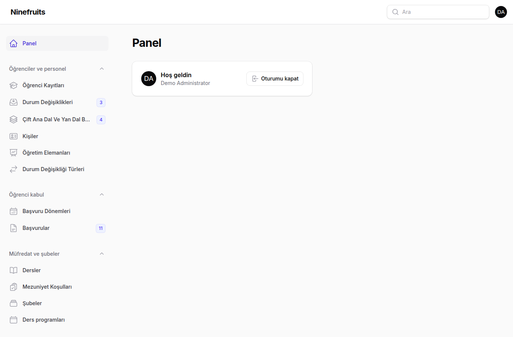
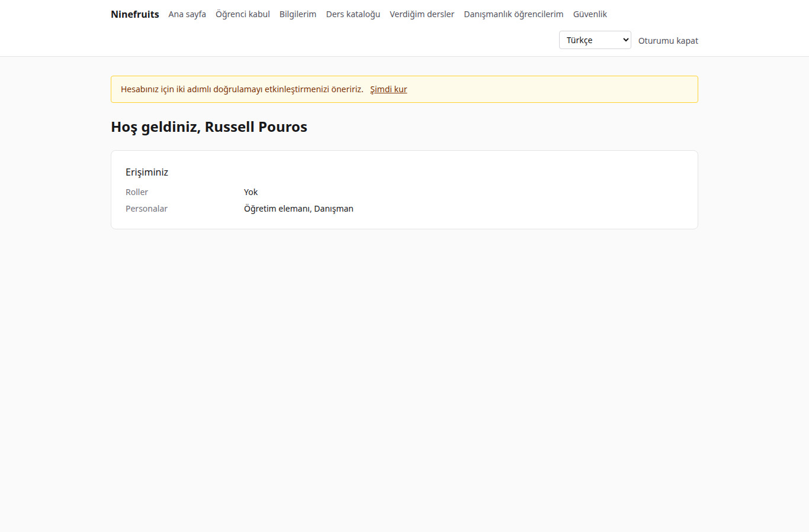
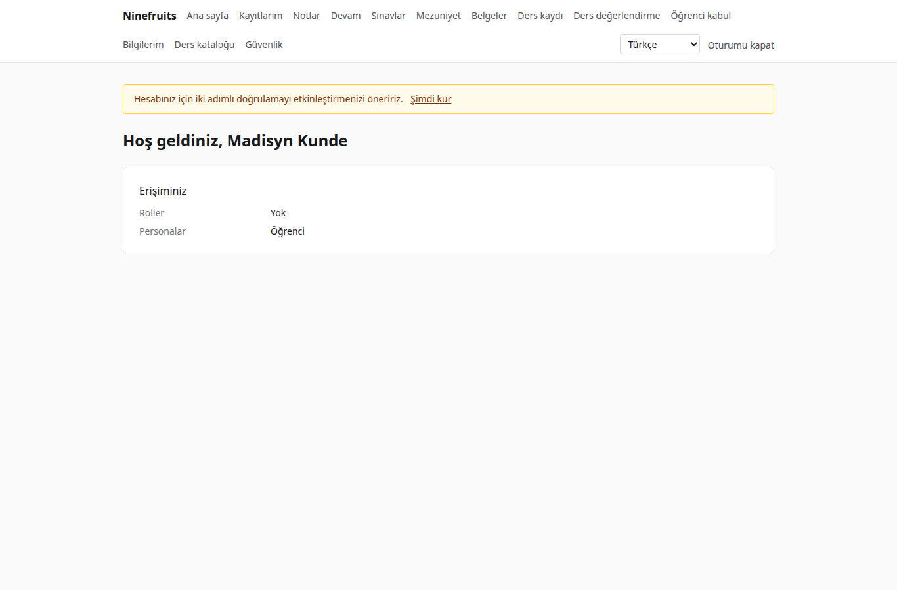

# Ninefruits — Öğrenci Bilgi Sistemi

**Diller / 언어**

| Dil | README | Kılavuz |
|---|---|---|
| 한국어 | [README.md](README.md) | [docs/manual/ko/](docs/manual/ko/README.md) |
| English | [README.en.md](README.en.md) | [docs/manual/en/](docs/manual/en/README.md) |
| 简体中文 | [README.zh_CN.md](README.zh_CN.md) | [docs/manual/zh_CN/](docs/manual/zh_CN/README.md) |
| ລາວ | [README.lo.md](README.lo.md) | [docs/manual/lo/](docs/manual/lo/README.md) |
| Deutsch | [README.de.md](README.de.md) | [docs/manual/de/](docs/manual/de/README.md) |
| Filipino | [README.fil.md](README.fil.md) | [docs/manual/fil/](docs/manual/fil/README.md) |
| Français | [README.fr.md](README.fr.md) | [docs/manual/fr/](docs/manual/fr/README.md) |
| 日本語 | [README.ja.md](README.ja.md) | [docs/manual/ja/](docs/manual/ja/README.md) |
| Монгол | [README.mn.md](README.mn.md) | [docs/manual/mn/](docs/manual/mn/README.md) |
| Bahasa Melayu | [README.ms.md](README.ms.md) | [docs/manual/ms/](docs/manual/ms/README.md) |
| नेपाली | [README.ne.md](README.ne.md) | [docs/manual/ne/](docs/manual/ne/README.md) |
| Русский | [README.ru.md](README.ru.md) | [docs/manual/ru/](docs/manual/ru/README.md) |
| ไทย | [README.th.md](README.th.md) | [docs/manual/th/](docs/manual/th/README.md) |
| Türkçe | [README.tr.md](README.tr.md) (bu dosya) | [docs/manual/tr/](docs/manual/tr/README.md) |
| Oʻzbek | [README.uz.md](README.uz.md) | [docs/manual/uz/](docs/manual/uz/README.md) |
| Tiếng Việt | [README.vi.md](README.vi.md) | [docs/manual/vi/](docs/manual/vi/README.md) |

Başka bir dil eklemek için [Dil ekleme](docs/development/adding-a-language.md) belgesine bakın.

Ninefruits, her üniversitenin kurabileceği bir öğrenci bilgi sistemidir. Akademik yönetimin çekirdeğini kapsar — öğrenci kabul, öğrenci kayıtları, müfredat ve şubeler, ders kaydı, notlar, ders değerlendirme, belgeler, dil ve yeterlik sınavları, devam, mezuniyet denetimleri, raporlar ve bir LMS entegrasyon altyapısı — ve ekranlar ile belgeler yukarıda listelenen 16 dilde sunulur.

## Bir bakışta

Üç rolün ilk ekranı (demo verileri).

| Yönetici (yönetim paneli) | Öğretim elemanı (portal) | Öğrenci (portal) |
|---|---|---|
|  |  |  |

- **Yönetim paneli** `/admin`: personel kayıtları, akademik işleri, öğrenci kabulü, belgeleri, sınavları, mezuniyeti ve raporları yönetir. Yetkiler, birimlere veya programlara kapsamlandırılmış rol şablonlarından gelir (Öğrenci İşleri, Akademik İşler, Belge Sorumlusu, Bölüm Asistanı, Öğrenci Kabul Sorumlusu, Sistem Yöneticisi).
- **Portal** `/portal`: öğrenciler ders kaydı yapar; notları, devamı, sınavları, mezuniyet koşullarını ve belgeleri görür; öğretim elemanları şubelerinin sınıf listelerini, devamı, not girişini ve değerlendirme sonuçlarını yönetir; adaylar başvuru yapar. Bir hesap birden fazla personaya sahip olabilir.

## Özellikler

| Alan | İçerik |
|---|---|
| Kullanıcılar ve güvenlik | Ortak oturum açma, iki adımlı doğrulama (uygulama, e-posta), birim/program kapsamlı roller, veri ve iş denetimi, satır düzeyi güvenlik, şifrelenmiş kişisel veriler |
| Kişiler ve kayıtlar | Kişi/kayıt ayrımı, öğrenci numarası kuralları, onaylı durum değişiklikleri (kayıt dondurma, kayıt dondurma sonrası dönüş, kendi isteğiyle ayrılma, ilişik kesme, yeniden kayıt, mezuniyet), danışmanlar, çift ana dallar ve yan dallar |
| Öğrenci kabul | Başvuru dönemleri, evraklı çevrim içi başvurular, inceleme ve kararlar, kabul edilen adaylar için kayıt oluşturma |
| Müfredat | Ders sürümleri, ön koşullar ve eşdeğer dersler, müfredat yılına göre mezuniyet koşulları, şubeler, ders programları, ders izlenceleri |
| Ders kaydı | Kural setleri, kredi sınırları, kontenjan ve bekleme listeleri, kısıtlamalar ve kural istisnaları, ders kaydı yoğunluğu için tasarlanmış |
| Notlar | Mutlak ve bağıl değerlendirme, not üst sınırları, gönderme ve kesinleştirme, değişiklik onayı, not ortalaması ve ders tekrarı, dönem kapatma (uyarılar, onur dereceleri), transkriptler |
| Ders değerlendirme | Anonim yanıtlar, formlar ve sorular, en az yanıt sayısı, yayımlama, değerlendirme tamamlanana kadar not görüntüleme engeli |
| Belgeler | Dile göre türler ve şablonlar, seri numaraları, saklanan PDF'ler, QR kodlu herkese açık doğrulama sayfası |
| Sınavlar | Alanları ve geçme kuralları olan türler, oturuma kayıt, sonuç girişi, CSV, yayımlama, düzeltmeler, dış sonuçlar |
| Devam | Haftalık ders zamanlarından ders oturumları, devam girişi, yoklama çizelgesi PDF'i, sınıf listesi CSV'si |
| Mezuniyet | Mezuniyet denetimleri, saklanan denetimler, koşul muafiyetleri (iki kişi kuralı), diploma numaralarıyla mezuniyet |
| Raporlar | CSV destekli yedi standart rapor, BI için `reporting` görünümleri |
| LMS entegrasyon altyapısı | Platformlar, ders bağlantıları, eşitleme günlükleri, olay güdümlü eşitleme, gece mutabakatı, not taslağı olarak LMS puanları |

## Teknoloji yığını

PHP 8.5, Laravel 13, Filament 5 (yönetim paneli), Livewire 4 (portal), PostgreSQL 18 (RLS, denetim), Redis ve Horizon (kuyruklar), Gotenberg (PDF), Fortify (oturum açma, 2FA). Geliştirme ve demo Docker (Laravel Sail) üzerinde çalışır.

## Kurulum (demo sitesi)

Ana makinede yalnızca Docker gerekir; PHP ve Composer konteynerlerde çalışır.

```bash
# 1. Dependencies
docker run --rm -u "$(id -u):$(id -g)" -v "$PWD":/app -w /app composer:latest \
    composer install --ignore-platform-req='ext-*'

# 2. Environment file
cp .env.example .env
printf '\nWWWUSER=%s\nWWWGROUP=%s\n' "$(id -u)" "$(id -g)" >> .env

# 3. Containers (database roles are created on first start)
./vendor/bin/sail up -d

# 4. Keys
./vendor/bin/sail artisan key:generate
./vendor/bin/sail artisan pii:generate-key   # put the two printed values in .env

# 5. Install: migrations, essential data, institution settings, first administrator, grade scale
./vendor/bin/sail artisan setup:install --profile=korean-university --grade-scale=4.5

# 6. Demo data and demo accounts per role
./vendor/bin/sail artisan setup:demo --size=small --seed=42

# 7. Assets
./vendor/bin/sail npm install && ./vendor/bin/sail npm run build
```

- Portal: http://localhost/portal · Yönetim paneli: http://localhost/admin (aynı oturum açma)
- E-posta (Mailpit): http://localhost:8025 · Kuyruklar (Horizon): http://localhost/horizon

### Demo hesapları

Tüm parolalar `demo-password` şeklindedir (`config/setup.php`). İki adımlı doğrulama kapalıdır.

| Hesap | Rol / persona | İlk ekran |
|---|---|---|
| system-administrator@demo.test | Sistem Yöneticisi (tüm yetkiler) | /admin |
| registrar@demo.test | Öğrenci İşleri (kayıtlar, ders kaydı, notların kesinleştirilmesi, belgeler, sınavlar, mezuniyet, raporlar) | /admin |
| academic-affairs@demo.test | Akademik İşler (dersler, şubeler, ders programları, not politikası, değerlendirme, ders oturumları) | /admin |
| certificate-officer@demo.test | Belge Sorumlusu | /admin |
| department-assistant@demo.test | Bölüm Asistanı (birim kapsamlı görünümler, danışmanlar, raporlar) | /admin |
| admissions-officer@demo.test | Öğrenci Kabul Sorumlusu | /admin |
| instructor@demo.test | Öğretim elemanı ve danışman (şubeler, devam, not girişi, danışmanlık öğrencileri) | /portal |
| student@demo.test | Kayıtlı öğrenci | /portal |
| alumni@demo.test | Mezun | /portal |
| readmitted@demo.test | Yeniden kabul edilen mezun (iki kayıt) | /portal |
| applicant@demo.test | Aday | /portal |
| admitted@demo.test | Kabul edilen aday | /portal |

Demo; öğrencileri, öğretim elemanları, dersleri, şubeleri, ders kayıtları, notları, değerlendirmeleri, belgeleri, sınavları, devam kayıtları, mezuniyet denetimleri ve LMS bağlantılarıyla hayali tek bir üniversitedir (Kore üniversitesi profili). Üretim ortamına hiçbir zaman yüklemeyin (`setup:demo` reddeder).

## Belgeler

- [Yönetici kılavuzu](docs/manual/tr/README.md) (Korece özgün metin: [docs/manual/ko/](docs/manual/ko/README.md))
- İşletim: [kurulum](docs/manual/tr/operations/installation.md), [komutlar](docs/manual/tr/operations/commands.md), [zamanlanmış işler](docs/manual/tr/operations/scheduled-jobs.md), [yedekleme ve geri yükleme](docs/manual/tr/operations/backup-restore.md), [güvenlik anahtarları](docs/manual/tr/operations/security-keys.md), [sorun giderme](docs/manual/tr/operations/troubleshooting.md)
- [LMS entegrasyon kılavuzu](docs/lms-integration-guide.md)
- [Geliştirme kuralları](docs/development/)
- Taşıma geçmişi ve tasarım kararları (başvuru için): [porting/](porting/README.md)

## Üretim veritabanı

Bir süper kullanıcı bunu bir kez çalıştırır.

```bash
psql -v migrator_password=... -v runtime_password=... -v reporting_password=... \
     -f database/sql/roles/create_roles.sql
psql -d <database> -f database/sql/roles/prepare_database.sql
```

Uygulama `app_runtime` olarak bağlanır (satır düzeyi güvenlik uygulanır), migration'lar `app_migrator` olarak, BI araçları ise `app_reporting` olarak (raporlama görünümleri) bağlanır. [Kurulum kılavuzuna](docs/manual/tr/operations/installation.md) bakın.

## Günlük komutlar

| Komut | Ne yapar |
|---|---|
| `sail composer check` | Pint, Larastan, adlandırma kontrolü, eksik çeviriler, testler (CI ile aynı) |
| `sail pest` | Testler |
| `sail artisan migrate` | Migration'lar (`app_migrator` bağlantısını otomatik kullanır) |
| `sail artisan setup:install`, `setup:demo` | Kurulum/güncelleme, demo verileri |
| `sail artisan system:health-check` | Ayarlar, anahtarlar, veritabanı rolleri, kuyruk, Redis, Gotenberg, depolama, zamanlayıcı |
| `sail artisan security:sync-permissions` | Yetki kataloğunu koddan veritabanına eşitler |
| `sail artisan i18n:missing` | Eksik çeviriler (çevirmenlerle çalışmak için `i18n:export`/`i18n:import`) |

Tam liste [komut başvurusunda](docs/manual/tr/operations/commands.md) bulunur.

## Lisans

[MIT Lisansı](LICENSE). Özgürce kullanın, değiştirin ve dağıtın; telif hakkı bildirimini ve lisans metnini koruyun.

---

**Teşekkür**

Bu sistemi mümkün kılan, Yanbian Bilim ve Teknoloji Üniversitesi'nin akademik yönetim sistemi YUSTIC'e teşekkür ederiz. YUSTIC, uzun yıllar boyunca birlikte hayal kuran, emek veren ve inşa eden küçük bir geliştirici ekibinin eseriydi. Bu sistem, birlikte çalıştığımız meslektaşlarımızı ne kadar özlediğimizi, onlara ne kadar saygı duyduğumuzu ve ne kadar minnettar olduğumuzu ifade etme biçimimizdir.
