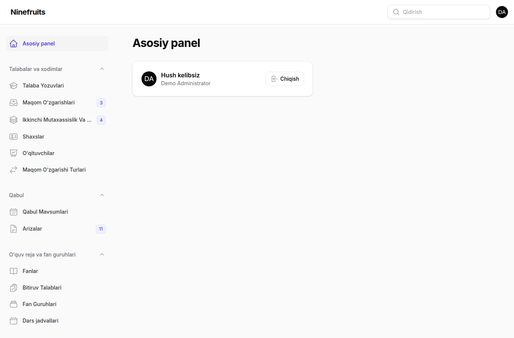
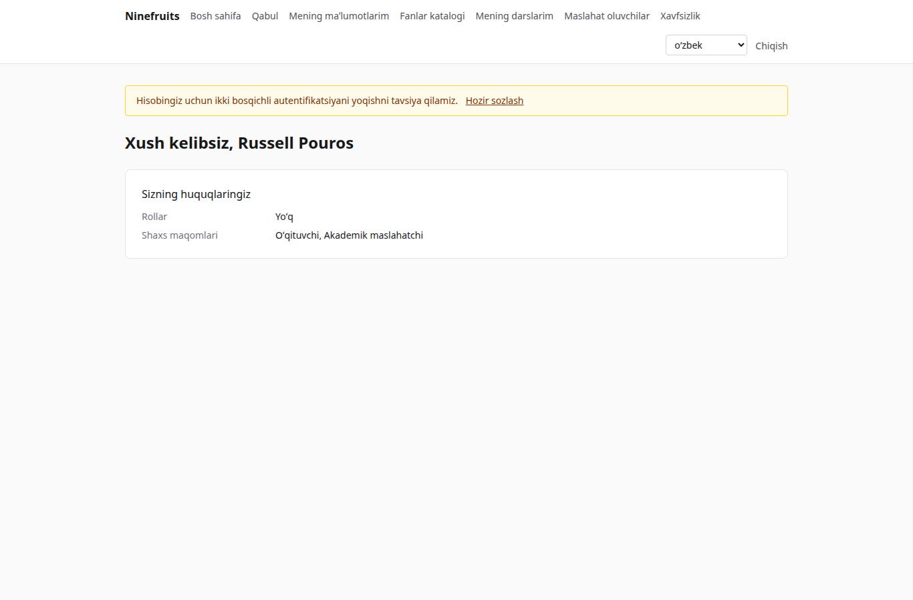
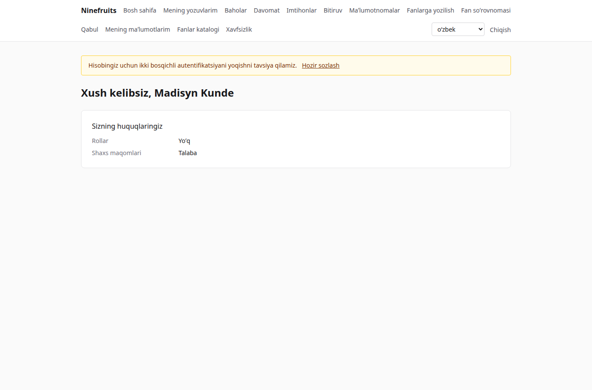

# Ninefruits — talabalar axborot tizimi

**Tillar / 언어**

| Til | README | Qoʻllanma |
|---|---|---|
| 한국어 | [README.md](README.md) | [docs/manual/ko/](docs/manual/ko/README.md) |
| English | [README.en.md](README.en.md) | [docs/manual/en/](docs/manual/en/README.md) |
| 简体中文 | [README.zh_CN.md](README.zh_CN.md) | [docs/manual/zh_CN/](docs/manual/zh_CN/README.md) |
| ລາວ | [README.lo.md](README.lo.md) | [docs/manual/lo/](docs/manual/lo/README.md) |
| Deutsch | [README.de.md](README.de.md) | [docs/manual/de/](docs/manual/de/README.md) |
| Filipino | [README.fil.md](README.fil.md) | [docs/manual/fil/](docs/manual/fil/README.md) |
| Français | [README.fr.md](README.fr.md) | [docs/manual/fr/](docs/manual/fr/README.md) |
| 日本語 | [README.ja.md](README.ja.md) | [docs/manual/ja/](docs/manual/ja/README.md) |
| Монгол | [README.mn.md](README.mn.md) | [docs/manual/mn/](docs/manual/mn/README.md) |
| Bahasa Melayu | [README.ms.md](README.ms.md) | [docs/manual/ms/](docs/manual/ms/README.md) |
| नेपाली | [README.ne.md](README.ne.md) | [docs/manual/ne/](docs/manual/ne/README.md) |
| Русский | [README.ru.md](README.ru.md) | [docs/manual/ru/](docs/manual/ru/README.md) |
| ไทย | [README.th.md](README.th.md) | [docs/manual/th/](docs/manual/th/README.md) |
| Türkçe | [README.tr.md](README.tr.md) | [docs/manual/tr/](docs/manual/tr/README.md) |
| Oʻzbek | [README.uz.md](README.uz.md) (shu fayl) | [docs/manual/uz/](docs/manual/uz/README.md) |
| Tiếng Việt | [README.vi.md](README.vi.md) | [docs/manual/vi/](docs/manual/vi/README.md) |

Boshqa til qoʻshish uchun [Til qoʻshish](docs/development/adding-a-language.md) ga qarang.

Ninefruits — istalgan universitet oʻrnatishi mumkin boʻlgan talabalar axborot tizimi. U oʻquv jarayonini boshqarishning asosiy qismini — qabul, talaba yozuvlari, oʻquv reja va fan guruhlari, fanlarga yozilish, baholar, fan soʻrovnomasi, maʼlumotnomalar, til va kompleks imtihonlar, davomat, bitiruv talablarini tekshirish, hisobotlar va LMS integratsiyasi asosini — yuqorida sanab oʻtilgan 16 tildagi ekranlar va hujjatlar bilan qamrab oladi.

## Bir qarashda

Uchta rolning birinchi ekrani (demo maʼlumotlar).

| Administrator (boshqaruv paneli) | Oʻqituvchi (portal) | Talaba (portal) |
|---|---|---|
|  |  |  |

- **Boshqaruv paneli** `/admin`: xodimlar talaba yozuvlari, oʻquv ishlari, qabul, maʼlumotnomalar, imtihonlar, bitiruv va hisobotlar bilan ishlaydi. Ruxsatlar boʻlinmalar yoki taʼlim dasturlari bilan cheklangan rol shablonlaridan (Registrator, Oʻquv-uslubiy boshqarma, Maʼlumotnomalar masʼuli, Kafedra yordamchisi, Qabul komissiyasi xodimi, Tizim administratori) olinadi.
- **Portal** `/portal`: talabalar fanlarga yoziladi, baholar, davomat, imtihonlar, bitiruv talablari va maʼlumotnomalarni koʻradi; oʻqituvchilar oʻz fan guruhlarining talabalar roʻyxatlari, davomati, baho kiritish va soʻrovnoma natijalarini boshqaradi; abituriyentlar ariza topshiradi. Bitta hisob bir nechta shaxs maqomiga ega boʻlishi mumkin.

## Imkoniyatlar

| Soha | Mazmuni |
|---|---|
| Foydalanuvchilar va xavfsizlik | Umumiy kirish, ikki bosqichli autentifikatsiya (ilova, e-pochta), boʻlinma/dastur qamroviga ega rollar, maʼlumotlar va ish jarayonlari auditi, qatorlar darajasidagi xavfsizlik, shifrlangan shaxsiy maʼlumotlar |
| Shaxslar va yozuvlar | Shaxs va talaba yozuvining ajratilishi, talaba raqami qoidalari, tasdiqlash bilan maqom oʻzgarishlari (akademik taʼtil, qaytish, oʻqishdan chiqish, oʻqishdan chetlashtirish, oʻqishga qayta tiklash, bitirish), akademik maslahatchilar, ikkinchi mutaxassisliklar va qoʻshimcha yoʻnalishlar |
| Qabul | Qabul mavsumlari, hujjatlar bilan onlayn arizalar, koʻrib chiqish va qarorlar, qabul qilingan abituriyentlar uchun talaba yozuvlarini yaratish |
| Oʻquv reja | Fan versiyalari, prerekvizitlar va muqobil fanlar, oʻquv reja yili boʻyicha bitiruv talablari, fan guruhlari, dars jadvallari, sillabuslar |
| Fanlarga yozilish | Qoidalar toʻplamlari, kredit chegaralari, sigʻim va kutish roʻyxatlari, cheklovlar va qoidadan istisnolar, fanlarga yozilish choʻqqisiga moʻljallangan loyiha |
| Baholar | Mutlaq va nisbiy baholash, baho chegaralari, topshirish va yakunlash, oʻzgartirishni tasdiqlash, GPA va qayta oʻqish, semestrni yopish (ogohlantirishlar, imtiyozlar), akademik maʼlumotnomalar |
| Fan soʻrovnomasi | Anonim javoblar, shakllar va savollar, minimal javoblar soni, eʼlon qilish, toʻldirilmaguncha baholarni koʻrishni bloklash |
| Maʼlumotnomalar | Tillar boʻyicha turlar va shablonlar, tartib raqamlari, saqlanadigan PDF fayllar, QR kodli ochiq tekshirish sahifasi |
| Imtihonlar | Sohalar va oʻtish qoidalariga ega turlar, sessiyaga roʻyxatdan oʻtish, natijalarni kiritish, CSV, eʼlon qilish, tuzatishlar, tashqi natijalar |
| Davomat | Haftalik dars vaqtlaridan darslar, davomatni kiritish, davomat qaydnomasi PDF, talabalar roʻyxati CSV |
| Bitiruv | Bitiruv talablarini tekshirish, saqlangan tekshiruvlar, talabdan ozod qilish (ikki kishi qoidasi), diplom raqamlari bilan bitiruv |
| Hisobotlar | CSV bilan yettita standart hisobot, BI uchun `reporting` koʻrinishlari |
| LMS integratsiyasi asosi | Platformalar, kurs bogʻlanishlari, sinxronlash jurnallari, hodisalarga asoslangan sinxronlash, tungi solishtirish, LMS ballari baho qoralamasi sifatida |

## Texnologiyalar

PHP 8.5, Laravel 13, Filament 5 (boshqaruv paneli), Livewire 4 (portal), PostgreSQL 18 (RLS, audit), Redis va Horizon (navbatlar), Gotenberg (PDF), Fortify (kirish, 2FA). Ishlab chiqish va demo Docker (Laravel Sail) da ishlaydi.

## Oʻrnatish (demo sayt)

Xost kompyuterda faqat Docker kerak; PHP va Composer konteynerlarda ishlaydi.

```bash
# 1. Dependencies
docker run --rm -u "$(id -u):$(id -g)" -v "$PWD":/app -w /app composer:latest \
    composer install --ignore-platform-req='ext-*'

# 2. Environment file
cp .env.example .env
printf '\nWWWUSER=%s\nWWWGROUP=%s\n' "$(id -u)" "$(id -g)" >> .env

# 3. Containers (database roles are created on first start)
./vendor/bin/sail up -d

# 4. Keys
./vendor/bin/sail artisan key:generate
./vendor/bin/sail artisan pii:generate-key   # put the two printed values in .env

# 5. Install: migrations, essential data, institution settings, first administrator, grade scale
./vendor/bin/sail artisan setup:install --profile=korean-university --grade-scale=4.5

# 6. Demo data and demo accounts per role
./vendor/bin/sail artisan setup:demo --size=small --seed=42

# 7. Assets
./vendor/bin/sail npm install && ./vendor/bin/sail npm run build
```

- Portal: http://localhost/portal · Boshqaruv paneli: http://localhost/admin (bir xil kirish)
- Pochta (Mailpit): http://localhost:8025 · Navbatlar (Horizon): http://localhost/horizon

### Demo hisoblar

Barcha parollar `demo-password` (`config/setup.php`). Ikki bosqichli autentifikatsiya oʻchirilgan.

| Hisob | Rol / shaxs maqomi | Birinchi ekran |
|---|---|---|
| system-administrator@demo.test | Tizim administratori (barcha ruxsatlar) | /admin |
| registrar@demo.test | Registrator (talaba yozuvlari, fanlarga yozilish, baholarni yakunlash, maʼlumotnomalar, imtihonlar, bitiruv, hisobotlar) | /admin |
| academic-affairs@demo.test | Oʻquv-uslubiy boshqarma (fanlar, fan guruhlari, dars jadvallari, baholash siyosati, soʻrovnomalar, darslar) | /admin |
| certificate-officer@demo.test | Maʼlumotnomalar masʼuli | /admin |
| department-assistant@demo.test | Kafedra yordamchisi (boʻlinma doirasidagi koʻrish, akademik maslahatchilar, hisobotlar) | /admin |
| admissions-officer@demo.test | Qabul komissiyasi xodimi | /admin |
| instructor@demo.test | Oʻqituvchi va akademik maslahatchi (fan guruhlari, davomat, baho kiritish, maslahat oluvchilar) | /portal |
| student@demo.test | Hozirgi talaba | /portal |
| alumni@demo.test | Bitiruvchi | /portal |
| readmitted@demo.test | Qayta qabul qilingan bitiruvchi (ikkita talaba yozuvi) | /portal |
| applicant@demo.test | Abituriyent | /portal |
| admitted@demo.test | Qabul qilingan abituriyent | /portal |

Demo — talabalar, oʻqituvchilar, fanlar, fan guruhlari, fanlarga yozilishlar, baholar, soʻrovnomalar, maʼlumotnomalar, imtihonlar, davomat, bitiruv talablari tekshiruvlari va LMS bogʻlanishlariga ega bitta xayoliy universitet (koreys universiteti profili). Uni hech qachon production muhitiga yuklamang (`setup:demo` rad etadi).

## Hujjatlar

- [Administrator qoʻllanmasi](docs/manual/uz/README.md) (koreyscha asl nusxa: [docs/manual/ko/](docs/manual/ko/README.md))
- Ekspluatatsiya: [oʻrnatish](docs/manual/uz/operations/installation.md), [buyruqlar](docs/manual/uz/operations/commands.md), [rejalashtirilgan vazifalar](docs/manual/uz/operations/scheduled-jobs.md), [zaxiralash va tiklash](docs/manual/uz/operations/backup-restore.md), [xavfsizlik kalitlari](docs/manual/uz/operations/security-keys.md), [nosozliklarni bartaraf etish](docs/manual/uz/operations/troubleshooting.md)
- [LMS integratsiyasi qoʻllanmasi](docs/lms-integration-guide.md)
- [Ishlab chiqish qoidalari](docs/development/)
- Koʻchirish tarixi va loyiha qarorlari (maʼlumot uchun): [porting/](porting/README.md)

## Production maʼlumotlar bazasi

Superfoydalanuvchi buni bir marta bajaradi.

```bash
psql -v migrator_password=... -v runtime_password=... -v reporting_password=... \
     -f database/sql/roles/create_roles.sql
psql -d <database> -f database/sql/roles/prepare_database.sql
```

Ilova `app_runtime` sifatida (qatorlar darajasidagi xavfsizlik qoʻllanadi), migratsiyalar `app_migrator` sifatida, BI vositalari `app_reporting` sifatida (hisobot koʻrinishlari) ulanadi. [Oʻrnatish qoʻllanmasi](docs/manual/uz/operations/installation.md) ga qarang.

## Kundalik buyruqlar

| Buyruq | Nima qiladi |
|---|---|
| `sail composer check` | Pint, Larastan, nomlash tekshiruvi, yetishmayotgan tarjimalar, testlar (CI bilan bir xil) |
| `sail pest` | Testlar |
| `sail artisan migrate` | Migratsiyalar (avtomatik ravishda `app_migrator` ulanishidan foydalanadi) |
| `sail artisan setup:install`, `setup:demo` | Oʻrnatish/yangilash, demo maʼlumotlar |
| `sail artisan system:health-check` | Sozlamalar, kalitlar, maʼlumotlar bazasi rollari, navbat, Redis, Gotenberg, ombor, rejalashtiruvchi |
| `sail artisan security:sync-permissions` | Ruxsatlar katalogini koddan maʼlumotlar bazasiga sinxronlash |
| `sail artisan i18n:missing` | Yetishmayotgan tarjimalar (tarjimonlar bilan ishlash uchun `i18n:export`/`i18n:import`) |

Toʻliq roʻyxat [buyruqlar maʼlumotnomasi](docs/manual/uz/operations/commands.md) da.

## Litsenziya

[MIT litsenziyasi](LICENSE). Erkin foydalaning, oʻzgartiring va tarqating; mualliflik huquqi belgisi va litsenziya matnini saqlang.

---

**Minnatdorchilik**

Ushbu tizimni yaratishga imkon bergan Yanbian fan va texnologiyalar universitetining oʻquv jarayonini boshqarish tizimi YUSTIC ga minnatdorchilik bildiramiz. YUSTIC koʻp yillar davomida birga orzu qilgan, mehnat qilgan va yaratgan kichik dasturchilar jamoasining mehnati edi. Bu tizim biz birga ishlagan hamkasblarimizni qanchalik sogʻinishimiz, hurmat qilishimiz va ularga minnatdor ekanimizni bildirish usulimizdir.
