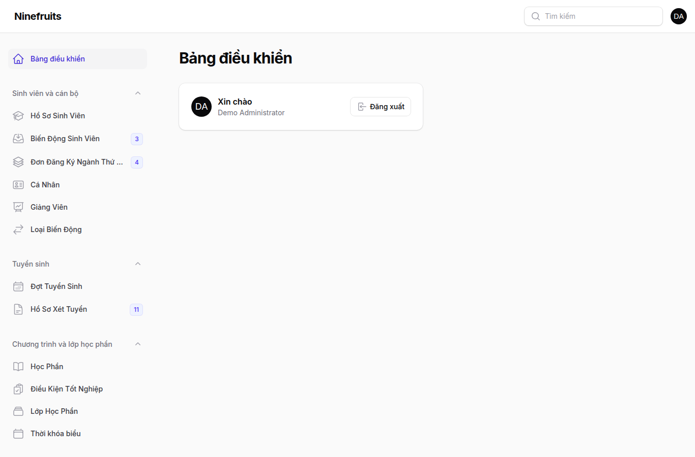
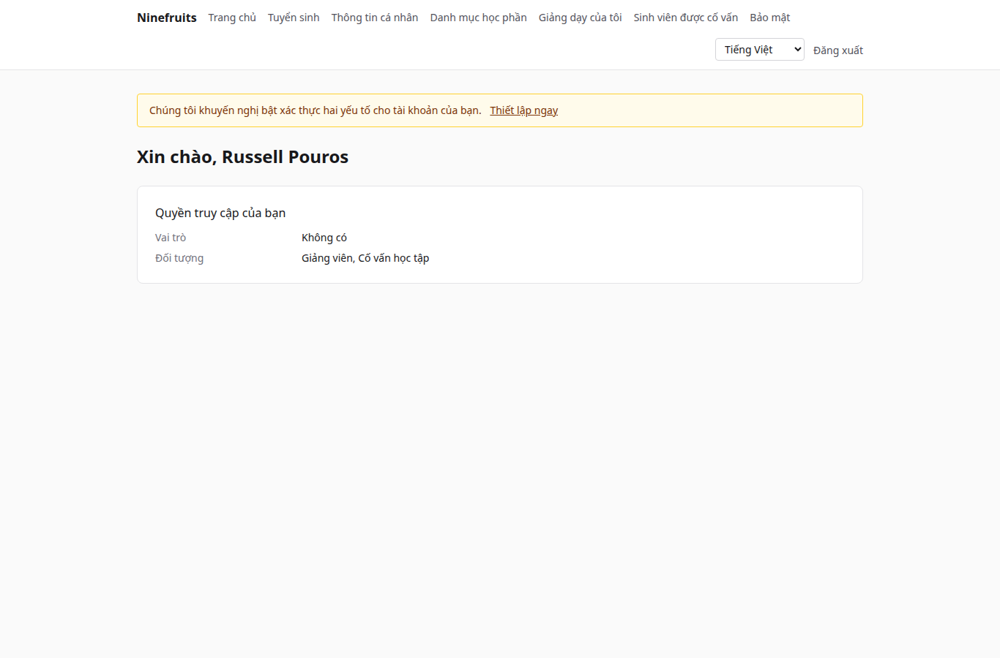

# Ninefruits — Hệ thống thông tin sinh viên

**Languages / 언어**

| Ngôn ngữ | README | Hướng dẫn sử dụng |
|---|---|---|
| 한국어 | [README.md](README.md) | [docs/manual/ko/](docs/manual/ko/README.md) |
| English | [README.en.md](README.en.md) | [docs/manual/en/](docs/manual/en/README.md) |
| 简体中文 | [README.zh_CN.md](README.zh_CN.md) | [docs/manual/zh_CN/](docs/manual/zh_CN/README.md) |
| ລາວ | [README.lo.md](README.lo.md) | [docs/manual/lo/](docs/manual/lo/README.md) |
| Deutsch | [README.de.md](README.de.md) | [docs/manual/de/](docs/manual/de/README.md) |
| Filipino | [README.fil.md](README.fil.md) | [docs/manual/fil/](docs/manual/fil/README.md) |
| Français | [README.fr.md](README.fr.md) | [docs/manual/fr/](docs/manual/fr/README.md) |
| 日本語 | [README.ja.md](README.ja.md) | [docs/manual/ja/](docs/manual/ja/README.md) |
| Монгол | [README.mn.md](README.mn.md) | [docs/manual/mn/](docs/manual/mn/README.md) |
| Bahasa Melayu | [README.ms.md](README.ms.md) | [docs/manual/ms/](docs/manual/ms/README.md) |
| नेपाली | [README.ne.md](README.ne.md) | [docs/manual/ne/](docs/manual/ne/README.md) |
| Русский | [README.ru.md](README.ru.md) | [docs/manual/ru/](docs/manual/ru/README.md) |
| ไทย | [README.th.md](README.th.md) | [docs/manual/th/](docs/manual/th/README.md) |
| Türkçe | [README.tr.md](README.tr.md) | [docs/manual/tr/](docs/manual/tr/README.md) |
| Oʻzbek | [README.uz.md](README.uz.md) | [docs/manual/uz/](docs/manual/uz/README.md) |
| Tiếng Việt | [README.vi.md](README.vi.md) (tệp này) | [docs/manual/vi/](docs/manual/vi/README.md) |

Để thêm một ngôn ngữ khác, xem [Thêm ngôn ngữ](docs/development/adding-a-language.md).

Ninefruits là hệ thống thông tin sinh viên mà bất kỳ trường đại học nào cũng có thể cài đặt. Hệ thống bao quát phần cốt lõi của công tác quản lý đào tạo — tuyển sinh, hồ sơ sinh viên, chương trình và lớp học phần, đăng ký học phần, điểm, đánh giá học phần, giấy chứng nhận, kỳ thi ngoại ngữ và kỳ thi tổng hợp, điểm danh, xét tốt nghiệp, báo cáo và nền tảng tích hợp LMS — với giao diện và tài liệu bằng 16 ngôn ngữ được liệt kê ở trên.

## Tổng quan nhanh

Màn hình đầu tiên của ba vai trò (dữ liệu demo).

| Quản trị viên (trang quản trị) | Giảng viên (cổng thông tin) | Sinh viên (cổng thông tin) |
|---|---|---|
|  |  |  |

- **Trang quản trị** `/admin`: cán bộ xử lý hồ sơ, công tác đào tạo, tuyển sinh, giấy chứng nhận, kỳ thi, tốt nghiệp và báo cáo. Quyền đến từ các mẫu vai trò (cán bộ quản lý sinh viên, cán bộ đào tạo, cán bộ cấp giấy chứng nhận, giáo vụ khoa, cán bộ tuyển sinh, quản trị hệ thống) với phạm vi theo đơn vị hoặc chương trình đào tạo.
- **Cổng thông tin** `/portal`: sinh viên đăng ký học phần, xem điểm, điểm danh, kỳ thi, điều kiện tốt nghiệp và giấy chứng nhận; giảng viên quản lý danh sách lớp, điểm danh, nhập điểm và kết quả đánh giá của các lớp học phần mình phụ trách; thí sinh nộp hồ sơ xét tuyển. Một tài khoản có thể mang nhiều đối tượng.

## Tính năng

| Lĩnh vực | Nội dung |
|---|---|
| Người dùng và bảo mật | Đăng nhập dùng chung, xác thực hai yếu tố (ứng dụng, email), vai trò có phạm vi theo đơn vị/chương trình đào tạo, kiểm toán dữ liệu và nghiệp vụ, bảo mật cấp dòng, mã hóa dữ liệu cá nhân |
| Cá nhân và hồ sơ | Tách biệt cá nhân/hồ sơ, quy tắc mã số sinh viên, biến động sinh viên (bảo lưu, trở lại học, thôi học, buộc thôi học, nhập học lại, tốt nghiệp) có phê duyệt, cố vấn học tập, ngành thứ hai và ngành phụ |
| Tuyển sinh | Đợt tuyển sinh, nộp hồ sơ trực tuyến kèm tài liệu, xét duyệt và quyết định, tạo hồ sơ sinh viên cho thí sinh trúng tuyển |
| Chương trình đào tạo | Phiên bản học phần, học phần tiên quyết và tương đương, điều kiện tốt nghiệp theo khóa CTĐT, lớp học phần, thời khóa biểu, đề cương học phần |
| Đăng ký học phần | Bộ quy tắc, giới hạn tín chỉ, sĩ số và danh sách chờ, chặn đăng ký và ngoại lệ, thiết kế cho cao điểm đăng ký |
| Điểm | Đánh giá tuyệt đối và tương đối, mức trần điểm, nộp điểm và chốt điểm, phê duyệt sửa điểm, điểm TB và học lại, khóa điểm học kỳ (cảnh báo, khen thưởng), bảng điểm |
| Đánh giá học phần | Phản hồi ẩn danh, phiếu đánh giá và câu hỏi, số phản hồi tối thiểu, công bố, chặn xem điểm cho đến khi hoàn thành |
| Giấy chứng nhận | Loại giấy và mẫu theo ngôn ngữ, số hiệu, lưu trữ PDF, trang xác minh công khai có mã QR |
| Kỳ thi | Loại kỳ thi với các phần thi và quy tắc đạt, đăng ký đợt thi, nhập kết quả, CSV, công bố, đính chính, kết quả bên ngoài |
| Điểm danh | Buổi học tạo từ lịch học hằng tuần, nhập điểm danh, bảng điểm danh PDF, danh sách lớp CSV |
| Tốt nghiệp | Xét tốt nghiệp, lưu kết quả xét, miễn điều kiện (nguyên tắc hai người), tốt nghiệp kèm số hiệu văn bằng |
| Báo cáo | Bảy báo cáo chuẩn kèm CSV, view `reporting` cho BI |
| Nền tảng tích hợp LMS | Nền tảng, liên kết khóa học, nhật ký đồng bộ, đồng bộ theo sự kiện, đối soát hằng đêm, điểm LMS làm bản nháp điểm |

## Công nghệ

PHP 8.5, Laravel 13, Filament 5 (trang quản trị), Livewire 4 (cổng thông tin), PostgreSQL 18 (RLS, kiểm toán), Redis và Horizon (hàng đợi), Gotenberg (PDF), Fortify (đăng nhập, 2FA). Môi trường phát triển và demo chạy trên Docker (Laravel Sail).

## Cài đặt (trang demo)

Máy chủ chỉ cần Docker; PHP và Composer chạy trong container.

```bash
# 1. Dependencies
docker run --rm -u "$(id -u):$(id -g)" -v "$PWD":/app -w /app composer:latest \
    composer install --ignore-platform-req='ext-*'

# 2. Environment file
cp .env.example .env
printf '\nWWWUSER=%s\nWWWGROUP=%s\n' "$(id -u)" "$(id -g)" >> .env

# 3. Containers (database roles are created on first start)
./vendor/bin/sail up -d

# 4. Keys
./vendor/bin/sail artisan key:generate
./vendor/bin/sail artisan pii:generate-key   # put the two printed values in .env

# 5. Install: migrations, essential data, institution settings, first administrator, grade scale
./vendor/bin/sail artisan setup:install --profile=korean-university --grade-scale=4.5

# 6. Demo data and demo accounts per role
./vendor/bin/sail artisan setup:demo --size=small --seed=42

# 7. Assets
./vendor/bin/sail npm install && ./vendor/bin/sail npm run build
```

- Cổng thông tin: http://localhost/portal · Trang quản trị: http://localhost/admin (cùng thông tin đăng nhập)
- Thư (Mailpit): http://localhost:8025 · Hàng đợi (Horizon): http://localhost/horizon

### Tài khoản demo

Mọi mật khẩu đều là `demo-password` (`config/setup.php`). Xác thực hai yếu tố được tắt.

| Tài khoản | Vai trò / đối tượng | Màn hình đầu tiên |
|---|---|---|
| system-administrator@demo.test | Quản trị hệ thống (mọi quyền) | /admin |
| registrar@demo.test | Cán bộ quản lý sinh viên (hồ sơ, đăng ký học phần, chốt điểm, giấy chứng nhận, kỳ thi, tốt nghiệp, báo cáo) | /admin |
| academic-affairs@demo.test | Cán bộ đào tạo (học phần, lớp học phần, thời khóa biểu, quy chế đánh giá, đánh giá học phần, buổi học) | /admin |
| certificate-officer@demo.test | Cán bộ cấp giấy chứng nhận | /admin |
| department-assistant@demo.test | Giáo vụ khoa (xem theo phạm vi đơn vị, cố vấn học tập, báo cáo) | /admin |
| admissions-officer@demo.test | Cán bộ tuyển sinh | /admin |
| instructor@demo.test | Giảng viên và cố vấn học tập (lớp học phần, điểm danh, nhập điểm, sinh viên được cố vấn) | /portal |
| student@demo.test | Sinh viên đang học | /portal |
| alumni@demo.test | Cựu sinh viên đã tốt nghiệp | /portal |
| readmitted@demo.test | Người đã tốt nghiệp và được nhận vào học lại (hai hồ sơ) | /portal |
| applicant@demo.test | Thí sinh | /portal |
| admitted@demo.test | Thí sinh trúng tuyển | /portal |

Dữ liệu demo là một trường đại học giả định (hồ sơ trường đại học Hàn Quốc) với sinh viên, giảng viên, học phần, lớp học phần, lượt đăng ký, điểm, đánh giá, giấy chứng nhận, kỳ thi, điểm danh, xét tốt nghiệp và liên kết LMS. Không bao giờ nạp dữ liệu này trên môi trường production (`setup:demo` sẽ từ chối).

## Tài liệu

- [Hướng dẫn dành cho quản trị viên](docs/manual/vi/README.md) (bản gốc tiếng Hàn: [docs/manual/ko/](docs/manual/ko/README.md))
- Vận hành: [cài đặt](docs/manual/vi/operations/installation.md), [lệnh](docs/manual/vi/operations/commands.md), [tác vụ định kỳ](docs/manual/vi/operations/scheduled-jobs.md), [sao lưu và khôi phục](docs/manual/vi/operations/backup-restore.md), [khóa bảo mật](docs/manual/vi/operations/security-keys.md), [xử lý sự cố](docs/manual/vi/operations/troubleshooting.md)
- [Hướng dẫn tích hợp LMS](docs/lms-integration-guide.md)
- [Quy ước phát triển](docs/development/)
- Lịch sử chuyển đổi và các quyết định thiết kế (tham khảo): [porting/](porting/README.md)

## Cơ sở dữ liệu production

Superuser chạy lệnh này một lần.

```bash
psql -v migrator_password=... -v runtime_password=... -v reporting_password=... \
     -f database/sql/roles/create_roles.sql
psql -d <database> -f database/sql/roles/prepare_database.sql
```

Ứng dụng kết nối bằng `app_runtime` (áp dụng bảo mật cấp dòng), migration dùng `app_migrator`, công cụ BI dùng `app_reporting` (view báo cáo). Xem [hướng dẫn cài đặt](docs/manual/vi/operations/installation.md).

## Các lệnh thường dùng

| Lệnh | Chức năng |
|---|---|
| `sail composer check` | Pint, Larastan, kiểm tra đặt tên, bản dịch còn thiếu, kiểm thử (giống CI) |
| `sail pest` | Kiểm thử |
| `sail artisan migrate` | Migration (tự động dùng kết nối `app_migrator`) |
| `sail artisan setup:install`, `setup:demo` | Cài đặt/cập nhật, dữ liệu demo |
| `sail artisan system:health-check` | Thiết lập, khóa, vai trò cơ sở dữ liệu, hàng đợi, Redis, Gotenberg, bộ lưu trữ, bộ lập lịch |
| `sail artisan security:sync-permissions` | Đồng bộ danh mục quyền từ mã nguồn vào cơ sở dữ liệu |
| `sail artisan i18n:missing` | Bản dịch còn thiếu (`i18n:export`/`i18n:import` để làm việc với người dịch) |

Danh sách đầy đủ có trong [tham chiếu lệnh](docs/manual/vi/operations/commands.md).

## Giấy phép

[Giấy phép MIT](LICENSE). Tự do sử dụng, sửa đổi và phân phối; giữ nguyên thông báo bản quyền và văn bản giấy phép.

---

**Lời cảm ơn**

Chúng tôi xin gửi lời cảm ơn đến YUSTIC, hệ thống quản lý đào tạo của Đại học Khoa học và Công nghệ Diên Biên (Yanbian University of Science and Technology), nền tảng đã giúp hệ thống này ra đời. YUSTIC là thành quả của một nhóm nhỏ các nhà phát triển đã cùng nhau mơ ước, đổ mồ hôi và xây dựng trong nhiều năm. Hệ thống này là cách chúng tôi bày tỏ nỗi nhớ, sự kính trọng và lòng biết ơn đối với những đồng nghiệp đã từng cùng làm việc.
