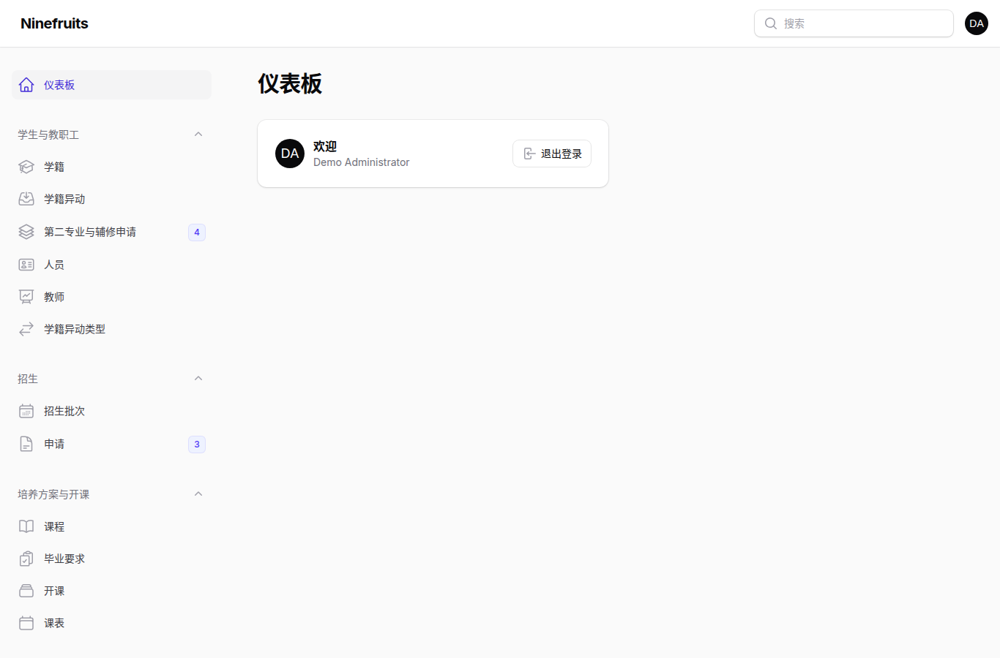
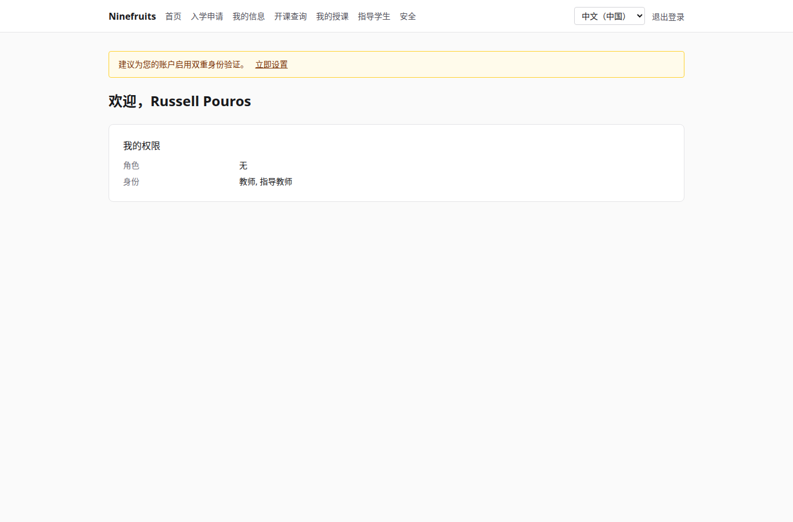
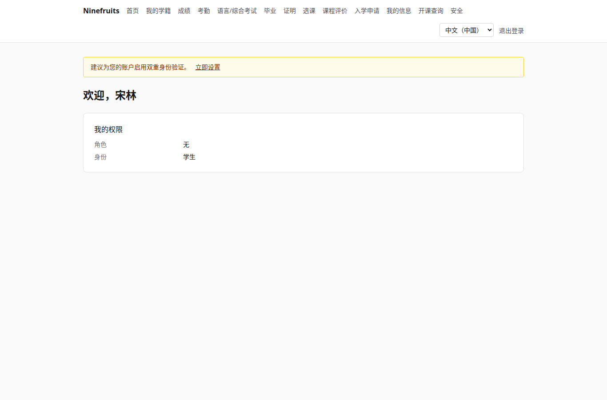

# Ninefruits — 高校教务管理系统

**언어 / Languages / 语言 / ພາສາ**

| 语言 | README | 手册 |
|---|---|---|
| 한국어 | [README.md](README.md) | [docs/manual/ko/](docs/manual/ko/README.md) |
| English | [README.en.md](README.en.md) | [docs/manual/en/](docs/manual/en/README.md) |
| 简体中文 | [README.zh_CN.md](README.zh_CN.md)（本文） | [docs/manual/zh_CN/](docs/manual/zh_CN/README.md) |
| ລາວ | [README.lo.md](README.lo.md) | [docs/manual/lo/](docs/manual/lo/README.md) |

要添加其他语言，请参阅[添加语言指南](docs/development/adding-a-language.md)（英文）。

Ninefruits 是一套可在多所高校部署的教务管理系统（Student Information System）。它覆盖教务工作的核心——招生、学籍、培养方案与开课、选课、成绩、课程评价、证明、语言/综合考试、考勤、毕业资格审核、报表以及 LMS 对接基础——界面和文档支持韩语、英语、简体中文和老挝语。

## 一览

三种角色登录后的首屏（演示数据）。

| 系统管理员（管理后台） | 教师（门户） | 学生（门户） |
|---|---|---|
|  |  |  |

- **管理后台** `/admin`：教职员处理学籍、教务、招生、证明、考试、毕业和报表。权限来自角色模板（学籍管理员、教务管理员、证明书管理员、院系助理、招生管理员、系统管理员），并可限定院系或专业范围。
- **门户** `/portal`：学生选课、查看成绩、考勤、考试报名、毕业要求和证明；教师管理所授课程的名单、考勤、成绩录入和课程评价结果；申请人提交入学申请。一个账号可以拥有多种身份。

## 主要功能

| 领域 | 内容 |
|---|---|
| 用户与安全 | 统一登录、双因素认证（应用、邮件）、带院系/专业范围的角色权限、数据与业务审计、行级安全（RLS）、个人信息加密 |
| 人员与学籍 | 人员与学籍分离、学号规则、学籍异动（休学、复学、退学、开除、重新入学、毕业）申请与审批、导师、第二专业与辅修 |
| 招生 | 招生批次、在线申请与材料、审核与录取、录取者学籍生成 |
| 培养方案 | 课程版本、先修与替代课程、按培养方案年份的毕业要求、教学班、课表、教学大纲 |
| 选课 | 规则集、学分上限、容量与候补、限制与例外，面向选课高峰设计 |
| 成绩 | 绝对/相对评价、等级比例上限、提交与确认、更正审批、绩点与重修、学期结算（学业警告、优秀）、成绩单 |
| 课程评价 | 匿名回答、问卷与题目、最低回答数、结果公布、未完成则限制查成绩 |
| 证明 | 种类与各语言模板、编号、PDF 保存、带二维码的公开验证页 |
| 语言/综合考试 | 考试种类、领域与合格标准，场次报名，成绩录入、CSV、公布，更正申请，外部成绩 |
| 考勤 | 按上课时间生成课次、考勤录入、考勤表 PDF、名单 CSV |
| 毕业 | 资格审核、审核存档、要求豁免（双人审批）、毕业办理与学位编号 |
| 报表 | 七种标准报表与 CSV，供 BI 使用的 `reporting` 视图 |
| LMS 对接基础 | 平台、课程关联、同步日志、事件驱动同步、每夜核对、LMS 分数草稿 |

## 技术栈

PHP 8.5、Laravel 13、Filament 5（管理后台）、Livewire 4（门户）、PostgreSQL 18（RLS、审计）、Redis 与 Horizon（队列）、Gotenberg（PDF）、Fortify（登录、双因素认证）。开发与演示环境使用 Docker（Laravel Sail）。

## 安装（演示站点）

主机只需 Docker；PHP 和 Composer 在容器内运行。

```bash
# 1. 安装依赖
docker run --rm -u "$(id -u):$(id -g)" -v "$PWD":/app -w /app composer:latest \
    composer install --ignore-platform-req='ext-*'

# 2. 环境文件
cp .env.example .env
printf '\nWWWUSER=%s\nWWWGROUP=%s\n' "$(id -u)" "$(id -g)" >> .env

# 3. 启动容器（首次启动时创建数据库角色）
./vendor/bin/sail up -d

# 4. 生成密钥
./vendor/bin/sail artisan key:generate
./vendor/bin/sail artisan pii:generate-key   # 将输出的两个值写入 .env

# 5. 安装：迁移、基础数据、机构设置、首位管理员、成绩等级制
./vendor/bin/sail artisan setup:install --profile=korean-university --grade-scale=4.5

# 6. 演示数据与各角色演示账号
./vendor/bin/sail artisan setup:demo --size=small --seed=42

# 7. 前端资源
./vendor/bin/sail npm install && ./vendor/bin/sail npm run build
```

- 门户：http://localhost/portal · 管理后台：http://localhost/admin（同一登录）
- 邮件（Mailpit）：http://localhost:8025 · 队列（Horizon）：http://localhost/horizon

### 演示账号

所有密码均为 `demo-password`（`config/setup.php`）。双因素认证已关闭。

| 账号 | 角色 / 身份 | 首屏 |
|---|---|---|
| system-administrator@demo.test | 系统管理员（全部权限） | /admin |
| registrar@demo.test | 学籍管理员（学籍、选课调整、成绩确认、证明、考试、毕业、报表） | /admin |
| academic-affairs@demo.test | 教务管理员（课程、开课、课表、成绩政策、课程评价、课次） | /admin |
| certificate-officer@demo.test | 证明书管理员 | /admin |
| department-assistant@demo.test | 院系助理（院系范围查询、导师、报表） | /admin |
| admissions-officer@demo.test | 招生管理员 | /admin |
| instructor@demo.test | 教师兼导师（所授课程、考勤、成绩录入、指导学生） | /portal |
| student@demo.test | 在校生 | /portal |
| alumni@demo.test | 毕业生 | /portal |
| readmitted@demo.test | 重新入学的毕业生（两条学籍） | /portal |
| applicant@demo.test | 入学申请人 | /portal |
| admitted@demo.test | 录取者 | /portal |

演示数据是一所虚构大学（韩国大学配置），包含学生、教师、课程、教学班、选课、成绩、课程评价、证明、考试、考勤、毕业审核和 LMS 关联。切勿在生产环境导入（`setup:demo` 在生产环境会拒绝执行）。

## 文档

- [管理员手册](docs/manual/zh_CN/README.md)（韩语原文：[docs/manual/ko/](docs/manual/ko/README.md)）
- 运维：[安装](docs/manual/ko/operations/installation.md)、[命令](docs/manual/ko/operations/commands.md)、[定时任务](docs/manual/ko/operations/scheduled-jobs.md)、[备份与恢复](docs/manual/ko/operations/backup-restore.md)、[安全密钥](docs/manual/ko/operations/security-keys.md)、[故障排除](docs/manual/ko/operations/troubleshooting.md)
- [LMS 对接指南](docs/lms-integration-guide.md)
- [开发规范](docs/development/)
- 移植历史与设计决策（参考）：[porting/](porting/README.md)

## 生产数据库

由超级用户执行一次。

```bash
psql -v migrator_password=... -v runtime_password=... -v reporting_password=... \
     -f database/sql/roles/create_roles.sql
psql -d <database> -f database/sql/roles/prepare_database.sql
```

应用以 `app_runtime`（应用行级安全）连接，迁移以 `app_migrator` 连接，BI 工具以 `app_reporting`（读取 reporting 视图）连接。详见[安装手册](docs/manual/ko/operations/installation.md)。

## 常用命令

| 命令 | 说明 |
|---|---|
| `sail composer check` | Pint、Larastan、命名检查、翻译缺失检查、测试（与 CI 相同） |
| `sail pest` | 测试 |
| `sail artisan migrate` | 迁移（自动使用 `app_migrator` 连接） |
| `sail artisan setup:install`、`setup:demo` | 安装/更新、演示数据 |
| `sail artisan system:health-check` | 检查设置、密钥、数据库角色、队列、Redis、Gotenberg、存储、调度器 |
| `sail artisan security:sync-permissions` | 将代码中的权限目录同步到数据库 |
| `sail artisan i18n:missing` | 检查翻译缺失（用 `i18n:export`/`i18n:import` 与译者协作） |

完整列表见[命令参考](docs/manual/ko/operations/commands.md)。

## 许可证

[MIT 许可证](LICENSE)。可自由使用、修改和分发，保留版权声明和许可证文本即可。

---

**致谢**

感谢使本系统成为可能的 YUSTIC（延边科技大学教务行政网络系统）。YUSTIC 是一支数人组成的开发团队多年来共同挥洒汗水、怀抱梦想、辛勤付出的成果。谨以本系统的开发，向曾经并肩的同事们致以思念、敬意与感谢。
