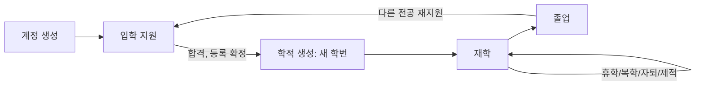
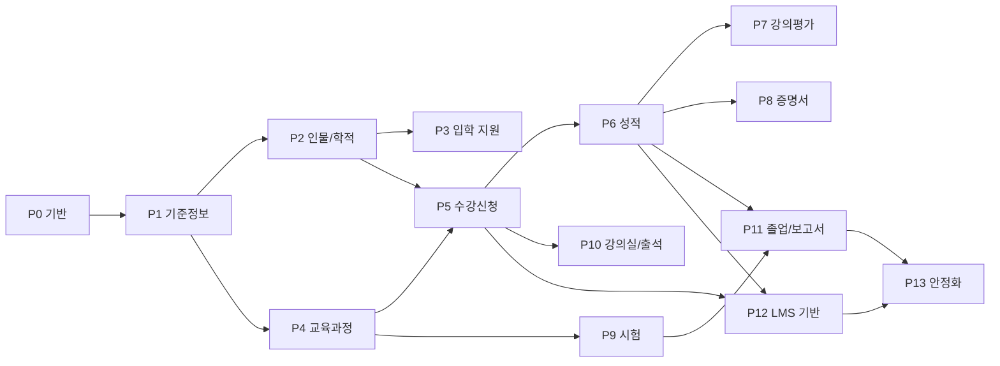

# 학사 행정 시스템 Laravel 이식 실행 계획 (Whole-in-one)

- 작성일: 2026-10-21 (개정 2), 2026-10-22 Phase 0 결과 반영 (개정 3), Phase 1 착수 전 검토 반영 (개정 4)
- 참조 자료: `/Users/daniel/work/yustic2` (YUSTIC 레거시 PHP 소스, Oracle 스키마, 스크린샷, Yii2 개발 안내 문서)
- 대상 저장소: `ninefruits-laravel`
- 관련 문서: [명명 규칙과 용어집](conventions/naming.md), [리뷰 체크리스트](conventions/review-checklist.md), [설계 결정](decisions/), [Phase 0 결과](phase-0-report.md)

---

## 1. 확정된 전제

| 항목 | 결정 |
|---|---|
| 제품 성격 | 여러 대학에 적용 가능한 범용 학사 행정 제품 |
| 배포 형태 | 대학별 독립 설치 (대학당 DB 하나, 멀티테넌트 아님) |
| 기능 범위 | 학사 핵심. 교수 강의실(M11)은 최소 기능으로 대체, 등록금/장학금(M13) 제외 |
| 추가 범위 | 최소 입학 지원(상시 접수), 일반화된 어학/종합시험, LMS 연동 기반 |
| 데이터 이관 | 하지 않음. 레거시는 스키마와 기능 참고용 |
| 런타임 | PHP 8.5 (확인 시점 8.5.12), Laravel 13.x, Filament 5.x, Livewire 4.x, Pest 5.x |
| DB | PostgreSQL 18 (Phase 0에서 고정, 확인 시점 18.6) |
| 화면 | Filament (교직원 관리 화면) + Livewire (지원자/학생/교수/조교/졸업생 포털) |
| 다국어 | 언어 수 제한 없음, 기본 언어 영어, 번역 키는 영문 |
| 2단계 인증 | 모든 사용자 권장(선택)이 기본값, 최고 관리자가 강제 범위 설정 |
| 행 단위 보안 | 애플리케이션 Policy/스코프 + 민감 테이블과 보고용 뷰에 PostgreSQL RLS |
| 학번 | 입학(학적)마다 새 학번. 사람과 로그인 계정은 평생 하나 |
| 로그인 수단 | 기본은 개인 이메일 + 비밀번호(평생). 학교 계정 SSO 연결, 학번 로그인은 대학별 설정 (7.1절) |
| 졸업생 로그인 | 허용, 졸업생 전용 제한 권한 |
| 운영 도구 | Phase마다 Artisan 명령, 운영/관리자 매뉴얼, 필수 시더, 팩토리와 데모 시더를 함께 작성 (13절) |
| 수강신청 집중 대비 | 사전 장바구니, 대기자 자동 승격, 시차 오픈, 좌석 할당 (+ 기본: 원자적 좌석 확보, 요청 제한) |
| Yii2 소스 | 없음. 안내 문서만 참고 |
| 테스트 | Pest, Laravel 관례(`tests/` 아래 `*Test.php`) |
| 개발 환경 | macOS + Docker (Laravel Sail, PHP 8.5 런타임) |

버전 확인 결과 (2026-10-21, Packagist와 php.net 기준)

| 패키지 | 최신 안정 | PHP 요구 |
|---|---|---|
| `laravel/framework` | 13.38.0 | ^8.3 |
| `filament/filament` | 5.10.3 | ^8.2 |
| `livewire/livewire` | 4.4.8 | ^8.1 |
| `pestphp/pest` | 5.3.3 | ^8.4 |
| `larastan/larastan` | 3.13.0 | ^8.2 |
| `spatie/laravel-permission` | 8.3.2 | ^8.3 |
| `spatie/laravel-activitylog` | 5.1.3 | ^8.4 |
| `spatie/laravel-translatable` | 6.15.0 | ^8.4 |
| `spatie/laravel-settings` | 3.10.0 | ^8.2 |
| `spatie/laravel-medialibrary` | 11.23.10 | ^8.2 |
| `laravel/fortify` | 1.41.0 | ^8.2 |
| `laravel/horizon` | 5.50.1 | ^8.0 |
| `laravel/octane` | 2.22.0 | ^8.1 |

모두 PHP 8.5에서 설치 가능한 범위다. Phase 0에서 실제 설치로 호환성을 검증한 뒤 `composer.lock`으로 고정한다.

---

## 2. 기본 원칙

1. **Laravel Best Practices 준수**
   - 검증은 Form Request, 권한은 Policy/Gate, 업무 로직은 Action 클래스, 부수 효과는 Event/Listener/Job으로 분리
   - Eloquent strict mode(`Model::shouldBeStrict()`): 지연 로딩, 누락 속성, 무시되는 대량 할당을 개발 단계에서 예외로 처리
   - 상태값은 PHP backed enum + Eloquent cast, 설정값은 `config/*`와 settings로만 접근 (`env()`는 config 파일 안에서만)
   - 스키마 변경은 모두 마이그레이션으로. PostgreSQL 함수, 트리거, RLS 정책, 뷰도 `database/sql/` 아래 SQL 파일을 마이그레이션에서 적용해 버전 관리
2. **프레임워크 기능 최대 활용**
   - 큐와 Horizon, Job batching(`Bus::batch`), Job chain, 고유 작업(`ShouldBeUnique`), 중복 실행 방지(`WithoutOverlapping`)
   - 스케줄러(`onOneServer`, `withoutOverlapping`), Artisan 명령 + Laravel Prompts
   - `RateLimiter`, `Cache::lock`(원자적 잠금), Notifications(메일, DB 알림), Laravel Context(요청 추적 정보를 로그와 큐 작업에 전파)
   - Laravel Pennant(기능 토글: 대기자, 장바구니 등 대학별 사용 여부)
   - 대량 처리는 `chunkById`, `lazyById`, Filament의 큐 기반 Import/Export
3. **이식 우선, 필요하면 신규 로직 과감히 도입**
   - 레거시 기능을 기준으로 하되 범용화나 품질상 필요한 경우 새 업무 로직을 넣는다. 기능 매핑(9절)에 `신규`로 표시한다.
4. **명명 일관성**
   - [명명 규칙과 용어집](conventions/naming.md)에 DB, PHP, 라우트, 권한, 번역 키 규칙과 레거시 이름 대응표를 둔다. 리뷰 체크리스트와 CI 검사에 반영한다.
5. **보안 기본값**
   - 문자열 연결 SQL 금지, 개인정보 암호화, 최소 권한, 모든 학적/성적 변경 감사

---

## 3. 레거시 분석 요약

### 3.1 자료 구성

| 자료 | 내용 |
|---|---|
| `yustic/` | 레거시 PHP 소스 약 4,300개 파일. 학사(`academy/`)가 2,163개로 핵심 |
| `YUSTIC_schema.sql` | Oracle DDL. 테이블 852개(백업/임시 제외 약 394개), 뷰 800개, 시퀀스 112개. 저장 프로시저/트리거 없음 |
| `YUSTIC_schema_cont.sql` | 인덱스, 제약조건 |
| `*_mysql.sql` | 2020년 MySQL 변환 시도본. Oracle 타입이 4,872곳 남아 있어 사용 불가 |
| `YUSTIC1.sql` | DB 역할(Role)과 담당 계정 목록, 컬럼 구조 덤프 (데이터 없음) |
| `yustic_views.txt` | 뷰 정의 SQL |
| `screenshot/` | 레거시 학생용/교수용 화면 17장 (Yii2 화면 아님, 실제 개인정보 포함) |

### 3.2 기술 구조

- 사용자 ID/비밀번호로 **Oracle DB 계정에 직접 접속**. 학생 계정은 `S` + 학번.
- 권한은 Oracle Role(`ACAREG`, `ACASCORE`, `ACACERT`, `PROFESSOR`, `STUDENT`, `ASSISTANT`, `BOOK` 등)로 판정하고, 역할마다 별도 디렉토리(`aca1`, `aca2`, `aca3`, `prof`, `stu`)의 화면이 고정 연결됨.
- 뷰 68개가 접속 계정(`USER`)으로 행 단위 접근 제어 (예: `'S'||ssc_stuid = user`).
- `index.php?f=파일명` 방식으로 PHP 파일 include.
- 교직원만 Google Authenticator 2단계 인증.
- 한국어/중국어/영어 3개 언어, 상수 기반 언어 파일(각 3,000줄 이상).

### 3.3 데이터 모델 특징

- 명칭이 언어별 컬럼으로 분리 (`SFO_KNAME`, `SFO_CNAME`, `SFO_ENAME`, 또는 `NAME_KR`, `NAME_CN`, `NAME_EN`).
- 날짜는 `CHAR(8)` 문자열(`YYYYMMDD`), 유효기간은 `CHAR(4)` 또는 `VARCHAR2(5)` 등 형식이 제각각.
- 학기는 3자리 코드(`149` = 2014년 가을), 상태는 `SFSEMESTER.AFS_CHECK`(`01` 현재, `11`/`31` 다음 신청, `10`/`20` 지난 학기).
- 재학생(`SRREGISTRY`, `SSCORE`)과 졸업생(`SGREGISTRY`, `SGSCORE`)이 동일 구조의 별도 테이블.
- 학기별 성적 백업 테이블(`SSCORE_PRE20170302` 등) 수십 개.
- 사진은 BLOB, 신분증번호와 계좌번호는 평문.

### 3.4 이식하지 않을 결함과 안티패턴

- `stu/subapp_addgo.php` 112행: `$sums` 대신 `$sum = 21`로 대입되어 14학번 이후 간호학부 학생의 학점 상한이 21이 아니라 18로 적용되는 버그.
- 학번 문자열 위치에 업무 의미를 부여한 규칙.
- 문자열 연결 SQL, `register_globals` 흉내 코드, 세션에 평문 비밀번호 저장.
- 학기별 백업 테이블로 이력을 대신하는 방식.
- 수강신청 중 교재 구매 여부 입력 (교재 모듈 범위 제외).

---

## 4. 범위

### 4.1 포함

1. 기반: 인증, 2단계 인증 정책, 권한 관리 화면, 감사 로그, 기관 설정, 다국어
2. 기준정보: 조직, 시설, 학년도/학기/기간, 교과 구분, 성적 척도, 코드 데이터
3. 인물과 학적: 평생 단위 인물/계정, 입학별 학적, 학적 변동, 지도교수
4. 입학 지원 (최소, `신규`): 상시 접수, 지원서, 상태 관리, 합격 처리, 학생 전환
5. 교육과정: 교과목(버전), 선수/대체과목, 졸업 요건(교육과정 연도별), 개설강좌, 강의 시간/강의실, 강의계획서
6. 수강신청: 장바구니, 규칙 엔진, 시차 오픈, 좌석 할당, 대기자, 관리자 조정
7. 성적: 입력/제출/확정, 정정 승인, 평점, 학기 기록, 학사 경고
8. 강의평가
9. 증명서 발급과 진위 확인
10. 어학/종합시험 (일반화)
11. 교수 강의실 최소 기능(M11 대체): 담당 강좌, 수강생 명단, 출석, 출석부 출력
12. 졸업 사정과 보고서
13. LMS 연동 기반과 다음 단계 가이드

### 4.2 제외

등록금/장학금(M13), 기숙사, 교재/서점, 인사/급여, 상담/취업, 게시판/투표, 종합품행평가, 해외가족현황, 하계 프로그램, 경비/방문자 관리, 입학 전형 평가(서류/면접 점수, 사정).

등록금 모듈이 없으므로 학기 등록 여부는 관리자 입력 또는 CSV로 반영하고, 미등록 학생은 수강 제한(hold)으로 처리한다.

---

## 5. 목표 아키텍처

### 5.1 기술 스택

| 구분 | 선택 | 용도 |
|---|---|---|
| 런타임 | PHP 8.5, Laravel 13 | |
| DB | PostgreSQL | `jsonb`, `daterange`, 배제 제약(`btree_gist`), 부분 unique 인덱스, `pg_trgm`, ICU collation, RLS, `security_invoker` 뷰 |
| 캐시/세션/큐 | Redis, Horizon | 수강신청 피크, 배치, PDF, LMS 동기화 |
| 관리자 화면 | Filament 5 | 교직원 업무 전체, 권한 관리 |
| 포털 | Livewire 4 | 지원자, 학생, 교수, 조교, 졸업생 |
| 인증 | Laravel Fortify (공용 로그인, 2단계 인증) | Filament 패널도 같은 인증과 2단계 인증 사용 (7.3절) |
| 권한 | `spatie/laravel-permission` + 범위 할당 테이블 + Policy | 7절 |
| 감사 | `spatie/laravel-activitylog` + PostgreSQL 트리거 감사 | 8절 |
| 다국어 데이터 | `spatie/laravel-translatable` + PostgreSQL 함수 | 6절 |
| 설정/기능 토글 | `spatie/laravel-settings`, Laravel Pennant | |
| 파일 | `spatie/laravel-medialibrary`, 비공개 디스크 / S3 호환 | 10.2절 |
| PDF | Gotenberg 8 컨테이너 (Chromium, Noto CJK 폰트 포함) | CJK 폰트 문제로 dompdf 제외. [0004](decisions/0004-pdf-rendering.md) |
| 처리량 | Laravel Octane (선택) | 수강신청 피크 부하 테스트 결과로 도입 여부 결정 |
| 품질 | Pest, Larastan, Pint, `composer audit` | CI |

### 5.2 디렉토리 구조

```text
app/
  Domain/
    Institution/  Organization/  Facility/  Term/  Person/  Admission/
    Curriculum/   Scheduling/    Registration/   Grading/   Evaluation/
    Certificate/  Assessment/    Classroom/      Integration/   Security/
      (각 컨텍스트 하위: Actions, Data, Enums, Events, Jobs, Rules, Services)
  Models/<Context>/
  Policies/
  Filament/Admin/          # Resources, Pages, Clusters
  Livewire/Portal/         # Applicant, Student, Instructor, Assistant, Alumni
database/
  migrations/
  factories/<Context>/     # 모델별 팩토리 (테스트와 데모 공용)
  seeders/
    Essential/             # 필수 데이터. 운영 환경에서도 실행, 반복 실행 안전
    Profiles/              # 선택 규칙 프로파일 (예: 한국형 4.5 척도, 레거시 YUST 규칙)
    Demo/                  # 선택 데모 데이터 (팩토리 기반, 운영 환경 실행 불가)
  sql/
    functions/             # util.i18n 등
    triggers/              # 감사 트리거
    policies/              # RLS 정책
    views/                 # reporting 스키마 뷰
lang/
  en/  ko/  zh_CN/  ...    # 언어 추가 = 폴더 추가 + 설정 등록
docs/
  porting-plan.md
  phase-0-report.md
  conventions/naming.md, review-checklist.md
  decisions/               # 설계 결정 기록 (ADR)
  manual/
    operations/            # IT 운영자용: 설치, Artisan 명령, 스케줄 작업, 백업, 키 관리
    admin/                 # 업무 관리자용: 관리 화면 기능별 사용법
  lms-integration-guide.md # 다음 단계
```

업무 로직은 Action에 두고 Filament와 Livewire는 Action을 호출만 한다. 같은 규칙을 두 화면 계층이 공유하고, 화면 프레임워크를 바꿀 때 업무 로직이 영향을 받지 않게 하기 위함이다.

### 5.3 PostgreSQL 스키마 구분

| 스키마 | 내용 | 접근 |
|---|---|---|
| `public` | 애플리케이션 테이블 | 애플리케이션 DB 역할 |
| `audit` | 감사 기록 (추가만 가능) | `record_changes`는 트리거만 기록. `activity_log`, `security_events`는 애플리케이션이 추가만 가능. 수정/삭제는 소유자도 불가 ([0002](decisions/0002-database-roles-schemas-audit.md)) |
| `reporting` | 보고/BI용 뷰 (다국어 적용, RLS 적용) | 보고 전용 읽기 역할 |
| `util` | 다국어, 권한 판정 함수 | |

DB 역할은 `app_migrator`(소유자, 마이그레이션 전용), `app_runtime`(애플리케이션 실행, RLS 적용, 테이블 소유자 아님), `app_reporting`(읽기 전용)으로 나눈다.

---

## 6. 다국어

### 6.1 소스

- 번역 키는 영문 의미 기반 (`registration.errors.credit_limit_exceeded`). 한국어 문장이나 레거시 병음 상수(`_SHJSHQ_BEI_JUDE_STUID`)를 키로 쓰지 않는다.
- 그룹 파일 `lang/{locale}/{group}.php`를 기본으로 하고, 기본/대체 언어는 `en`.
- 언어 추가는 `lang/{locale}` 폴더 추가와 기관 설정의 지원 언어 등록만으로 끝나도록 한다. 코드에 언어 목록을 하드코딩하지 않는다.
- 날짜, 숫자, 정렬은 사용자 언어 기준 (Carbon 로케일, Laravel `Number`, ICU collation).
- 번역 누락 검사 Artisan 명령, 번역가용 내보내기/가져오기(JSON) 제공.

### 6.2 DB: 언어별 컬럼을 `jsonb`로 통합

레거시 `SFO_KNAME / SFO_CNAME / SFO_ENAME`은 언어가 늘 때마다 컬럼을 추가해야 한다. 신규는 다음 구조로 바꾼다.

```text
course_versions.title = {"en": "Data Structures", "ko": "데이터구조", "zh_CN": "数据结构"}
```

- Eloquent: `spatie/laravel-translatable`로 현재 로케일 값 자동 선택, 대체 언어 적용
- 무결성: `CHECK (jsonb_typeof(title) = 'object')` + 애플리케이션 검증(기본 언어 값 필수)
- 인명은 번역 대상이 아니라 표기 대상이므로 `family_name`, `given_name`(로마자) + `name_variants`(jsonb, 언어/문자별 표기)로 둔다.

PostgreSQL 함수 (마이그레이션으로 관리)

| 함수 | 성격 | 용도 |
|---|---|---|
| `util.i18n(value jsonb, locale text, fallback text)` | IMMUTABLE | 요청 언어, 언어 기본형(`zh_CN`에서 `zh`), 대체 언어, 첫 번째 값 순으로 반환. 인덱스 식에도 사용 가능 |
| `util.i18n(value jsonb)` | STABLE | 세션 설정 `app.locale`, `app.fallback_locale`를 읽어 반환. 보고용 뷰와 직접 SQL 조회용 |
| `util.i18n_search_text(value jsonb)` | IMMUTABLE | 모든 언어 값을 이어 붙인 문자열. `pg_trgm` GIN 인덱스로 언어 구분 없는 부분 검색 |

보고용 뷰 활용

- `reporting` 스키마 뷰는 원본 `jsonb`와 함께 `util.i18n(...)`으로 현지화한 컬럼을 제공한다. BI 도구나 SQL 사용자는 `SET app.locale = 'ko';`만 하면 한국어 명칭으로 조회된다.
- 정렬은 `ORDER BY util.i18n(title, 'ko', 'en') COLLATE "ko-x-icu"`처럼 언어별 collation을 적용한다.
- 레거시 `AV_*`, `SV_*` 조회 뷰 중 실사용 가치가 있는 것(학생별 학기 성적, 강좌별 수강 인원, 시간표 등)은 `reporting` 뷰로 다시 만든다. 화면용 조회는 Eloquent로 처리하고 뷰에 의존하지 않는다.

---

## 7. 인증과 권한

### 7.1 Oracle 계정 의존 구조 폐기와 로그인 수단

- PostgreSQL `users` 테이블에 로그인 계정을 두고, 비밀번호는 Argon2id 해시.
- DB 접속 계정은 애플리케이션 전용 하나(`app_runtime`)뿐이다. 사용자는 DB 계정을 갖지 않는다.
- `users`와 `people`의 구분은 10.1절.

레거시는 `S` + 학번으로 Oracle 계정에 로그인했다. 신규에서는 학번과 학교 이메일 모두 평생 로그인 ID가 될 수 없다.

- 입학할 때마다 새 학번이 부여되므로 학번은 학적에 속하고, 한 사람이 학번을 여러 개 가질 수 있다.
- 지원자는 아직 학교 이메일이 없고, 학교 이메일은 졸업 후 회수되는 경우가 많다.

그래서 평생 유지되는 기본 수단 하나에, 대학별로 켜고 끄는 보조 수단을 더한다.

| 로그인 수단 | 기본값 | 내용 |
|---|---|---|
| 개인 이메일 + 비밀번호 | 항상 사용 | `users.email`. 지원 시 등록하고 이메일 인증을 받으며 평생 유지. 비밀번호 재설정과 알림도 이 주소로 보냄. 사용자가 변경할 수 있되 새 주소도 인증 필요 |
| 학교 계정 SSO (OIDC 또는 SAML) | 사용 안 함 | 대학이 Google Workspace, Microsoft 365, 자체 IdP 등을 운영하면 연결. 외부 계정은 `user_identities`(제공자, 외부 식별자, 연결 시각, 마지막 사용 시각)에 저장하고 같은 `users` 행에 연결 |
| 학번 + 비밀번호 | 사용 안 함 | 대학별 설정. 학번으로 학적을 찾아 그 학적의 사람에게 연결된 계정으로 로그인. 비밀번호는 계정 하나에 하나이므로 이메일 로그인과 같은 비밀번호 |

설정 (`authentication.*`, 최고 관리자만 변경, 변경은 감사 대상)

- `authentication.sso.providers`: 사용할 SSO 제공자 목록과 연결 정보
- `authentication.sso.auto_link`: SSO 첫 로그인 시 연결 방식. 학교 이메일이 학적의 학교 이메일과 일치하면 자동 연결 / 개인 이메일 로그인 후 사용자가 직접 연결(기본)
- `authentication.student_number_login`: 사용 안 함(기본) / 재학 중인 학적의 학번만 / 졸업 학적 포함 모든 학번
- `authentication.password_login_for_sso_users`: SSO 연결 사용자에게도 비밀번호 로그인 허용 여부 (기본 허용. 졸업 후 학교 계정이 회수되어도 개인 이메일로 계속 로그인하기 위함)

동작 규칙

- 로그인 수단이 무엇이든 2단계 인증 정책(7.3절)은 같은 계정 기준으로 적용한다. SSO 제공자가 이미 2단계 인증을 했는지 여부를 신뢰할지는 제공자별 설정으로 둔다.
- 학적이 종료되면 학번 로그인 대상에서 빠진다(설정이 "재학 중인 학적만"일 때). 계정 자체는 졸업생 권한으로 유지된다.
- 학교 이메일은 `student_records.institutional_email`(학적별)에 두고, 로그인 ID와는 별개로 연락처로 사용한다.
- 로그인 실패 메시지는 어떤 수단이 틀렸는지 알려주지 않는다. 시도 제한은 수단과 관계없이 계정과 IP 기준으로 적용한다.

### 7.2 권한 구조: 기능과 역할의 분리

레거시는 DB Role과 화면 디렉토리가 일대일로 강하게 묶여 있었다. 신규는 세 층으로 분리한다.

| 층 | 정의 위치 | 내용 |
|---|---|---|
| 권한(Permission) | 코드 (권한 카탈로그 enum, 시더로 동기화) | 기능 단위 `{resource}.{action}` (예: `grades.finalize`, `student_records.view_sensitive`) |
| 역할(Role) | 관리자 화면에서 생성/수정 | 권한 묶음. 레거시 역할은 기본 템플릿으로만 제공 |
| 범위 할당(Role assignment) | 관리자 화면 | 사용자 + 역할 + 범위(전체, 조직 단위, 프로그램) + 유효기간 |

- 업무 담당 변경은 코드 수정 없이 관리자 화면에서 역할 구성과 할당만 바꾸면 된다.
- **신분형 역할(persona)** 은 데이터에서 자동 부여한다: 지원자(지원서 존재), 학생(재학 학적), 졸업생(졸업 학적), 교수(담당 강좌 또는 교원 등록), 지도교수(지도 관계). 수동 할당 대상이 아니다.
- 직무 분리 규칙: 성적 정정을 요청한 사람은 같은 건을 승인할 수 없음 등. 규칙 위반은 Policy에서 차단.
- 권한/역할/할당 변경은 모두 감사 대상.

레거시 역할의 기본 템플릿

| 템플릿 | 레거시 | 기본 범위 |
|---|---|---|
| System Administrator | DBA, 관리자 | 전체 + 보안 설정 |
| Registrar | `ACAREG` | 전체 학적 |
| Academic Affairs | `ACASCORE` | 교과목, 개설, 수강 조정, 성적 |
| Certificate Officer | `ACACERT` | 증명서, 학생 조회 |
| Department Assistant | `ASSISTANT` | 할당된 조직 단위 |
| Admissions Officer | 없음 (`신규`) | 입학 지원 |
| (persona) Applicant, Student, Alumni, Instructor, Advisor | `STUDENT`, `PROFESSOR` | 본인 또는 관계된 데이터 |

`BOOK` 역할은 교재 모듈 제외에 따라 이식하지 않는다.

### 7.3 2단계 인증 정책

- 기본값: 모든 사용자에게 권장(선택). 로그인 후 미등록 사용자에게 등록 안내.
- 최고 관리자 설정 (`security.mfa`):
  - 강제 수준: 사용 안 함 / 권장(기본) / 지정 역할 강제 / 전체 강제
  - 강제 적용 유예 기간(일), 기기 기억 기간
- 방식: TOTP 앱 + 복구 코드(기본), 이메일 일회용 코드(기관이 허용할 때 선택, 기본 꺼짐).
  - 이메일 코드는 TOTP의 대체 수단이 아니라 독립된 방식이다. 인증 앱을 쓸 수 없는 사용자도 필수 정책을 충족할 수 있다.
  - 로그인 시에는 사용자가 등록한 방식만 제공한다. TOTP만 등록한 사용자에게 이메일 우회 경로를 열지 않는다.
  - 코드: 6자리, 해시만 저장, 10분 유효, 1회용, 5회 오류 시 폐기, 발송 1분 1회·1시간 5회 제한. 발송, 등록, 해제, 실패는 보안 로그.
  - 기관이 허용을 끄면 이메일 코드는 2단계 인증으로 인정되지 않는다.
- 관리자가 사용자의 2단계 인증을 초기화할 수 있되 사유 입력과 감사 기록 필수.
- 사용자가 두 번 등록하지 않도록 포털과 Filament가 **하나의 구현을 공유**한다. Phase 0에서 Filament 5 내장 MFA와 비교한 뒤 Fortify 공용 로그인/2단계 인증을 채택했다. Filament 패널은 자체 로그인 없이 이 인증 세션을 사용한다. [0001](decisions/0001-shared-authentication.md)

### 7.4 행 단위 보안 (최소 권한 유지)

레거시 뷰 68개가 보장하던 "본인 데이터만"을 두 겹으로 구현한다.

1. **애플리케이션 계층 (필수, 모든 테이블)**
   - 모델별 `visibleTo(User $user)` 쿼리 스코프 + Policy. Filament Resource의 `getEloquentQuery()`와 Livewire 조회는 반드시 이 스코프를 거친다.
   - 범위 판정은 7.2절의 범위 할당과 persona 관계로 계산.
   - 역할별 접근 테스트를 기능마다 작성 (학생 A가 학생 B의 성적 URL을 직접 호출하면 403 등).
2. **DB 계층 (민감 테이블과 보고용 뷰)**
   - 대상: `people`(민감 컬럼), `student_records`, `enrollments`, `term_records`, `grade_change_requests`, `certificate_issues`, `evaluation_*`
   - 요청 시작 시 미들웨어가 `set_config('app.user_id', ..., false)`와 `app.locale`을 설정하고 요청 종료 시 초기화 (Octane과 연결 재사용 대비).
   - 정책은 `util.current_user_id()`, `util.can_access_student_record(id)` 같은 STABLE 함수로 작성.
   - 큐 작업과 배치는 명시적 시스템 컨텍스트(`app.actor = 'system:{job}'`)로 실행하고 감사에 남긴다.
   - `reporting` 뷰는 `security_invoker`로 만들어 조회자의 RLS가 그대로 적용된다.
   - Phase 0 PoC 결과 대상 테이블을 줄일 이유는 없었다. 정책 안의 함수 호출은 `(SELECT util.fn())`로 감싸야 한다(50만 건에서 1,156 ms → 25 ms). [0003](decisions/0003-row-level-security.md)

---

## 8. 감사와 로그

레거시에는 감사 기능이 없었고 학기별 백업 테이블이 그 역할을 대신했다. 신규는 세 층으로 구성한다.

| 층 | 수단 | 기록 내용 |
|---|---|---|
| 업무 감사 | `spatie/laravel-activitylog` | 누가, 무엇을, 왜(사유), 변경 전/후, 요청 ID, IP, 사용자 에이전트 (Laravel Context로 전파) |
| 데이터 감사 | PostgreSQL 트리거 → `audit.record_changes` | 모든 INSERT/UPDATE/DELETE의 행 전/후 값(jsonb), 트랜잭션 ID, `app.user_id`/`app.actor`. 애플리케이션을 거치지 않은 변경도 포착 |
| 보안 로그 | Laravel 인증 이벤트, 자체 이벤트 | 로그인 성공/실패/잠금, 2단계 인증 등록/초기화, 권한 변경, 개인정보 열람/표시 해제, 대량 내보내기 |

학적과 성적에 대한 추가 규칙

- 학적 상태 변경, 성적 변경은 사유 입력 필수.
- 확정된 성적은 정정 요청 승인 절차로만 변경 가능. DB 트리거도 확정 성적의 직접 UPDATE를 차단하고, 승인된 정정 요청 ID가 세션에 설정된 경우만 허용.
- `audit` 스키마는 `app_runtime`에 INSERT 외 권한을 주지 않음 (수정/삭제 불가). 선택 사항으로 행 해시 체인을 두어 변조 여부를 야간 배치로 검증.
- Filament에 학생별 "변경 이력" 탭, 성적 변경 이력 화면, 감사 검색 화면 제공.
- 보존 기간은 설정값. 학적/성적 감사는 기본 영구 보존.

---

## 9. 기능 매핑

`신규`는 레거시에 없던 기능이다.

| 레거시 기능 | 신규 기능 | Phase |
|---|---|---|
| 사용자/비밀번호 (`aca1/user*`), Oracle Role | 사용자, 역할, 범위 할당, 2단계 인증 정책 | 0 |
| 없음 | 감사 로그, 개인정보 열람 이력 (`신규`) | 0 |
| 기초자료 (`fnation`, `flanguage`, `fadmdist`, `sf-obj-dist`) | 코드 데이터, ISO 국가/언어 코드 | 1 |
| 대학/학과 (`sf-college`, `sf-department`, `col_info`, `dep_info`) | 조직 단위(유효기간, 개편 이력) | 1 |
| 건물/강의실 (`bld_info*`, `room*`) | 시설 | 1 |
| 학기 (`semester*`, `AFS_CHECK`) | 학년도, 학기, 업무별 기간 | 1 |
| 재학생/졸업생 학적 (`srregistry`, `sgregistry`, `aca2/student*`, `graduate*`) | 인물 + 입학별 학적 | 2 |
| 학적 변동 (`aca2/alter*`, `stu/alter*`) | 학적 변동 신청/승인 | 2 |
| 학생 정보 조회/수정 (`stu/stuinfo*`) | 포털 내 정보 | 2 |
| 없음 | 상시 입학 지원, 합격 처리, 학생 전환, 재입학 (`신규`) | 3 |
| 교과목 (`aca1/object*`) | 교과목 + 교과목 버전 | 4 |
| 개설교과목 (`sv-opobj-a`, `student-obj`, `aca1/opobj*`) | 개설강좌 | 4 |
| 시간표 (`room_table*`, `prof/timetable*`) | 강의 시간, 강의실 배정, 충돌 검사 | 4 |
| 강의계획서 (`lecplan`) | 강의계획서 | 4 |
| 수강 허용/거부 (`allow*`, `deny*`) | 수강 제한(hold), 예외(override) | 5 |
| 수강신청/변경/취소 (`stu/subapp*`, `modify*`, `subcc*`) | 수강신청 규칙 엔진 | 5 |
| 없음 | 장바구니, 대기자, 좌석 할당, 시차 오픈 (`신규`) | 5 |
| 교무처 수강 조정 (`sv-semester-obj`) | 관리자 수강 조정 | 5 |
| 수강 현황 (`sv-obj-rstudent`, `sv-obj-gstudent`) | 수강 현황 조회 | 5 |
| 성적 입력 (`sv-psemester-obj`, `prof/sdscore*`) | 성적 입력/제출 | 6 |
| 성적 관리 (`aca1/score*`, `student_score*`) | 성적 확정, 정정 승인 | 6 |
| 성적 확인 (`rstudent-score`, `gstudent-score`, `stu/score`) | 성적 조회, 성적표 | 6 |
| 학사경고, 성적우수 (`report_warn*`, `report_toplevel*`) | 학기 마감 배치와 보고서 | 6 |
| 강의평가 (`pingjia`, `stu0_courseeval`) | 강의평가 | 7 |
| 증명서 (`aca3/cti_*`, `all_score*`, `all_biye*`) | 증명서 발급, 진위 확인(`신규`) | 8 |
| CET, 종합시험 (`aca3/cet*`, `comexam*`) | 어학/종합시험 (일반화) | 9 |
| 강의실 (`instructor-obj`, `prof/opobj*`), 출석부 (`prt_chuxi`) | 담당 강좌, 수강생 명단, 출석 관리 | 10 |
| 졸업 사정 (`report_chkgrad*`, `report_tograd*`) | 졸업 요건 점검, 졸업 처리 | 11 |
| 각종 명단 보고서 (`report_stulist`, `report_sslist` 등) | 표준 보고서, `reporting` 뷰 | 11 |
| 없음 | LMS 연동 기반 (`신규`) | 12 |

---

## 10. 도메인 설계와 검토 결과

### 10.1 인물, 계정, 학적의 생애 주기

레거시는 재학생(`SRREGISTRY`/`SSCORE`)과 졸업생(`SGREGISTRY`/`SGSCORE`)을 별도 테이블로 두고 졸업 시 행을 옮겼다. 신규는 사람 중심으로 바꾼다.



| 테이블 | 단위 | 내용 |
|---|---|---|
| `people` | 사람 1명당 1행 (평생) | 이름, 생년월일, 연락처, 암호화된 신분증번호 |
| `users` | 로그인 계정 1개 (평생) | 입학 지원 시점에 생성. 개인 이메일 인증 |
| `user_identities` | 외부 로그인 수단 1개 | 학교 계정 SSO 연결 (7.1절) |
| `applications` | 지원 1건 | 지원 회차, 지원 프로그램, 상태, 결정 |
| `student_records` | 입학 1건 (학적) | 학번(입학마다 새로 부여), 프로그램, 교육과정 연도, 입학/졸업일, 상태 |
| `enrollments` | 학적 + 개설강좌 | 수강과 성적 |
| `credit_transfers` | 학적 | 이전 학적이나 타 기관 학점 인정 (`신규`) |

- 합격 후 등록 확정 시 `MatriculateApplicant` Action이 학적을 만들고 학번을 부여한다. 계정과 인물은 그대로이므로 지원자에서 학생으로 자연스럽게 전환된다.
- 졸업 시 학적 상태만 `graduated`로 바뀌고 계정은 졸업생 권한으로 유지된다. 성적 조회, 증명서 조회, 재입학 지원이 가능하다.
- 졸업생이 다른 전공에 다시 입학하면 새 학적과 새 학번이 생기고, 이전 학적의 성적은 학점 인정 절차로 연결할 수 있다.
- 학적이 여러 개인 사용자는 포털에서 학적을 선택해 사용한다.

#### `people`과 `users`의 차이, 관계, 특징

**차이:** `people`은 "그 사람이 누구인가"를, `users`는 "어떻게 로그인하는가"를 담는다.

| 구분 | `people` (인물) | `users` (로그인 계정) |
|---|---|---|
| 의미 | 학사 데이터의 주체인 사람 | 인증 수단 |
| 주요 컬럼 | 이름(`family_name`, `given_name`, `name_variants`), 생년월일, 성별, 국적, 연락처, 암호화된 신분증/여권번호, 사진 | `person_id`, 로그인 이메일, 비밀번호 해시, 2단계 인증 정보, 언어 설정, 활성 여부, 마지막 로그인 |
| 참조하는 쪽 | 지원서, 학적, 교원, 보호자 관계, 지도 관계 | 세션, 범위 할당(`role_assignments`), 감사의 행위자, `user_identities` |
| 생성 시점 | 지원, CSV 등록, 교원 등록 등 학사 업무 발생 시 | 지원자 본인 가입, 또는 관리자가 기존 인물에게 계정 발급(초대 메일) |
| 수정 주체 | 학적/교무 담당(감사 대상), 본인은 허용 필드만 | 본인(이메일, 비밀번호, 2단계 인증, 언어), 관리자(잠금, 초기화) |
| 삭제 | 하지 않음. 학적과 성적의 근거이므로 영구 보존 | 비활성화가 원칙. 개인정보 파기 요청 시 인증 정보만 파기 |
| 보안 | 민감 테이블. 개인정보 암호화, RLS 적용, 열람 기록 | 인증 비밀값은 감사 기록에서 마스킹 |

**관계:** `users.person_id`가 `people.id`를 가리키는 1:1 관계다(`person_id`에 unique 제약). 다만 한쪽만 있는 경우를 허용한다.

| 경우 | 예 | 처리 |
|---|---|---|
| 인물 + 계정 | 지원자, 학생, 졸업생, 교원, 교직원 | 일반적인 경우 |
| 계정 없는 인물 | CSV로 등록했지만 아직 계정을 활성화하지 않은 학생/교원 | 관리자가 초대 메일 발송. 본인이 이메일을 인증하면 계정 생성 |
| 인물 없는 계정 | 외부 연동용 서비스 계정, 학사 데이터와 무관한 시스템 운영 계정 | `person_id` NULL. persona 역할을 받을 수 없고 관리 역할만 할당 |

**분리하는 이유**

- 계정을 잠그거나 삭제해도 학적과 성적의 근거인 인물 기록은 남아야 한다.
- 한 사람이 학생이면서 교직원이어도 계정은 하나여야 한다. 학적이 여러 개여도 마찬가지다.
- 로그인 이메일 변경, 비밀번호 재설정 같은 계정 작업이 개인정보 원본을 건드리지 않는다.
- 같은 사람이 중복 등록되면 인물 병합(관리자 기능, 감사 대상)으로 바로잡는다. 계정이 두 개라면 하나로 합치고 로그인 수단을 옮긴다.

**표시 이름:** 인물이 있는 계정은 `people`의 이름을 표시한다. `users.name`은 인물 없는 계정의 표시 이름으로만 남는다(Phase 2에서 nullable로 정리, [0007](decisions/0007-people-accounts-and-sign-in.md)).

### 10.2 학기 관리 유연화

레거시는 `AFS_CHECK` 플래그 하나로 "현재/다음/지난 학기"를 표시했기 때문에 동시에 하나의 현재 학기만 존재했고, 관리자가 플래그를 바꿔야 업무가 넘어갔다. 신규는 전역 상태 플래그를 두지 않는다.

- `academic_years`, `terms`(학기 종류, 시작/종료일, 성적 마감일 등), `term_sessions`(전체 학기, 전반기·후반기, 집중 과목 등 하위 기간. 모든 학기에 전체 학기 세션이 있고 모든 개설강좌는 세션에 속함. Phase 4, [0009](decisions/0009-courses-sections-and-sessions.md))
- `term_windows`: 업무별 기간. 종류(장바구니, 수강신청, 정정, 수강 철회, 성적 입력, 성적 이의, 강의평가, 졸업 신청 등), 시작/종료 시각, 대상 조건(학년, 입학 연도, 프로그램). 과목에 딸린 업무(정정, 철회, 성적, 강의평가)는 세션에 붙는다
- 업무마다 "현재"가 다르다. `TermResolver` 서비스가 질문별로 답한다.
  - 수업 진행 중인 학기: 오늘이 학기 기간 안에 있는 학기
  - 이 학생이 지금 신청 가능한 학기: 열려 있는 수강신청 기간 중 대상 조건에 맞는 학기
  - 성적 입력 가능한 학기: 열려 있는 성적 입력 기간의 학기
- 그 결과 지난 학기 성적 처리, 현재 학기 수업, 다음 학기 신청이 서로 막지 않고 동시에 진행된다.
- 학기 운영 상태(계획, 공개, 성적 마감, 보관)는 기간과 별도로 관리자 조치(학기 마감 배치 등)로만 바뀐다.
- 입학 지원은 학기와 분리된 `admission_cycles`로 관리. 마감일 없는 상시 접수를 허용하고, 입학 학기는 합격/등록 시점에 정한다.
- `terms.code`(예: `2026-FA`)는 표시용이며 코드 문자열에 업무 의미를 두지 않는다.

### 10.3 수강과 성적의 통합 테이블 검토

검토 결론: **한 테이블 유지(현상 유지)**, 다만 상태를 명시적으로 둔다.

레거시 방식의 문제점과 대응

| 문제 | 대응 |
|---|---|
| 성적 NULL이 "신청 상태"인지 "미입력"인지 "미완료(I)"인지 구분 불가 | `status`(enrolled, dropped, withdrawn, completed)와 `grade_status`(none, draft, submitted, finalized) 컬럼 분리 |
| 수강 취소 시 행 삭제로 이력 소실 | 삭제하지 않고 `dropped` 상태와 시각 기록. 부분 unique 인덱스로 활성 수강 중복 방지 |
| 성적 변경 시 덮어쓰기 | 감사 트리거 + `grade_change_requests` |
| 재수강 표시(`SSC_RAPPLY`)가 이전 행 플래그 | `repeats_enrollment_id` 관계(수강신청 때 연결) + 재수강 반영 정책. 어느 시도를 누적에 반영할지는 저장하지 않고 정책으로 계산(Phase 6) |
| 학점/구분이 과목 개편 후 달라질 수 있음 | 수강 시점의 `course_version_id`, 학점, 교과 구분을 행에 스냅샷 |

1인 1강좌 1행이라는 성격은 같으므로 분리할 이유가 없다. 세부 평가 항목(중간, 기말, 과제)은 LMS가 원본이며 학사 시스템은 최종 성적만 보관한다.

### 10.4 유효기간 관리 검토

검토 결론: **유효기간 방식 유지**, 다만 형식과 참조 방식을 바로잡는다.

레거시 문제점

- 형식이 제각각 (`CHAR(4)`, `VARCHAR2(5)`), 기간 중복을 막는 제약 없음
- `SFOBJECT`의 PK가 `과목코드 + STARTDATE`인데 `SSCORE`는 과목코드만 참조하므로, 어떤 버전을 수강했는지 조인 시 모호함

신규 설계

- 정체성과 버전 분리: `courses`(불변 식별자, 과목 코드) + `course_versions`(명칭, 학점, 시간, 교과 구분, `effective_period daterange`)
- 같은 과목의 버전 기간 중복은 PostgreSQL 배제 제약(`EXCLUDE USING gist (course_id WITH =, effective_period WITH &&)`)으로 차단
- 조직 단위도 같은 방식 + 개편 관계(`successor_org_unit_id`, 통합/분리)
- 졸업 요건은 `curriculum_requirements`를 교육과정 연도(catalog year)별 버전으로 관리
- 졸업 사정 시 판정 순서: 학생의 교육과정 연도 요건 버전 → 수강 당시 스냅샷된 과목 버전 → 그 시기에 유효한 대체과목 관계. 개편 전후 과목을 시기별로 정확히 판별한다.

### 10.5 사진 저장: BLOB와 파일 비교

| 관점 | DB BLOB | 파일 저장 (비공개 디스크/S3) |
|---|---|---|
| 트랜잭션 일관성 | DB와 함께 커밋/롤백 | 별도. 삭제/교체 시 정리 작업 필요 |
| 백업 | DB 백업 하나로 끝 | DB와 저장소를 같은 주기로 백업 필요 |
| DB 크기, 백업/복원 시간 | 크게 증가 | 영향 없음 |
| 조회 성능, 캐시 | 앱 서버가 매번 DB에서 읽어 전송 | 서명 URL, CDN, 썸네일 생성 용이 |
| 접근 통제 | DB 권한 | 비공개 디스크 + 서명 URL(만료) |
| 확장 | 문서/첨부가 늘면 DB 부담 | 증명서 PDF, 첨부까지 같은 방식으로 확장 |

특별한 이슈가 없으므로 **파일 저장**을 채택한다. `spatie/laravel-medialibrary`로 메타데이터(경로, MIME, 크기, 체크섬)를 DB에 두고, 원본은 비공개 디스크에 저장하며, 고아 파일 정리와 체크섬 검증은 야간 배치로 처리한다. 발급한 증명서 PDF도 같은 방식으로 보관해 재검증에 사용한다.

### 10.6 수강신청 규칙 유연화

규칙을 코드의 if 문이 아니라 **학기별 규칙 세트**로 설정한다. 각 규칙은 사용 여부, 심각도(차단/경고), 예외 허용 여부, 매개변수를 가진다. 이전 학기 규칙 세트를 복사해 시작할 수 있다. 대상 지정은 공통 "대상 조건"(프로그램, 조직 단위, 입학 연도 범위, 학년, 학적 상태, 학업 상태, 학생 태그)으로 표현한다.

| 레거시 규칙 | 신규 설정 |
|---|---|
| 수강거부 명단 `SRDENY` | `registration_holds`: 유형, 효과(수강신청 차단, 성적 조회 차단, 증명서 차단), 기간, 사유, 출처(수동, CSV, 미등록). 성적 조회·증명서 차단은 기본 꺼짐이며 등록금 미납 외에 부정행위 조사 등 행정 처리에도 쓴다(2026-10-22 결정). 성적 조회는 Phase 6, 증명서는 Phase 8에서 적용 |
| 수강허용 `SRALLOW` | `registration_overrides`: 학생별, 규칙별 또는 강좌별 예외, 만료일 |
| 시간표 충돌 | 규칙 매개변수: 허용 겹침(분), 예외 허용 |
| 학점 상한 (학번 자리 판정) | `credit_limit_policies`: 학기 종류 + 대상 조건 + 최소/최대 + 우선순위. 직전 학기 평점에 따른 추가 학점(`신규`) |
| 학점은행 과목 제외 (`009%`, `900%`) | 교과목 속성 `counts_toward_credit_limit` |
| 정원 `SFOP_MAX` | 정원 + 좌석 할당 그룹 + 대기자 (10.7절) |
| 선수과목 `SPCOURSE` | `course_requisites`: AND/OR 그룹, 최소 성적, 동시 수강 허용, 대체과목 자동 인정 |
| 수강 대상 (학과/학년) `TARGET_ST*` | 강좌별 대상 조건(포함/제외), 제한 해제 시각 |
| 재수강 표시 `SSC_RAPPLY` | 자동 판정(과목 정체성 + 대체과목), 재수강 허용 기준 성적, 최대 횟수(`신규`) |

레거시 YUST 규칙은 샘플 설정 시더로 제공한다. 예: 입학 연도 2014 이상, 봄/가을, 간호 프로그램 21학점, 기타 18학점. 2013 이하 20/17학점. 여름학기 2014 이상 간호 6, 기타 5학점. 2013 이하 6학점.

규칙 엔진(`RegistrationRuleEngine`)은 모든 규칙 결과를 모아 반환하고, 신청 시도와 결과를 `registration_attempts`에 기록해 분쟁 시 근거로 쓴다.

### 10.7 인기 강좌 집중 대비

| 대책 | 방식 |
|---|---|
| 원자적 좌석 확보 (기본) | 트랜잭션 안에서 강좌 행을 잠그고(`SELECT ... FOR UPDATE`, 규칙 검사 뒤 짧게) 좌석 할당까지 계산해 카운터를 올리고 수강 행 INSERT. 부분 unique 인덱스로 중복 차단. Phase 5에서 조건부 UPDATE 대신 채택([0010](decisions/0010-registration.md)) |
| 요청 제한, 중복 제출 방지 (기본) | `RateLimiter` 사용자별 제한, 멱등 키로 이중 클릭 방지 |
| 사전 장바구니 | 신청 기간 전 담기와 규칙 사전 점검. 오픈 시 한 번에 제출해 오픈 직후 요청 수와 화면 이동을 줄임 |
| 시차 오픈 | `term_windows` 대상 조건으로 학년/입학 연도별 오픈 시각 분리 |
| 좌석 할당 | 강좌별 좌석 그룹(예: 전공 학과 30석, 타 학과 10석), 지정 시각 이후 미사용 좌석 일반 전환 |
| 대기자 | 정원 초과 시 대기 등록, 취소 발생 시 큐 작업으로 순번대로 규칙 재검증 후 자동 승격, 알림 |
| 조회 부하 분산 | 강좌 목록은 짧은 TTL 캐시, 잔여 좌석은 별도 경량 조회 |
| 처리량 | 무상태 앱 서버 수평 확장, Redis 세션, 필요 시 Octane. Phase 13 부하 테스트로 결정 |

### 10.8 어학/종합시험 일반화

레거시 `CET`는 특정 시험(영역: 문법, 쓰기, 듣기, 읽기)에 맞춘 고정 컬럼이었다.

- `assessment_types`: 시험 종류(어학, 종합, 졸업, 외부 공인 등), 합격 기준(총점, 영역별 최저)
- `assessment_components`: 영역 정의 (종류별로 자유롭게)
- `assessment_sessions`: 시험 회차 / `assessment_registrations`: 응시 신청
- `assessment_results`, `assessment_component_scores`: 결과와 영역별 점수, 외부 성적 증빙 파일
- `curriculum_requirements`에서 "시험 종류 X 합격"을 졸업 요건으로 참조

### 10.9 교수 강의실 최소 기능과 출석 (M11 대체)

- 담당 강좌 목록, 강좌 정보, 수강생 명단(사진 포함, 권한 범위 내), 명단 엑셀
- 출석 회차(강의 시간 기준 자동 생성), 출석/지각/결석/공결 입력, 출석부 PDF
- 공지, 과제, 자료 등 강의실 기능은 LMS로 넘긴다 (12절)

---

## 11. 보안과 개인정보

### 11.1 SQL Injection 방지

- 쿼리는 Eloquent/쿼리 빌더 바인딩만 사용. `DB::raw`, `whereRaw`, `orderByRaw`에 사용자 입력을 직접 넣지 않고 바인딩 배열을 사용
- 정렬/필터 컬럼명은 허용 목록으로만 받음
- CI에서 Larastan 규칙과 정적 검사로 변수 보간된 raw SQL 탐지
- 그 외: Form Request 검증, `$fillable` 명시, CSRF, 보안 헤더(CSP 등), 업로드 MIME/크기 검증, `composer audit`

### 11.2 개인정보 암복호화

| 항목 | 처리 |
|---|---|
| 신분증번호, 여권번호 | 전용 키 기반 암호화 캐스트 + HMAC 검색 인덱스(정확 일치 검색) |
| 연락처, 주소 | 기본 평문 저장(검색 필요), 설정으로 암호화 대상 추가 가능 |
| 사진, 증빙 파일 | 비공개 저장, 서명 URL |
| 계좌번호 | 범위 제외로 저장하지 않음 |

- 암호화 키는 `APP_KEY`와 분리한 개인정보 전용 키를 사용하고, 키 교체는 이전 키 목록으로 복호화 후 재암호화하는 큐 배치로 처리
- 화면에는 마스킹 표시, `*.view_sensitive` 권한자만 표시 해제 가능하며 해제 시 열람 기록
- 대량 내보내기는 권한, 사유, 감사 기록 필수
- 레거시 스크린샷의 실제 개인정보는 저장소에 반입하지 않음. 시드 데이터는 Faker로 생성

### 11.3 날짜/시간 타입

- 날짜는 `date`, 시각은 `timestamptz`, 기간은 `daterange`/`tstzrange`. 문자열 날짜 금지
- 시간대는 기관 설정값, DB 저장은 UTC
- 학사 일정 판정(기간 시작/종료)은 기관 시간대 기준으로 계산

---

## 12. LMS 연동 방향 (다음 단계 예고)

이번 범위에서는 연동 기반만 만들고, 구체적인 연동은 다음 단계에서 `docs/lms-integration-guide.md`로 정리한다.

원칙

- 학사 시스템이 원본인 데이터: 사용자, 개설강좌, 수강 명단, 최종 성적
- LMS가 원본인 데이터: 강의 콘텐츠, 과제, 퀴즈, 원점수
- LMS 점수는 성적 입력 초안으로만 가져오고, 교수가 학사 시스템에서 확인 후 제출

| 연동 수준 | 내용 | 표준/수단 |
|---|---|---|
| 1. 통합 로그인 | 같은 계정으로 LMS 사용 | 공용 IdP를 통한 OIDC 또는 SAML |
| 2. 명단 동기화 | 개설강좌를 LMS 강좌로, 수강 확정을 LMS 등록으로 | Moodle Web Services, Open edX REST API, 1EdTech OneRoster |
| 3. 강좌 바로가기 | 포털에서 LMS 강좌로 이동 | LTI 1.3 |
| 4. 성적 회수 | LMS 최종 점수를 성적 입력 초안으로 | LTI Advantage(AGS) 또는 각 LMS API |

이번 범위의 산출물: `lms_platforms`, `lms_course_links`, `lms_user_links`, `lms_sync_logs`, `LmsConnector` 인터페이스와 `NullConnector`, 도메인 이벤트(`SectionPublished`, `EnrollmentConfirmed`, `EnrollmentDropped`, `GradesFinalized`)를 연동 작업으로 바꾸는 큐 리스너.

다음 단계 가이드에 포함할 내용: Moodle/Open edX 대상 버전과 필요한 플러그인, 실제 API 엔드포인트(대상 버전 기준 검증), 식별자 매핑 규칙, 이벤트 기반 즉시 반영 + 야간 전체 대조, 실패 재시도, Sail에 테스트 인스턴스 연결 방법.

---

## 13. 배치, 운영 명령, 매뉴얼, 시드 데이터

### 13.1 배치와 스케줄 작업

| 작업 | Laravel 기능 |
|---|---|
| 학기 마감 (평점 재계산, 학업 상태 판정, `term_records` 스냅샷) | `Bus::batch` (학생 단위 작업), 진행률 표시, 실패 재시도, 완료 알림 |
| 대기자 자동 승격 | 취소 이벤트 → 큐 작업, 강좌별 `ShouldBeUnique` |
| 기간 시작/종료 알림 | 스케줄러 + Notifications |
| 대량 가져오기/내보내기 | Filament Importer/Exporter (큐, 청크 처리) |
| 증명서 일괄 생성 | `Bus::batch` |
| LMS 동기화, 야간 대조 | 큐 + 스케줄러 `withoutOverlapping` |
| 개인정보 키 교체 재암호화 | `lazyById` + 배치 |
| 감사 해시 체인 검증, 고아 파일 정리 | 스케줄러 `onOneServer` |

모든 배치는 Artisan 명령으로도 실행 가능하게 하고(Laravel Prompts로 확인 절차), 실행자와 결과를 감사에 남긴다.

### 13.2 Artisan 명령

관리 화면이 1차 수단이고, Artisan 명령은 설치, 배치, 점검, 비상 조치처럼 화면보다 명령이 나은 작업에 둔다. 명령은 해당 기능이 생기는 Phase에서 함께 만든다.

공통 규칙

- 이름은 `{context}:{action}` kebab-case ([명명 규칙](conventions/naming.md) 4.1절). 클래스는 `app/Console/Commands/{Context}/`.
- 업무 로직은 Action을 호출만 한다. 화면과 명령이 같은 Action을 쓴다.
- 대량 변경이나 되돌리기 어려운 작업은 `--dry-run`(변경 없이 결과만 출력)과 Laravel Prompts 확인 절차를 둔다. 비대화식 실행은 `--force`.
- 실행 시 DB 세션 컨텍스트를 `system:command:{name}`으로 설정하고, 실행자(OS 사용자, 지정한 경우 관리자 계정), 옵션, 결과를 업무 감사에 기록한다.
- 사유가 필요한 작업(2단계 인증 초기화, 성적 재계산 등)은 `--reason`을 필수로 받는다.
- 종료 코드: 성공 0, 실패 1, 점검 명령에서 문제 발견 2. 스케줄러와 모니터링이 결과를 판단할 수 있게 한다.
- 스케줄 등록이 필요한 명령은 `routes/console.php`에서 `withoutOverlapping`, `onOneServer`와 함께 등록한다.

Phase별 명령 목록 (Phase 0은 구현됨)

| Phase | 명령 | 용도 |
|---|---|---|
| 0 | `security:create-administrator` | 최초 시스템 관리자 생성 |
| 0 | `security:sync-permissions` | 코드의 권한 카탈로그를 DB에 동기화 |
| 0 | `pii:generate-key`, `pii:reencrypt` | 개인정보 키 생성, 키 교체 후 재암호화 |
| 0 | `i18n:missing`, `i18n:export`, `i18n:import` | 번역 누락 검사, 번역가용 내보내기/가져오기 |
| 0 | `naming:check` | 마이그레이션 명명 규칙 검사 |
| 0 | `pdf:sample` | PDF 렌더링 점검 |
| 1 | `setup:install` | 신규 설치: 마이그레이션, 필수 시더, 기관 기본 설정, 최초 관리자, 선택 프로파일 적용. 이후 Phase마다 단계를 추가 |
| 1 | `setup:demo` | 데모 데이터 생성 (13.4절) |
| 1 | `reference:import {type} {file}` | 대용량 기준정보 CSV 가져오기 (화면 가져오기와 같은 Importer 사용) |
| 1 | `term:inspect {--at=}` | 지정 시각 기준으로 업무별 학기와 열린 기간을 보여 줌 (`TermResolver` 점검) |
| 2 | `security:reset-mfa {user} --reason=` | 비상용 2단계 인증 초기화 (관리자가 잠겨서 화면을 쓸 수 없을 때) |
| 2 | `security:unlock-user {user} --reason=` | 계정 잠금 해제 |
| 2 | `people:find-duplicates` | 중복 의심 인물 목록 (병합은 화면에서) |
| 3 | `admission:matriculate {cycle} --dry-run` | 등록 확정 지원자 일괄 학생 전환 |
| 3 | `admission:expire-drafts` | 기한 지난 작성 중 지원서 정리 (스케줄) |
| 4 | `section:copy {from-term} {to-term} --dry-run` | 이전 학기 개설강좌 복사 |
| 4 | `schedule:check-conflicts {term}` | 강의실/교원 시간 충돌 점검 |
| 5 | `registration:preflight {term}` | 수강신청 오픈 전 점검: 기간, 규칙 세트, 정원, 좌석 그룹, 수강 제한 |
| 5 | `registration:simulate {student-number} {section}` | 규칙 엔진 결과를 규칙별로 설명 (민원 대응) |
| 5 | `waitlist:promote {term?}` | 대기자 승격 수동 실행 (평소에는 이벤트로 자동) |
| 5 | `registration:release-reserved-seats` | 지정 시각이 지난 할당 좌석 일반 전환 (스케줄) |
| 6 | `term:close {term} --dry-run` | 학기 마감 배치: 평점, 학업 상태, `term_records` 스냅샷 |
| 6 | `grades:recalculate {--term=} {--student-number=} --reason=` | 평점 재계산 |
| 6 | `grades:remind-missing {term}` | 성적 미제출 교원 알림 |
| 7 | `evaluation:remind {term}`, `evaluation:publish-results {term}` | 강의평가 독려 알림, 결과 공개 |
| 8 | `certificate:verify {code}`, `certificate:render {issue}` | 진위 확인, 발급본 PDF 재생성 |
| 9 | `assessment:import-results {session} {file}` | 시험 결과 일괄 등록 |
| 10 | `attendance:generate-sessions {term}` | 강의 시간 기준 출석 회차 생성 |
| 11 | `degree-audit:run {--term=} {--student-number=}` | 졸업 요건 판정 |
| 11 | `graduation:confer {term} --dry-run` | 졸업 처리 |
| 12 | `lms:sync {platform} {--section=} --dry-run`, `lms:reconcile {platform}` | LMS 동기화, 야간 전체 대조 |
| 13 | `system:health-check` | 설정, 키, 큐, Redis, Gotenberg, 저장소, 스케줄러 상태 점검 |
| 13 | `audit:verify-chain`, `audit:prune --before=` | 감사 해시 체인 검증, 보존 기간 지난 감사 정리 (운영 절차와 함께) |
| 13 | `media:prune-orphans --dry-run` | 고아 파일 정리 |

목록은 Phase 시작 시 범위에 맞게 다듬는다. 확정된 목록과 사용법은 운영 매뉴얼의 명령 레퍼런스(13.3절)가 기준이다.

### 13.3 운영 매뉴얼과 관리자 매뉴얼

독자가 다르므로 두 종류로 나눈다.

| 매뉴얼 | 독자 | 위치 | 내용 |
|---|---|---|---|
| 운영 매뉴얼 | IT 운영자 | `docs/manual/operations/` | 설치, 업그레이드, Artisan 명령 레퍼런스, 스케줄 작업, 큐 모니터링, 백업/복구, 키 관리, 장애 대응 |
| 관리자 매뉴얼 | 업무 관리자 (학적, 교무, 증명서, 입학, 시스템 관리자) | `docs/manual/admin/` | 관리 화면 기능별 사용법, 학기 운영 절차, 권한 설계 예시, 자주 묻는 질문 |

운영 매뉴얼 구성

- `installation.md`: 요구 사항, `setup:install`, 첫 학기 운영까지의 순서
- `commands.md`: 명령 레퍼런스. 명령마다 용도, 실행 시점, 옵션, 예시, 출력 해석, 실패 시 조치
- `scheduled-jobs.md`: 스케줄 작업 목록, 실행 주기, 실패 감지
- `backup-restore.md`: DB와 파일 저장소 백업, 복구 훈련
- `security-keys.md`: `APP_KEY`, 개인정보 키 교체 절차
- `troubleshooting.md`: 증상별 점검 순서

관리자 매뉴얼 구성 (Phase별로 장 추가)

| Phase | 장 |
|---|---|
| 0 | 시작하기, 사용자와 역할/범위 할당, 2단계 인증 정책, 감사 조회 |
| 1 | 기관 설정, 코드 데이터, 조직 단위, 시설, 학년도/학기/업무 기간 |
| 2 | 인물과 학적, 학적 변동, 지도교수, 로그인 수단 설정, 인물 병합 |
| 3 | 입학 회차, 지원서 처리, 학생 전환 |
| 4 | 교과목과 버전, 졸업 요건, 개설강좌, 시간표 |
| 5 | 수강신청 규칙 세트, 수강 제한/예외, 좌석 할당, 대기자, 수강 조정 |
| 6 | 성적 입력 기간, 성적 확정과 정정, 학기 마감 |
| 7~10 | 강의평가, 증명서, 어학/종합시험, 출석 |
| 11 | 졸업 사정, 보고서 |
| 12 | LMS 연동 설정 |

작성 규칙

- 화면 이름과 용어는 실제 번역 파일의 표시명과 같게 쓰고, 용어집([명명 규칙](conventions/naming.md) 6절)과 맞춘다.
- 절차는 번호 목록으로, 화면 캡처는 데모 데이터로만 만든다 (실제 개인정보 금지).
- 매뉴얼 언어는 한국어로 먼저 작성한다. 영문판은 Phase 13에서 작성한다 (17절 확인 사항).
- 자동 점검: 등록된 앱 명령이 모두 `commands.md`에 있는지 확인하는 테스트를 CI에 둔다. 명령을 추가하고 문서를 빠뜨리면 CI가 실패한다.

Phase 0의 명령 9개와 보안 관련 화면은 매뉴얼이 아직 없으므로 Phase 1 시작 시 먼저 작성한다.

### 13.4 시드 데이터와 팩토리

데이터 이관이 없으므로 시드 데이터가 설치, 개발, 교육, 시연, 부하 테스트의 출발점이 된다. 성격에 따라 세 종류로 나눈다.

| 종류 | 위치 | 실행 | 운영 환경 | 내용 |
|---|---|---|---|---|
| 필수 시더 | `database/seeders/Essential/` | `setup:install`, `db:seed` | 실행 (배포마다 실행해도 안전) | 시스템이 동작하는 데 꼭 필요한 데이터 |
| 프로파일 시더 | `database/seeders/Profiles/` | `setup:install`에서 선택, 또는 `db:seed --class=` | 선택 실행 | 대학 유형별 규칙 묶음 |
| 데모 시더 | `database/seeders/Demo/` | `setup:demo` | 실행 불가 | 팩토리로 만드는 가상 대학 데이터 |

필수 시더 규칙과 Phase별 내용

- 반복 실행해도 결과가 같아야 한다(멱등). 기존 행은 코드나 이름으로 찾아 갱신하고, 관리자가 바꾼 값(역할의 권한 구성, 표시 이름 등)은 덮어쓰지 않는다.
- 시스템이 의존하는 행은 `is_system`으로 표시하고 화면에서 삭제를 막는다.
- `DatabaseSeeder`는 필수 시더만 호출한다. 데모 데이터는 명시적으로 요청할 때만 만든다.

| Phase | 필수 시더 내용 |
|---|---|
| 0 | 권한 카탈로그 동기화, 역할 템플릿, persona 역할 (구현됨: `RoleTemplateSeeder`. Phase 1에서 `Essential/`로 옮김) |
| 1 | ISO 국가/언어 코드, 코드 데이터 유형, 조직 단위 유형 기본값 (구현됨) |
| 2 | 시스템 학적 상태와 학적 변동 유형 (재학, 휴학, 복학, 자퇴, 제적, 졸업) |
| 5 | 수강신청 규칙 카탈로그 (코드의 규칙 클래스를 DB 목록과 동기화) |
| 8 | 기본 증명서 종류와 언어별 기본 서식 (대학이 수정) |

프로파일 시더

- `KoreanUniversityProfileSeeder`: 4.5 만점 성적 척도, 봄/여름/가을/겨울 학기 종류, 교과 구분 예시
- `YustLegacyProfileSeeder`(프로파일 `yust-legacy`): 레거시 YUST 학점 상한 규칙(10.6절, Phase 5), 4.3 성적 척도와 성적 처리 정책(Phase 6). 규칙 엔진 검증과 교육용. 교과 구분은 한국 대학 프로파일과 같다(레거시 덤프에 코드 값 데이터가 없음). A+ 평점은 레거시 화면에서 확인할 수 없어 4.3으로 두었고 운영 전 확인이 필요하다

데모 시더

- 팩토리만으로 만든다. 가상 대학 1곳, 조직 단위, 건물/강의실, 교원, 교직원(역할별 할당 포함), 지원자, 학생, 졸업생, 재입학 졸업생(학적 2개), 교과목과 버전, 개설강좌, 시간표, 수강, 성적(재수강 포함), 강의평가, 증명서, 시험 결과, 출석.
- 학기는 실행일 기준으로 만든다: 성적이 확정된 지난 학기, 수업 중인 현재 학기, 수강신청이 열린 다음 학기. 유연한 학기 관리(10.2절)를 바로 시연할 수 있다.
- 규모 선택: `--size=small`(개발/테스트, 학생 약 100명), `medium`(교육/시연, 약 2,000명), `large`(부하 테스트, 약 20,000명. Phase 13 사용).
- 재현성: `--seed=`로 Faker 시드를 고정하면 같은 데이터가 생성된다.
- 다국어: 인물마다 `en_US`, `ko_KR`, `zh_CN` Faker 로케일을 섞어 이름과 명칭을 만든다.
- 역할별 고정 데모 계정(예: `registrar@demo.test`)을 만들고 실행 결과에 출력한다. 데모 계정은 2단계 인증 미등록 상태로 둔다.
- 안전장치: 운영 환경(`APP_ENV=production`)에서는 `--force`로도 실행되지 않는다. 이메일은 예약 도메인(`.test`)만, 신분증번호는 실제 형식과 겹치지 않는 가상 형식만 쓴다.
- Phase마다 그 Phase의 데모 시더를 `Demo/` 아래 추가하고 `DemoSeeder`가 순서대로 호출한다.

팩토리 규칙

- 모델마다 하나, 위치는 모델 네임스페이스와 같게 (`database/factories/{Context}/{Model}Factory.php`).
- 의미 있는 상태(state)를 둔다. 예: `StudentRecordFactory::graduated()`, `EnrollmentFactory::finalized()`, `EnrollmentFactory::retake()`, `ApplicationFactory::accepted()`.
- 관계는 `for()`, `has()`로 만들고 외부 서비스를 호출하지 않는다.
- 테스트와 데모 시더가 같은 팩토리를 쓴다. 팩토리를 고치면 데모 데이터도 함께 바뀌므로 데모 시더 테스트로 확인한다.

### 13.5 Phase 공통 완료 기준

14절의 각 Phase는 자체 완료 기준과 함께 아래 항목을 충족해야 완료로 본다.

1. 해당 Phase의 Artisan 명령과 테스트 (13.2절)
2. 운영 매뉴얼 명령 레퍼런스 갱신, 관리자 매뉴얼 해당 장 작성 (13.3절)
3. 필수 시더 갱신과 멱등성 테스트, 해당 Phase 모델의 팩토리와 데모 시더 (13.4절)
4. `setup:install`과 `setup:demo --size=small`이 새 환경에서 처음부터 성공
5. 화면과 메시지 번역 en, ko, zh_CN
6. Phase 결과 보고 (`docs/phase-{n}-report.md`)

---

## 14. 단계별 실행 계획

규모는 상대값(S, M, L). 일정은 인력 규모 확정 후 산정한다. 모든 Phase는 13.5절 공통 완료 기준(명령, 매뉴얼, 시더, 팩토리, 번역, 결과 보고)을 함께 충족한다.

### Phase 0. 기반 구축 (L)

상태: 완료 (2026-10-22). 결과와 남은 일은 [Phase 0 결과 보고](phase-0-report.md).

- Laravel 13 + PHP 8.5 프로젝트, Sail(pgsql, redis, mailpit, 필요 시 gotenberg), 버전 고정
- Pest, Larastan, Pint, raw SQL 정적 검사, `composer audit`, CI
- [명명 규칙 문서](conventions/naming.md) 확정과 리뷰 체크리스트
- PostgreSQL 스키마(`audit`, `reporting`, `util`)와 DB 역할 분리
- 공용 로그인(Fortify), 2단계 인증 정책 설정, Filament 패널 연동 검증
- 권한 카탈로그, 역할 관리 화면, 범위 할당, persona 판정 기반
- 감사 3층 (activitylog, 트리거, 보안 로그), 감사 조회 화면
- RLS PoC (학적/성적 테이블 대상, Octane/큐 환경 포함)
- 개인정보 암호화 캐스트, 검색 인덱스, 마스킹/표시 해제
- 다국어 기반: 로케일 전환, `util.i18n` 함수, translatable 기본 trait, 번역 누락 검사
- PDF 렌더링 검증 (다국어 혼합 문서)

완료 기준: 2단계 인증 정책 변경이 즉시 반영, 역할/할당 변경만으로 메뉴와 데이터 범위가 바뀜, 트리거 감사가 애플리케이션 외부 변경도 기록, RLS가 다른 사용자 데이터 조회를 DB에서도 차단, CI 통과.

### Phase 1. 기준정보 (M)

상태: 완료 (2026-10-22). 결과와 남은 일은 [Phase 1 결과 보고](phase-1-report.md), 설계는 [0006](decisions/0006-reference-data-model.md).

- 시작 시 먼저: Phase 0 명령 9개의 운영 매뉴얼과 보안 화면 관리자 매뉴얼 작성, `RoleTemplateSeeder`를 `Essential/`로 이동, `setup:install`/`setup:demo` 골격과 시더 3종 구조 마련 (완료: 2026-10-22, Phase 0 명령을 13.2절 규칙에 맞게 수정 포함)
- 코드 데이터, ISO 국가/언어 코드, 조직 단위(유효기간, 개편 관계), 프로그램
- 건물, 강의실 / 학년도, 학기, `term_windows`, 교시 정의
- 교과 구분, 성적 척도
- CSV 가져오기 기반(검증, 미리보기, 큐 처리, 오류 보고)과 조직 단위, 건물/강의실, 코드 데이터 가져오기
  - 학생, 교원 가져오기는 해당 테이블이 생기는 Phase 2, 교과목 가져오기는 Phase 4에서 같은 기반으로 추가한다 (개정 4: 테이블 의존 관계에 맞춤)
- 역할 할당 화면의 범위 입력을 조직 단위/프로그램 선택으로 교체, 조직 단위 범위는 하위 조직 단위를 포함
- Laravel 기본 검증 메시지 ko, zh_CN 번역

완료 기준: 신규 대학이 화면과 CSV만으로 기준정보 초기 세팅 가능. 여러 학기가 서로 다른 업무 기간에 동시에 존재해도 `TermResolver`가 업무별로 올바른 학기를 반환.

### Phase 2. 인물과 학적 (L)

상태: 완료 (2026-10-22). 결과와 남은 일은 [Phase 2 결과 보고](phase-2-report.md), 설계는 [0007](decisions/0007-people-accounts-and-sign-in.md).

- `people`, `student_records`, 교원, 보호자, 학번 생성기
- 학생, 교원 CSV 가져오기 (Phase 1 가져오기 기반 사용)
- `users.person_id`(unique) 추가와 `users.name` 정리, 계정 없는 인물에게 초대 메일로 계정 발급, 인물 병합
- 로그인 수단: `user_identities`(SSO 연결), 학번 로그인 설정, `authentication.*` 설정 화면 (7.1절)
- 학생 목록/상세, 사진(파일 저장), 학적 상태와 변동 신청/승인, 지도교수
- 학생 포털 내 정보(허용 필드 수정), 교수/조교 조회, 졸업생 포털(제한 권한)

완료 기준: 역할별 조회 범위 테스트, 한 사람이 여러 학적을 가질 때 학적 선택과 권한이 정확, 학적 변경 감사 기록, 학번 로그인 설정 3가지 값별 동작 테스트, SSO 연결 사용자가 졸업 후 개인 이메일로 로그인 가능.

### Phase 3. 입학 지원 최소 기능 (M, `신규`)

상태: 완료 (2026-10-22). 결과와 남은 일은 [Phase 3 결과 보고](phase-3-report.md), 설계는 [0008](decisions/0008-admissions.md).

- 계정 생성(이메일 인증), `admission_cycles`(상시 접수 가능), 지원서, 증빙 업로드
- 지원 상태(작성 중, 제출, 검토, 합격, 불합격, 등록 확정, 포기), 결과 통보
- `MatriculateApplicant`: 학적 생성, 학번 부여, persona 전환
- 졸업생 재지원 시 기존 계정 사용, 새 학적 생성

완료 기준: 지원부터 첫 수강신청까지 같은 계정으로 끊김 없이 진행, 재입학 시 이전 학적 보존.

### Phase 4. 교육과정과 개설강좌 (L)

상태: 완료 (2026-10-22). 결과와 남은 일은 [Phase 4 결과 보고](phase-4-report.md), 설계는 [0009](decisions/0009-courses-sections-and-sessions.md).

- `courses` + `course_versions`(배제 제약), 선수/대체과목, 졸업 요건(교육과정 연도별), 교과목 CSV 가져오기
- 개설강좌, 담당 교원(복수), 대상 조건, 좌석 그룹, 강의 시간/강의실, 충돌 검사
- 학생/교수/강의실별 시간표 (모바일 대응), 강의계획서, 이전 학기 개설 복사

완료 기준: 과목 버전 기간 중복 차단, 강의실/교원 시간 중복 배정 차단.

### Phase 5. 수강신청 (L)

상태: 완료 (2026-10-22). 결과와 남은 일은 [Phase 5 결과 보고](phase-5-report.md), 설계는 [0010](decisions/0010-registration.md).

- 규칙 세트, 규칙 엔진, hold/override, 학점 상한 정책
- 장바구니, 시차 오픈, 좌석 할당, 대기자 자동 승격
- 학생 신청/변경/취소/철회, 관리자 수강 조정, 수강 현황, `registration_attempts`

완료 기준: 레거시 샘플 규칙을 설정만으로 재현 (3.4절 버그는 재현하지 않음), 동시 요청에서도 정원 초과 없음, 대기자 승격 시 규칙 재검증.

### Phase 6. 성적 (L)

상태: 완료 (2026-10-22). 결과와 남은 일은 [Phase 6 결과 보고](phase-6-report.md), 설계는 [0011](decisions/0011-grades-and-term-records.md).

- 성적 입력 그리드(Livewire), 임시 저장/제출/확정, 정정 요청과 승인(직무 분리)
- 평점 계산(척도, 재수강 정책, P/F, 반올림 설정), 성적표
- 학기 마감 배치(`Bus::batch`), 학사 경고/성적 우수 산출

완료 기준: 평점 계산 경계값 테스트, 확정 성적의 직접 수정이 애플리케이션과 DB 양쪽에서 차단.

### Phase 7. 강의평가 (M)

상태: 완료 (2026-10-22). 결과와 남은 일은 [Phase 7 결과 보고](phase-7-report.md), 설계는 [0012](decisions/0012-course-evaluation.md).

- 양식/문항, 기간, 익명 응답(완료 여부와 응답 분리), 최소 응답 수 미만 비공개 집계
- 미완료 시 성적 조회 제한 (설정)

### Phase 8. 증명서 (M)

상태: 완료 (2026-10-23). 결과와 남은 일은 [Phase 8 결과 보고](phase-8-report.md), 설계는 [0013](decisions/0013-certificates.md).

- 종류, 언어별 서식, 발급 대장, 일련번호, 진위 확인 코드/QR과 공개 확인 페이지, PDF 보관

### Phase 9. 어학/종합시험 (S~M)

상태: 완료 (2026-10-23). 결과와 남은 일은 [Phase 9 결과 보고](phase-9-report.md), 설계는 [0014](decisions/0014-assessments.md).

- 10.8절 구조, 응시/결과, 외부 성적, 졸업 요건 연계

### Phase 10. 교수 강의실 최소 기능과 출석 (S~M)

상태: 완료 (2026-10-23). 결과와 남은 일은 [Phase 10 결과 보고](phase-10-report.md), 설계는 [0015](decisions/0015-attendance.md).

- 10.9절 범위

### Phase 11. 졸업 사정과 보고서 (M)

상태: 완료 (2026-10-23). 결과와 남은 일은 [Phase 11 결과 보고](phase-11-report.md), 설계는 [0016](decisions/0016-graduation-and-reporting.md).

- 교육과정 연도와 과목 버전 기준 졸업 요건 판정, 졸업 처리(학적 상태, 학위번호, 졸업생 persona)
- 표준 보고서, `reporting` 뷰(다국어, RLS 적용)

### Phase 12. LMS 연동 기반 (S~M)

상태: 완료 (2026-10-23). 결과와 남은 일은 [Phase 12 결과 보고](phase-12-report.md), 설계는 [0017](decisions/0017-lms-integration.md).

- 12절 산출물, `docs/lms-integration-guide.md` 작성

### Phase 13. 안정화와 배포 (M)

상태: 완료 (2026-10-23). 결과와 남은 일은 [Phase 13 결과 보고](phase-13-report.md). 영문·중문 매뉴얼 번역과 라오어(첫 고객) 추가, [언어 추가 가이드](../docs/development/adding-a-language.md)를 포함한다.

- 수강신청 부하 테스트(k6 등, `setup:demo --size=large` 데이터 사용)와 Octane 도입 판단, 쿼리/인덱스 튜닝
- 보안 점검(권한 우회, RLS, 개인정보 노출), 감사 무결성 점검
- 운영 명령 마무리: `system:health-check`, `audit:verify-chain`, `audit:prune`, `media:prune-orphans`
- 테스트 기반 보강: Livewire 컴포넌트 테스트의 `actingAs`가 DB 사용자 컨텍스트(`DatabaseSessionContext::forUser`)도 설정하게 해 RLS 조건에서 돌도록 한다(2026-10-23 결정, Phase 10 보고서 검토 3)
- 명령과 매뉴얼 최종 정리: 전체 명령 레퍼런스 검토, 관리자 매뉴얼 전 장 통합 점검, 영문판 작성
- 시드 최종 점검: 필수/프로파일/데모 시더 전체를 새 환경에서 실행, 데모 데이터로 매뉴얼 화면 캡처 갱신
- 설치 리허설: 프로젝트에 참여하지 않은 사람이 매뉴얼만 보고 `setup:install`부터 첫 학기 운영 절차까지 수행 (온보딩 검증)
- 백업/복구(DB + 파일 저장소) 훈련, 운영 배포 가이드
- PHP 보안 패치 확인(2026-10-22 결정으로 릴리스 때 처리): php2shell(CVE-2026-109618/109619, php.net 공지와 대조)에 맞춰 Sail 이미지 재빌드와 `php -v` 8.5.12 이상 확인, `composer.json` PHP 하한을 `^8.5.12`로, 운영 `php.ini`의 `session.upload_progress.enabled = Off`와 업로드 크기 제한을 배포 체크리스트에 추가

### 의존 관계



Phase 3은 Phase 4와 병렬, Phase 7~10은 Phase 6 이후 병렬 진행 가능하다.

---

## 15. 테스트 전략

- 단위: 규칙 엔진 규칙별, 평점 계산, 학번 생성기, `TermResolver`, 다국어 함수
- 기능: 역할/범위별 접근(애플리케이션 계층), 주요 흐름(지원에서 학생 전환, 수강신청, 성적 확정, 증명서)
- DB: RLS 정책(다른 사용자 컨텍스트로 조회 시 0건), 감사 트리거, 확정 성적 변경 차단 트리거, 배제 제약
- 동시성: 정원 초과 방지, 대기자 승격 경합
- 다국어: 번역 누락 검사, 대체 언어 동작
- Filament/Livewire 컴포넌트 테스트
- 인증: 로그인 수단별(이메일, 학번 설정값별, SSO) 같은 계정 연결, 실패 메시지와 시도 제한 동일 적용
- 시더: 필수 시더 2회 실행 후 중복 없음과 관리자 변경값 보존, `setup:demo --size=small` 성공과 persona별 데모 계정 존재, 운영 환경에서 데모 실행 거부
- 명령: 명령별 기능 테스트(`--dry-run`이 데이터를 바꾸지 않음 포함), 등록된 명령이 모두 운영 매뉴얼에 있는지 확인
- 테스트 데이터는 팩토리와 샘플 프로파일 시더. 레거시 실데이터 사용 안 함

---

## 16. 위험 요소

| 위험 | 대응 |
|---|---|
| 범용화로 규칙 조합이 복잡해짐 | 규칙을 설정으로 분리, 샘플 프로파일로 검증, 설정 미리보기(가상 학생으로 규칙 시뮬레이션) |
| 레거시 규칙의 암묵성과 버그 | Phase 시작 전 레거시 규칙 목록을 만들고 채택 여부 확인 |
| RLS 운영 복잡도와 성능 | Phase 0 PoC, 대상 테이블 최소화, 애플리케이션 계층을 1차 방어선으로 유지 |
| 수강신청 피크 | 10.7절 대책, Phase 13 부하 테스트 |
| 개인정보 노출 | 암호화, 마스킹, 열람 기록, 권한/RLS 테스트 |
| 번역 누락 | 대체 언어, 누락 검사, 관리 화면 표시 |
| 프레임워크 메이저 업그레이드 | 업무 로직을 Action 계층에 두어 화면 교체 비용 최소화 |

---

## 17. 진행 중 확인이 필요한 사항

해당 Phase 시작 전에 결정한다. 괄호 안은 결정 전까지의 기본 가정이다.

1. 복수전공/부전공 지원: 결정됨(2026-10-22). 학생이 포털에서 신청하고 대상 프로그램 담당자가 승인한다. Phase 4에서 구현([0009](decisions/0009-courses-sections-and-sessions.md))
2. 성적 정정 승인 단계 (교수 요청, 학사 담당 승인 1단계). Phase 6에서 기본 가정대로 구현했다. 직원도 권한으로 요청할 수 있고, 요청자는 처리할 수 없다([0011](decisions/0011-grades-and-term-records.md))
3. 상대평가 비율 제한 (미지원)
4. 재수강 성적 반영 기본값 (최근 성적). Phase 6에서 설정(최근 또는 최고, 재수강 최고 성적 상한)으로 구현했다. 기본은 최근 성적
5. 학생의 증명서 온라인 신청 (교직원 발급만)
6. 대기자 승격 방식 기본값 (자동 등록 + 알림, 수락 기한 방식은 설정). Phase 5는 자동 등록 + 메일 알림만 구현했다. 수락 기한 방식은 요청이 있을 때 추가한다([0010](decisions/0010-registration.md))
7. 수강신청 동시 접속 목표 수치와 응답 시간 목표
8. 개발 인력 규모와 일정
9. 매뉴얼 언어 (한국어 먼저, 영문판은 Phase 13)
10. 첫 적용 대학의 학교 계정 SSO 제공자 (Phase 2에서는 OIDC 일반 연결로 구현하고, 제공자별 설정은 대학 확정 후)
